# 학사학위논문

**시장 국면을 보존한 전진 평가에서의 
심층강화학습 기반 암호자산 포트폴리오 최적화: 
PPO 정책망 구조 비교와 전통전략 대비 성과 검증**

      

한국외국어대학교 통계학과

000

---

# 목차

1. 서론
   - 1.1 연구 배경 및 필요성
   - 1.2 연구 질문
   - 1.3 논문의 구성
2. 이론적 배경 및 선행연구
   - 2.1 포트폴리오 최적화와 전통적 배분 전략
   - 2.2 강화학습 기반 포트폴리오 관리와 PPO
   - 2.3 시계열 표현과 정책 네트워크 (MLP, Transformer)
   - 2.4 암호자산 백테스트의 방법론적 쟁점
   - 2.5 본 연구의 위치
3. 연구 방법
   - 3.1 데이터 및 전처리
   - 3.2 강화학습 환경 설계
   - 3.3 정책 네트워크
   - 3.4 전통 벤치마크 모형
   - 3.5 Walk-Forward Validation 설계
   - 3.6 평가 지표 및 통계적 유의성 검정
   - 3.7 실험 재현성 확보 절차
4. 연구 결과
   - 4.1 하이퍼파라미터 탐색 결과
   - 4.2 국면별 OOS 성과
   - 4.3 PPO와 전통 벤치마크의 비교
   - 4.4 MLP와 Transformer 정책망 비교
   - 4.5 정책 행동 진단
   - 4.6 결과 종합
5. 논의 및 결론
   - 5.1 연구 결과 요약
   - 5.2 연구 질문에 대한 논의
   - 5.3 방법론적 시사점
   - 5.4 연구의 한계
   - 5.5 향후 연구 과제

참고문헌 / 표 목차 / 그림 목차 / 요약

부록 A. 실험 환경 및 패키지 버전
부록 B. 하이퍼파라미터 탐색 전체 표
부록 C. 통계 검정 상세
부록 D. 정책별 상세 결과(시드별 표 및 그림)

---
# 1. 서론

## 1.1 연구 배경 및 필요성

암호자산 시장은 전통적인 주식이나 채권 시장에 비해 가격 변동성이 크고, 자산 간의 상관관계 역시 시간에 따라 변화하는 경향을 보인다. 이러한 특성으로 인해 암호자산에 투자할 때에는 개별 자산의 수익률만을 고려하는 것보다, 여러 자산을 함께 고려하여 비중을 조정하는 포트폴리오 관리의 관점이 중요하게 다루어진다.

포트폴리오 구성 문제에 대해서는 전통적으로 동일가중, 최소분산, 위험 균형 등의 자산 배분 전략이 활용되어 왔다. 본 연구에서도 이러한 전통적 전략들을 벤치마크로 삼아 제안하는 모델과의 차이를 실증하고자 한다.

한편 최근에는 시장 정보를 바탕으로 포트폴리오 비중을 동적으로 결정하기 위해 강화학습을 활용하는 연구가 활발히 이루어지고 있다. 강화학습은 정형화된 규칙을 따르는 대신 환경과의 상호작용을 통해 최적의 정책을 학습한다는 점에서 전통적 배분 전략과 차별화된 접근 방식을 제공한다. 특히 포트폴리오 비중을 결정하는 과정에서는 현재 시점의 정보뿐만 아니라 과거 일정 기간의 시계열 정보를 함께 반영하는 것이 중요하다. 이때 시계열 정보를 정책 네트워크에 어떠한 방식으로 반영할 것인지는 학습 결과와 최종 성과에 직결되는 핵심 요소이다. 이에 본 연구는 정책 네트워크의 특징 추출(feature extractor) 구조로 다층 퍼셉트론(MLP)과 Transformer를 함께 고려하고, 두 구조가 학습 결과 및 성과에 어떠한 차이를 유발하는지 비교하고자 한다.

## 1.2 연구 질문

본 연구는 심층강화학습 기반 포트폴리오 최적화 모델의 실질적 효용을 평가하기 위해 다음과 같은 세 가지 핵심 연구 질문을 설정한다.

1. Proximal Policy Optimization(PPO) 기반 동적 배분이 전통 포트폴리오 전략보다 우수한 위험조정 성과를 내는가?
2. 정책망의 특징 추출 구조로서 Transformer가 MLP보다 우수한가?
3. 학습된 정책은 서로 다른 시장 국면에 일반화되는가?

본 연구의 목적은 특정 모델이 우수하다는 것을 주장하는 것이 아닌, 이를 엄밀한 통제 환경에서 검증하는 것에 있다. 이에 따라 첫 번째 질문은 PPO와 전통 벤치마크 간의 통계적 유의성 검증을 통해 다루며, 두 번째 질문은 구조 간 성과 비교를 통해 확인한다. 마지막으로 세 번째 질문은 상승 국면과 조정 국면에서의 표본외 성과 및 상태 의존적 배분 학습 여부를 파악하는 사후 정책 행동 진단을 종합하여 검증한다.

## 1.3 논문의 구성

본 논문은 다음과 같이 구성된다. 1장에서는 연구의 배경과 필요성을 설명하고, 이를 바탕으로 연구 질문을 제시한다. 2장에서는 포트폴리오 최적화와 관련된 이론적 배경 및 선행연구를 검토하며, 전통적 배분 전략, 강화학습 기반 포트폴리오 관리와 PPO, 시계열 표현과 정책 네트워크, 그리고 암호자산 백테스트의 방법론적 쟁점을 순서대로 다룬다. 3장에서는 연구방법을 다룬다. 사용한 데이터와 전처리 과정, 강화학습 환경의 설계, MLP와 Transformer 정책 네트워크의 구조, 비교 대상이 되는 전통적 벤치마크 모형, Walk-Forward 검증 설계, 평가 지표 및 통계적 유의성 검정 방법, 그리고 실험의 재현성을 확보하기 위한 절차를 순서대로 제시한다. 4장에서는 연구결과를 제시한다. 하이퍼파라미터 탐색 결과를 시작으로, 국면별 표본외(out-of-sample, OOS) 성과, PPO와 전통 벤치마크 간의 비교, MLP와 Transformer 정책망 간의 비교, 정책 행동 진단 결과를 순서대로 다루고, 이를 종합하여 정리한다. 5장에서는 연구 결과를 요약하고, 1.2에서 제시한 연구 질문에 대해 논의한다. 이어서 본 연구가 가지는 방법론적 시사점을 살펴보고, 연구의 한계와 향후 연구 방향을 제시하며 논문을 마무리한다.

---

# 2. 이론적 배경 및 선행연구

## 2.1 포트폴리오 최적화와 전통적 배분 전략

포트폴리오 최적화는 여러 자산의 기대수익과 위험을 함께 고려하여 자산별 투자 비중을 결정하는 문제이다. Markowitz(1952)의 평균-분산(mean-variance) 접근은 이를 대표하는 이론으로, 각 자산의 기대수익률과 분산, 자산 간 공분산을 이용해 포트폴리오 전체의 위험과 수익을 계산하고, 주어진 위험 수준에서 기대수익을 최대화하는 비중을 구한다. 이후 실무에서는 이러한 위험-수익 관점을 바탕으로 비교적 단순한 규칙에 따라 비중을 결정하는 배분 전략들이 활용되어 왔다.

대표적인 전통적 배분 전략은 다음과 같다. 동일가중(Equal-Weight) 전략은 모든 자산에 같은 비중을 할당한다. 최소분산(Minimum-Variance) 전략은 자산 간 공분산 구조를 이용하여 포트폴리오 전체의 분산이 최소가 되도록 비중을 정하며, 공분산 추정의 불안정성을 줄이기 위해 축소(shrinkage) 추정량이 함께 쓰이는 경우가 많다(Ledoit & Wolf, 2004). 위험균등(Risk Parity) 전략은 각 자산이 포트폴리오 위험에 기여하는 정도를 같게 맞추는 방식으로 비중을 정한다(Maillard et al., 2010). 이 전략들은 원리는 서로 다르지만, 공통적으로 미리 정해진 규칙에 따라 비중이 계산된다는 특징을 갖는다.

이러한 규칙 기반 방식은 시장 상황이 변하더라도 비중을 결정하는 규칙 자체는 고정되어 있다는 점에서, 데이터로부터 정책을 학습하는 강화학습 기반 접근과 차이를 가진다. 다만 규칙이 이론적으로 정교하다고 해서 표본외 성과도 항상 우수한 것은 아니다. 예를 들어 DeMiguel et al.(2009)은 평균-분산 계열의 여러 최적화 모형이 단순한 동일가중(1/N) 배분을 표본외에서 일관되게 능가하지 못했다고 보고하였다. 따라서 본 연구는 이러한 구조적 차이를 성과의 우열로 단정하지 않는다. 비트코인 매수 후 보유(Buy & Hold BTC), 동일가중, 최소분산, 위험균등의 네 전략을 PPO 기반 전략과 비교하기 위한 벤치마크로 사용하며, 구체적인 계산 방식은 3.4절에서 설명한다.

## 2.2 강화학습 기반 포트폴리오 관리와 PPO

강화학습은 에이전트가 환경과 상호작용하며 보상을 최대화하는 방향으로 정책을 학습하는 방법이다(Sutton & Barto, 2018). 이를 포트폴리오 관리 문제에 대응시키면, 에이전트는 포트폴리오 운용 주체에, 상태는 시장의 과거 관측정보에, 행동은 각 자산의 포트폴리오 비중에, 보상은 포트폴리오 수익률에 해당한다. 즉 에이전트는 시장 상태를 관측하고 정책에 따라 비중을 결정한 뒤, 그 결과로 발생한 수익을 보상으로 받아 정책을 반복적으로 갱신한다. 이는 정해진 규칙에 따라 비중을 계산하는 전통적 배분 전략과 달리, 데이터와의 상호작용을 통해 의사결정 규칙 자체를 학습한다는 점에서 차이가 있다.

암호자산 시장을 대상으로 한 초기 연구에서 Jiang and Liang(2017)은 과거 가격을 입력으로 받아 자산 비중을 직접 출력하는 심층 강화학습 기반 포트폴리오 관리 방식을 제안하였다. 이후 Jiang et al.(2017)은 CNN, RNN, LSTM 기반 정책을 포함하는 model-free 프레임워크를 제시하고, 거래비용이 포함된 암호자산 백테스트에서 여러 포트폴리오 선택 전략과 비교하였다. 한편 FinRL은 데이터, 거래 환경, 강화학습 알고리즘, 백테스트를 모듈화한 오픈소스 프레임워크로, 거래비용과 시장 환경을 포함한 금융 거래 실험을 구성할 수 있는 기반을 제공한다(Liu et al., 2021). 본 연구는 FinRL의 `PortfolioOptimizationEnv`를 연구 데이터와 평가 형식에 맞게 일부 수정하여 적용하며, 수정 내역은 3.2.1절에 밝힌다.

Proximal Policy Optimization(PPO)는 정책 경사 계열의 강화학습 알고리즘이다. 정책 갱신의 폭이 지나치게 크면 학습이 불안정해질 수 있는데, PPO는 이전 정책과 새 정책의 변화 폭을 제한하는 clipped objective를 사용하여 이 문제를 완화하고, 수집한 하나의 rollout에 대해 여러 epoch의 미니배치 최적화를 수행할 수 있게 한다(Schulman et al., 2017). 본 연구도 포트폴리오 비중 결정에 PPO를 적용하며, 구체적인 관측값과 행동 구성은 3장에서 다룬다.

이러한 강화학습 기반 접근은 정해진 배분 규칙을 따르는 대신, 신경망 기반 정책을 통해 포트폴리오 비중을 데이터로부터 직접 학습한다. 신경망 기반 정책(이하 정책 네트워크 또는 정책망)의 구조나 대상 자산군에 따라 학습 결과가 달라질 수 있으므로, 정책망의 설계는 중요한 요소이다.

본 연구는 PPO 자체의 새로운 알고리즘을 제안하기보다, 동일한 PPO 환경에서 정책망이 시계열 정보를 표현하는 방식에 따른 차이가 표본외 성과와 정책 행동에 어떤 차이를 가져오는지를 비교하는 데 목적을 둔다. 이때 PPO가 전통적 전략보다 우수할 것이라는 점은 사전에 가정하지 않는다. 정책망이 시계열 정보를 어떻게 처리하는지는 다음 절에서 다룬다.

## 2.3 시계열 표현과 정책망 (MLP, Transformer)

금융 시계열 데이터는 가격, 거래량 등 시간에 따른 관측값으로 구성된다. 본 연구에서는 Binance의 1시간봉 OHLCV 데이터를 사용하며, 이 중 PPO 환경의 실제 관측값에는 close, high, low가 사용된다.

금융 시계열은 시간적 의존성을 지닌다. 수익률 자체의 자기상관은 약한 경향이 있으나, 절대 수익률이나 제곱 수익률에서는 변동성 군집(volatility clustering)과 같은 지속적인 자기상관이 관찰되는 것이 대표적인 특징이다(Cont, 2001). 또한 비정상성(non-stationarity)을 띠는 경우가 많아 평균, 분산 등 통계적 특성이 시간에 따라 변할 수 있고, 변동성이 높은 구간이 일정 기간 지속되거나 서로 다른 시장 국면이 나타나기도 한다.

강화학습 기반 포트폴리오 관리에서 상태(state) 표현은 에이전트가 환경을 인식하고 의사결정을 내리는 데 핵심적인 역할을 하며, 학습 효율과 전략의 성능에 직접 영향을 줄 수 있다. 따라서 금융 시계열의 특성을 반영하는 정책망 설계가 중요하다.

### 2.3.1 MLP(Multi-Layer Perceptron)

MLP는 여러 은닉층으로 구성된 가장 기본적인 형태의 심층 신경망이다. 각 층의 노드는 이전 층의 모든 노드와 연결되며, 활성화 함수를 통해 비선형 관계를 학습한다. 구조가 단순하여 구현과 해석이 용이하고, 분류와 회귀를 포함한 다양한 분야에 적용되어 왔다.

MLP는 시계열 입력을 하나의 고정 길이 벡터로 펼쳐 완전연결층에서 처리한다. 따라서 각 입력 위치의 값은 학습에 활용될 수 있지만, Transformer와 달리 시간축의 순서와 시점 간 관계를 명시적으로 모델링하는 구조적 장치는 없다. 시간적 의존성을 별도의 구조로 표현하기보다는 전체 입력 벡터 간의 비선형 관계를 학습하는 방식으로 시계열 정보를 처리한다. 본 연구에서는 두 정책망의 비교 조건을 동일하게 유지하기 위해 최근 50시간의 고정된 관측 윈도우를 사용한다.

### 2.3.2 Transformer

Transformer는 self-attention을 기반으로 입력 시퀀스 내 요소 간 관계를 모델링하는 구조로, 2017년에 제안되었다(Vaswani et al., 2017). 재귀(recurrent) 또는 합성곱(convolutional) 구조 없이 self-attention만으로 입력 시퀀스의 모든 요소 쌍 사이의 관계를 병렬적으로 학습하므로, 멀리 떨어진 시점 간의 의존성을 직접 모델링할 수 있다. 시퀀스 내 순서 정보는 위치 인코딩(positional encoding)으로 반영한다. 이후 자연어 처리뿐 아니라 시계열 예측으로도 활용 범위가 넓어졌으며, 예를 들어 Temporal Fusion Transformer는 지역적 처리와 self-attention을 결합하여 다변량 시계열의 시간적 관계를 학습하는 구조를 제안하였다(Lim et al., 2021).

금융 시계열에 Transformer를 적용할 수 있는 이유는 다음과 같다. 첫째, 금융 시장 데이터는 불규칙하고 변동성이 크지만 특정 패턴이나 장기적 추세가 존재할 수 있으며, self-attention은 이러한 복잡하고 비선형적인 관계를 유연하게 학습할 수 있다. 둘째, 여러 자산의 시계열을 동시에 입력으로 사용하면 각 자산의 과거 흐름뿐 아니라 자산 간 상호작용도 잠재적으로 학습할 수 있다. 다만 본 연구의 Transformer는 자산별로 시간축을 독립적으로 처리하므로 자산 간 cross-attention은 적용하지 않는다.

### 2.3.3 두 정책망의 시계열 표현 방식 차이

MLP는 시계열 입력을 평탄화하여 처리하므로 시간 순서나 장기 패턴을 구조적으로 인코딩하지 않는다. 반면 Transformer는 self-attention으로 각 자산의 시간축 내 시점 간 관계를 모델링하고 이를 바탕으로 시계열 표현을 만든다. 이러한 구조적 차이는 Transformer가 시계열 내 장거리 의존성을 명시적으로 모델링할 수 있음을 뜻하지만, 이것이 암호자산 포트폴리오 성과의 향상으로 이어지는지는 별도의 실증적 비교로 확인해야 한다. 따라서 본 연구에서 두 정책망의 차이는 자산 간 상호작용의 가능 여부가 아니라 시간적 관계를 표현하는 구조적 방식의 차이로 한정된다.

### 2.3.4 관련 선행연구

강화학습 기반 포트폴리오 관리에서는 다양한 신경망 구조가 활용되어 왔다. 앞 절의 Jiang et al.(2017)은 CNN, RNN, LSTM 기반 정책을 비교하였고, Transformer 계열 구조는 시계열 예측에서 장기 의존성과 여러 입력 변수의 상호작용을 다루기 위해 활용되어 왔다(Lim et al., 2021). 한편 MLP는 Stable-Baselines3와 같은 범용 구현에서 기본 정책으로 제공되는 구조로(Raffin et al., 2021), 본 연구는 이를 비교의 기준선으로 삼는다. 그러나 구조적 표현력의 차이가 서로 다른 시장 국면의 표본외 성과로 이어지는지는 동일한 환경과 평가 절차에서 비교한 근거가 충분하지 않다. 본 연구는 이 지점을 검토 대상으로 삼는다.

### 2.3.5 본 연구의 실제 구조와의 연결

본 연구에서 PPO의 관측은 (3, 8, 50) 형태의 시계열 텐서로, 3개 가격 피처(close, high, low), 8개 암호자산, 50시간의 윈도우로 구성된다. 환경 내부에서 직전 시점 대비 변화를 반영하는 형태로 변환한 뒤 최근 50시간의 관측값을 구성한다.

MLP 정책망은 Stable-Baselines3의 기본 `MlpPolicy`를 사용하며, (3, 8, 50) 입력을 평탄화한 벡터로 처리한다. Transformer 정책망은 직접 구현한 `TransformerFeaturesExtractor`를 사용하며, 각 자산의 50시간 시계열 안에서 self-attention을 적용하여 시점 간 관계를 모델링한다. 이러한 설계로 동일한 PPO 환경에서 두 정책망이 금융 시계열 정보를 서로 다른 방식으로 인코딩하는 효과를 비교한다.

## 2.4 암호자산 백테스트의 방법론적 쟁점

암호자산 시장은 높은 변동성과 24시간 365일(24/7) 거래가 특징이며, 단일 기간의 백테스트 결과를 일반화하기 어렵다. Gort et al.(2022)은 암호자산 심층 강화학습에서 백테스트 과적합이 거짓 양성(false positive)으로 이어질 수 있음을 지적하고 과적합을 고려한 검증의 필요성을 제시하였다. 이 절은 본 연구가 다루는 네 가지 쟁점, 즉 데이터 누수, 다중비교, 단일 시드(seed)·단일 구간 보고, 거래비용 누락을 정리한다. 각 쟁점에 대한 본 연구의 대응은 표 2-1에 요약하고, 구체적인 절차는 3장에서, 방법론적 의미는 5.3절에서 논의한다.

[표 2-1] 백테스트 방법론적 쟁점과 본 연구의 대응

| 쟁점 | 본 연구의 대응 | 관련 절 |
|---|---|---|
| 데이터 누수 | 시간 순서를 보존하는 국면 보존 확장 윈도우 2-fold 전진 평가, OOS 확인 전 후보 동결, 관측값의 직전 시점 대비 비율 변환(학습 구간 표준화는 구현했으나 본 실험 경로에는 연결되지 않음) | 3.1.4, 3.2.1, 3.5, 5.4 |
| 다중비교 | stationary block bootstrap으로 Sharpe 차이의 신뢰구간 산출, Holm-Bonferroni 보정(비교 16개) | 3.6.2, 3.6.3 |
| 단일 시드·단일 구간 보고 | 시드 5개의 평균과 표준편차 보고, 두 국면을 평균하지 않고 분리 보고, 시드 확장 이력 공시 | 3.5, 3.7 |
| 거래비용 누락 | 학습 보상에는 반영하지 않고, 평가 단계에서 편도 0.1%를 turnover에 곱해 차감한 순수익률로 모든 전략을 동일하게 평가 | 3.2.2, 3.6.1 |

### 2.4.1 데이터 누수(Data Leakage)

데이터 누수는 모델 학습이나 평가 과정에 미래 정보나 외부 정보가 의도치 않게 유입되어, 실제 환경에서는 얻을 수 없는 정보가 활용되는 현상이다. 이는 백테스트 성과를 과대평가하여 실제 적용 시 성능 저하를 초래할 수 있다(López de Prado, 2018).

금융 시계열에서는 미래 시점의 정보를 현재 시점의 의사결정에 쓰는 선행편의(look-ahead bias)가 대표적이다. 예를 들어 백테스트 시작 시점에 전체 데이터의 평균이나 표준편차로 정규화하면 미래 정보가 현재의 의사결정에 반영된다. 이를 막으려면 학습 데이터가 평가 데이터보다 과거 시점의 데이터로만 구성되도록 시간 순서를 보존해야 하고, 전체 데이터에 일괄 표준화를 적용하는 대신 학습 구간만으로 정규화 파라미터를 계산하여 검증·평가 구간에 적용해야 한다. 강화학습 환경에서도 관측값에 미래 가격이나 수익률이 포함되거나 학습·검증·평가 환경의 데이터 경계가 분리되지 않으면 같은 문제가 생긴다.

본 연구의 전진 평가는 시간 순서를 유지하고 OOS 구간을 확인하기 전에 하이퍼파라미터 후보를 동결함으로써 미래 정보가 학습과 모델 선택에 유입될 가능성을 줄이도록 설계되었다. 관측값은 환경 내부에서 직전 시점 대비 변화를 반영하는 형태로 변환되므로 전체 표본의 통계량을 사용하지 않는다. 한편 학습 구간만으로 표준화 통계를 산출하는 `TrainStandardizeWrapper`를 구현하고 검증했으나, 최종 전진 평가의 학습·평가 경로에는 연결되지 않았다. 따라서 PPO 입력에는 환경 내부의 비율 변환만 적용되었으며, 이에 따른 한계는 5.4절에서 논의한다.

### 2.4.2 다중비교(Multiple Comparisons)

다중비교는 여러 통계적 가설을 동시에 검정할 때 생기는 문제이다. 개별 검정의 제1종 오류 확률(귀무가설이 참인데 기각하는 오류)을 유의수준 α라 할 때, 여러 가설을 동시에 검정하면 적어도 하나에서 제1종 오류가 발생할 확률은 α보다 훨씬 커진다. 그 결과 통계적으로 유의하지 않은 결과를 유의하다고 잘못 판단할 가능성이 높아진다.

금융에서는 이러한 문제가 데이터 스누핑(data snooping)과 백테스트 과적합으로 이어진다(White, 2000; Bailey et al., 2017). 여러 모델, 하이퍼파라미터, 시드를 반복해서 비교하고 가장 좋은 결과만 보고하면 우연에 의한 성과가 실제로 우수한 전략처럼 보일 수 있으며, 다수의 전략을 시험하는 연구에서는 개별 검정의 유의수준을 더 엄격하게 요구해야 한다는 지적도 있다(Harvey et al., 2016).

본 연구는 PPO와 여러 벤치마크의 성과 차이를 검정하되, 수익률 시계열의 시간적 의존성을 고려하여 stationary bootstrap(Politis & Romano, 1994)으로 Sharpe 차이의 신뢰구간과 p-값을 구한다. 그리고 다중 가설검정에서 전체 제1종 오류율(FWER)을 통제하기 위해 step-down 방식의 Holm 보정(Holm, 1979)을 적용한다. 따라서 Holm 보정은 여러 비교에서 우연히 유의한 결과가 나타날 가능성을 통제하기 위한 절차이다.

### 2.4.3 단일 시드·단일 구간 중심의 보고

단일 결과 중심의 보고는 여러 실험 조건, 기간, 자산, 시장 상황에 대한 결과를 충분히 제시하지 않고 하나의 대표 결과로 전략의 성과를 판단하는 방식을 가리킨다. 이는 전략의 강건성과 일반화 가능성을 평가하기 어렵게 하며, 유리한 결과만 강조하는 선택편향(selection bias)을 낳을 수 있다. 또한 성과가 특정 기간이나 특정 자산에만 의존하는 경향, 그리고 특정 강세장이나 약세장에서만 좋은 성능을 내는 전략을 범용적으로 우수하다고 오판할 위험을 가린다.

심층 강화학습에서는 난수 시드가 달라지면 같은 알고리즘과 설정에서도 학습 결과가 크게 달라질 수 있으므로, 단일 시드의 결과로 알고리즘의 성능을 판단하는 것은 위험하다(Henderson et al., 2018). 따라서 여러 시드의 결과를 평균과 변동으로 함께 보고하는 것이 필요하다. 또한 시드 수나 평가 구간의 선택이 결과를 본 뒤에 바뀌면 그 자체가 보고 편향이 될 수 있으므로, 사후에 변경한 부분은 변경 이력과 함께 명시해야 한다.

본 연구는 두 개의 OOS 국면에서 시드 5개의 결과를 평균과 표준편차로 보고하고, 두 국면을 평균하지 않고 분리하여 제시한다. 시드 수를 사후에 확장한 이력은 3.7절에 밝힌다. 이러한 구성은 단일 기간이나 단일 실행에 의존하는 해석을 줄이기 위한 것이며, 두 국면과 시드 5개로 모든 시장 상황의 일반화를 보장하는 것은 아니다(5.4절).

### 2.4.4 거래비용 누락(Transaction Cost Omission)

거래비용은 금융 자산을 거래할 때 발생하는 모든 비용을 뜻하며, 수수료(commission), 슬리피지(slippage), 리밸런싱에 따른 turnover 비용 등으로 구성된다. 거래 빈도가 높은 전략에서는 거래비용이 누적되어 수익률에 큰 영향을 주므로, 이를 무시한 백테스트는 전략의 수익률을 과대평가하고 실제 성과와의 괴리를 낳는다. 따라서 백테스트에서는 거래비용이 성과에 미치는 영향을 반영해야 한다. 앞 절의 Jiang et al.(2017)도 거래비용을 포함한 백테스트에서 전략을 비교하였다.

본 연구에서 거래비용은 학습과 평가 단계에서 서로 다르게 처리된다. PPO 학습 과정에서는 환경의 거래비용률이 설정되지 않아(기본값 0) 거래비용이 보상에 반영되지 않는다. 반면 최종 평가 단계에서는 편도 0.1%의 거래비용률을 turnover에 적용하여 순수익률을 계산하고, 모든 정책망과 벤치마크를 동일한 방식으로 평가한다. 즉 거래비용을 보상에 내재화하는 방식이 아니라, 최종 성과 평가 단계에서 사후적으로 반영하는 방식이다. 이 처리 방식이 학습된 정책에 미치는 영향은 5.2.3절과 5.4절에서 논의한다.

## 2.5 본 연구의 위치

기존 연구는 심층 강화학습을 이용한 암호자산 포트폴리오 관리의 가능성을 제시했고(Jiang & Liang, 2017; Jiang et al., 2017), PPO는 연속적인 포트폴리오 비중을 학습하기 위한 실용적인 정책 최적화 방법을 제공한다(Schulman et al., 2017). Transformer 계열 연구는 복잡한 시계열 의존성을 표현할 수 있는 구조적 근거를 제공하지만(Vaswani et al., 2017; Lim et al., 2021), 이러한 표현력이 금융 시계열의 표본외 성과 향상으로 이어지는지는 별도의 실증적 검증이 필요하다. 한편 암호자산 백테스트에서는 과적합, 다중비교, 단일 결과 보고, 거래비용 누락과 같은 방법론적 쟁점이 결과의 신뢰성을 좌우한다(2.4절).

이에 본 연구는 다음 네 가지를 수행한다. (1) 동일한 암호자산 포트폴리오 환경과 공통 평가 모듈에서 MLP 기반 PPO와 Transformer 기반 PPO를 비교한다. (2) Buy & Hold BTC와 전통적 포트폴리오 전략을 벤치마크로 구성한다. (3) 국면의 시간 순서를 보존하는 확장 윈도우 2-fold 전진 평가를 적용하고, OOS 확인 전 후보 동결, 시드 5개 반복, stationary block bootstrap과 Holm-Bonferroni 보정, 거래비용 차감 후 순수익률 기준 평가를 결합한다. (4) 성과지표만으로는 정책이 관측 변화에 실제로 반응하는지 알 수 없으므로, 학습된 정책의 목표 비중을 직접 진단한다(3.6.4절).

본 연구의 기여는 새로운 PPO 알고리즘이나 Transformer 구조를 제안하는 데 있지 않다. 엄밀한 평가 설계 아래에서 정책망 구조에 따른 차이와 전통 전략 대비 상대적 성과를 검증하고, 그 결과를 성과표와 정책 행동 진단으로 함께 해석하여 Transformer 기반 포트폴리오 정책의 실증적 위치를 검토하는 데 있다. 다만 본 연구의 결론은 두 OOS 국면과 두 정책망에 한정되며, 모든 시장 국면이나 구조로 일반화되지 않는다.

---

# 3. 연구 방법

## 3.1 데이터 및 전처리

본 절에서는 연구에 사용한 데이터의 구성과 정합성 점검 결과, 시장 국면의 정의와 구간 배정, 변수 생성과 관측값 정규화 방법을 설명한다. 모든 단계는 시간 순서와 국면 경계를 보존하도록 구성하였다.

### 3.1.1 데이터 수집 및 자산 구성

본 연구는 Binance 현물 시장의 USDT 마켓에서 ADA, AVAX, BNB, BTC, DOGE, ETH, SOL, XRP 8개 암호자산의 1시간봉 OHLCV(시가, 고가, 저가, 종가, 거래량) 자료를 사용한다. 자산은 시가총액 상위 종목 중 전 기간 데이터 가용성을 기준으로 선정하였다. 특히 상장 시기가 상대적으로 늦은 SOL과 AVAX의 경우 공통 기간이 짧아질 우려가 있었으나, 확인 결과 8개 종목 모두 2021-01-01부터 동일하게 데이터를 확보할 수 있었다. 자료는 Binance API를 통해 2021-01-01부터 조회하여 내려받았다. 수집한 전체 자료는 2026년 7월 말까지 이어지나, 분석 대상 기간은 2021-01-01부터 2025-12-31까지로 한정하였다. 분석 기간의 마지막 관측 시각은 2025-12-31 00:00이다.

Binance API가 제공하는 시각은 에포크 기준 값이며, 본 연구는 이를 시각 형식으로 변환하여 사용하였다. 변환 과정에서 별도의 타임존을 지정하지 않았으므로, 본 연구의 시각은 API가 제공하는 기준 시각을 따른다.

투자 배분 대상은 현금을 포함한 총 9개 항목으로 구성된다. 포트폴리오는 현금을 포함한 9개 항목의 비중으로 표현되며, 자산은 알파벳순으로 정렬하여 일관되게 사용하였다.

### 3.1.2 정합성 점검 및 데이터 동결

데이터의 시간적 연속성과 정합성을 확인하기 위해 자산별 관측 행 수, 누락된 타임스탬프, 중복 여부를 점검하였다. 원천 자료의 자산별 관측 행 수는 48,897행으로 기대 행 수 48,911행보다 14행 적었고, 중복 행은 없었다. 1시간 간격이 아닌 시간 갭은 총 56건 발생했는데, 이는 2021-02-11, 2021-03-06, 2021-04-20, 2021-04-25, 2021-08-13, 2021-09-29, 2023-03-24의 7개 시점에 걸쳐 나타났다. 이는 거래소 서버 점검 등에 의한 것으로 8개 자산 모두에 동일하게 발생했으며, 모두 분석 기간 안에 있다.

결측 시간 봉은 보간이나 보충을 하지 않고 관측된 시간봉만을 그대로 사용하였다. 따라서 이 구간을 포함하는 관측 창에서는 50개의 관측이 50시간보다 긴 기간에 걸친다.

기술지표는 종목별로 계산한 뒤, 지표 계산에 필요한 가장 긴 구간(50봉)에 해당하는 처음 50개 행을 종목별로 제외하여 지표 초기화로 인한 결측 구간을 제거하였다. 그 결과 분석 기간의 최종 피처 테이블은 자산당 43,737행씩 총 349,896행(17개 열)으로 구성되며, 2021-01-03 02:00부터 2025-12-31 00:00까지의 관측을 포함한다.

이렇게 구성한 자료는 SQLite에 저장하고 데이터 딕셔너리를 작성하여 하나의 기준 데이터로 동결하였다. 초기 동결 이후 데이터 수집 스크립트의 문제로 4개 종목만 수집된 것을 발견하여 v1.1로 재동결을 수행한 바 있다. 이 문제는 bull_2021 국면의 요약 통계 산출 과정에만 영향을 주었을 뿐, 실제 학습에 사용된 피처 데이터(features.parquet)는 처음부터 8개 종목이 완전히 포함되어 있어 학습 자체에는 전혀 영향을 미치지 않았다. 동결은 후속 실험 간 비교가 완벽히 동일한 자료 위에서 이루어지도록 하기 위한 절차이다.

### 3.1.3 시장 국면 정의

암호자산 시장은 시기별로 수익률과 변동성의 특성이 달라질 수 있다. 실제로 자산별 왜도와 첨도를 분석한 결과 암호자산 특유의 두꺼운 꼬리 분포가 확인되었다. 이에 본 연구는 시간 순서를 유지하면서 분석 구간을 다섯 개의 시장 국면으로 구분하고, 각 국면을 학습·검증·표본외(out-of-sample, OOS) 평가에 배정하였다. 국면 정보는 정책망의 입력 특징으로 사용하지 않고, 데이터 분할 기준으로만 활용했다.

[표 3-1] 시장 국면 구분

| 국면 | 기간 | 성격 | 용도 |
|---|---|---|---|
| 상승 국면(bull_2021) | 2021-01-01 ~ 2021-11-09 | 상승 | 학습 |
| 하락 국면(bear_2022) | 2021-11-10 ~ 2023-01-01 | 하락 | 학습 |
| 횡보 국면(side_2023) | 2023-01-02 ~ 2023-10-15 | 횡보 | 검증 (Fold 1) |
| 상승 국면(bull_2024) | 2023-10-16 ~ 2025-01-01 | 상승 | OOS (Fold 1) |
| 조정 국면(choppy_2025) | 2025-01-02 ~ 2025-12-31 | 조정 | OOS (Fold 2) |

분석 기간은 시장 흐름에 따라 다섯 개의 국면으로 구분하였다. 2021-01-01부터 2021-11-09까지를 상승 국면(bull_2021), 2021-11-10부터 2023-01-01까지를 하락 국면(bear_2022), 2023-01-02부터 2023-10-15까지를 횡보 국면(side_2023), 2023-10-16부터 2025-01-01까지를 상승 국면(bull_2024), 2025-01-02부터 2025-12-31까지를 조정 국면(choppy_2025)으로 하였다. 국면 경계는 8개 자산을 동일가중으로 보유한 경우의 누적수익률 곡선과 24시간 롤링 변동성을 그래프로 관찰하여 정하였다.

학습·검증·평가는 시간 순서와 국면 경계를 보존하면서 학습 구간을 누적해 가는 확장 윈도우(expanding-window) 방식으로 구성하였다. 국면 내부를 임의로 나누거나 무작위로 섞지 않고, 국면 단위로 구간을 배정하였다. 두 번의 평가(Fold)는 다음과 같다.

Fold 1에서는 bull_2021과 bear_2022를 학습 구간으로 사용하고 side_2023에서 검증하여 정책망별 설정을 확정한다. 이후 검증 구간까지 포함한 2021-01-01 ~ 2023-10-15 전체로 모델을 새로 학습하고, 그 이후의 bull_2024에서의 표본외 성과를 평가한다.

Fold 2에서는 Fold 1에서 확정한 설정을 그대로 사용하되 학습 구간을 2021-01-01 ~ 2025-01-01까지 넓히고, 시간상 그 이후인 choppy_2025에서 평가한다. Fold 2의 학습 자료에는 Fold 1의 평가 구간(bull_2024)의 원시 가격 자료가 포함되지만, Fold 1의 평가 성과를 이용하여 설정을 다시 고르지는 않았다. 각 평가 구간의 직전 50시간은 첫 관측을 구성하는 용도로만 사용하고 성과 계산에서는 제외하였다.

### 3.1.4 특징 생성 및 학습 구간 기준 표준화

피처 생성 단계에서는 총 15개의 피처를 생성하였다. 원본 OHLCV 변수 5개와 기술지표 10개로 구성되며, 기술지표에는 RSI(14), MACD(12, 26, 9)의 MACD line·signal·histogram, ATR(14), OBV, SMA(20), SMA(50), EMA(20), EMA(50)가 포함된다. 이 가운데 MACD 관련 세 지표를 각각 계산 항목으로 취급하여 총 10개로 산정하였다. 각 지표는 고유한 정보를 담고 있다. RSI는 가격 모멘텀, MACD는 추세 전환, ATR은 시장 변동성, OBV는 누적 거래량 흐름, SMA와 EMA는 단기 및 장기 이동평균을 나타낸다. 한편, 달러 인덱스(DXY)나 변동성 지수(VIX) 같은 거시 경제 지표는 본 연구의 범위를 벗어나므로 제외하였다.

관측 상태는 8개 자산 각각의 최근 50시간 종가·고가·저가로 구성되며, 정책망에 주어지는 입력 텐서의 차원은 (변수 × 자산 × 시간) = (3, 8, 50)이다. 본 연구에서는 미래 정보 누수를 차단하고 심층 신경망 학습의 안정성을 확보하기 위해 관측값을 환경 내부에서 직전 시점 대비 비율로 변환하여 적용하였다. 자산 $i$, 변수 $f$, 시점 $t$에 대해

$$\tilde{x}_{i,f,t} = \frac{x_{i,f,t}}{x_{i,f,t-1}}$$

이며, 각 변수는 같은 자산의 같은 변수의 직전 값으로 나눈다. 따라서 고가는 직전 고가로, 저가는 직전 저가로 나눈다. 환경이 불러온 구간의 첫 관측은 직전 값이 없으므로 1로 처리한다. 이 변환은 해당 시점과 직전 관측의 값만 사용하므로 평가 구간의 통계량을 참조하지 않는다. 직전 관측은 직전 행을 뜻하므로, 3.1.2에서 설명한 결측 구간을 가로지르는 비율은 1시간보다 긴 간격의 변화율이다.

## 3.2 강화학습 환경 설계

### 3.2.1 상태·행동·보상 정의

본 연구는 포트폴리오 배분 문제를 유한 구간 마르코프 결정과정(Markov
Decision Process)으로 정식화한다. 매 시점 에이전트는 과거 일정 구간의
가격 정보를 관측하고, 자산별 목표 보유 비중을 결정하며, 그 결과로 발생한
포트폴리오 가치 변화를 보상으로 받는다. 환경은 FinRL(Liu et al., 2021)의
`PortfolioOptimizationEnv`를 본 연구의 데이터 형식에 맞게 수정하여
사용했다.[^env]

[^env]: 원 패키지가 본 연구에 불필요한 외부 브로커 API 의존성을 요구하여,
해당 환경 클래스를 프로젝트 내부로 이식한 뒤 관측·행동 공간 정의 일부를
수정해 사용했다. 수정 내역은 3.2.1의 행동 공간 설명에서 밝힌다.

배분 대상은 암호자산 8종(ADA, AVAX, BNB, BTC, DOGE, ETH,
SOL, XRP)과 현금 1종을 합한 9개다. 현금을 명시적 배분 대상으로 포함한
것은 하락 국면에서 에이전트가 위험자산 노출을 줄이는 방어적 행동을
선택할 수 있도록 하기 위함이다. 이 설계는 4.5절의 행동 진단에서
"학습된 정책이 실제로 현금 비중을 조정하는가"를 검증하는 근거가 된다.

시점 $t$의 상태(state)는 관측 $s_t$로 주어지며, 다음 3차원 텐서다.

$$
s_t \in \mathbb{R}^{F \times N \times W}, \quad F=3,\; N=8,\; W=50
$$

여기서 $F$는 가격 피처 수(종가, 고가, 저가), $N$은 자산 수, $W$는
관측 창(lookback) 길이다. 본 연구의 데이터는 1시간봉이므로 관측 창
$W=50$은 직전 50시간의 가격 경로에 해당한다.

관측 텐서의 각 성분은 환경 내부에서 직전 시점 대비 비율로 변환된다.
즉 원 가격 수준이 아니라 상대적 변화율이 입력되며, 이는 자산 간 가격
수준 차이(예: BTC와 DOGE의 절대 가격 차)가 학습을 지배하지 않도록 하는
표준적 처리다.

본 연구의 walk-forward 실험에서 PPO 입력에 적용된 변환은 이 비율 변환이
전부다. 3.1.4절에서 서술한 학습 구간 기준 표준화(train-only
standardization)는 피처 테이블 수준에서 구현·검증되었으나, 본 장의 모든
walk-forward 학습과 평가에는 적용되지 않았다. 따라서 관측값의 자산별
분포 차이는 비율 변환으로만 완화된 상태이며, 이 점은 5.4절의 한계에서
다시 논의한다.

기술지표를 포함한 15개 피처(3.1.4절) 중 환경 관측에는 가격 피처 3종만
사용했다. 관측 텐서의 크기가 $F \times N \times W$로 피처 수에 비례해
증가하는 데 비해, 본 연구의 학습 예산(3.3.1절)에서 고차원 관측을 충분히
학습하기 어렵다고 판단했기 때문이다. 이 선택이 결과에 미친 영향은
5.4절의 한계에서 논의한다.

시점 $t$의 행동(action) $a_t$는 9차원 실수 벡터이며, 행동
공간은 $[-10, 10]^9$의 유계 구간으로 정의된다. 에이전트가 출력한 raw
행동은 다음 softmax 변환을 거쳐 목표 비중 $w_t^{\text{target}}$으로
정규화된다.

$$
w_{t,i}^{\text{target}} = \frac{\exp(a_{t,i})}{\sum_{j=0}^{8} \exp(a_{t,j})},
\qquad \sum_{i=0}^{8} w_{t,i}^{\text{target}} = 1,\quad w_{t,i}^{\text{target}} \ge 0
$$

여기서 인덱스 0은 현금, 1~8은 자산 8종에 대응한다. softmax 변환에 의해
비중의 비음수성과 합 제약이 자동으로 만족되므로, 공매도와 레버리지는
구조적으로 배제된다.

행동 공간의 범위를 $[-10, 10]$으로 설정한 데에는 두 가지 이유가 있다.
첫째, softmax 입력을 $[0,1]$로 제한하면 성분 간 최대 격차가 1에 그쳐
출력 비중이 균등분포 근방의 좁은 영역에 갇힌다. 특정 자산에 집중하는
배분을 표현할 수 없게 되어 정책의 표현력이 인위적으로 제약되는 것이다.
둘째, 사용한 PPO 구현은 무계(unbounded) 연속 행동 공간을 허용하지 않는다.
$[-10, 10]$은 성분 간 격차가 최대 20까지 가능하여 한 자산에 사실상 100%를
배분하는 극단적 비중까지 표현하면서도 유계 조건을 만족하는 설정이다.

본 연구는 비중을 두 가지로 구분하며, 이 구분은
거래비용 계산(3.2.2절)과 정책 행동 진단(3.6.5절, 4.5절)의 전제가 된다.

[표 3-2] 비중 관련 기호와 정의

| 기호 | 명칭 | 정의 |
|---|---|---|
| $w_t^{\text{target}}$ | 목표 비중 | 시점 $t$에 에이전트가 지시한 리밸런싱 목표. softmax 직후 값으로, 가격 변동이 반영되기 전이다 |
| $w_t$ | 사후 비중 | 시점 $t$의 가격 변동이 반영된 기말 실제 보유 비중 |

리밸런싱 직후 목표 비중대로 자산을 보유하더라도, 해당 기간 동안 자산별
가격이 서로 다르게 움직이면 기말 비중은 목표 비중에서 벗어난다. 두
비중의 관계는 다음과 같다.

$$
w_{t,i} = \frac{w_{t,i}^{\text{target}} \cdot y_{t,i}}{\sum_{j} w_{t,j}^{\text{target}} \cdot y_{t,j}}
$$

여기서 $y_{t,i}$는 자산 $i$의 시점 $t$ 가격 변동 배수다. 따라서 에이전트가
목표 비중을 전혀 바꾸지 않아도 $w_t$는 시간에 따라 변동한다. 정책이
실제로 무엇을 지시했는지를 보려면 $w_t^{\text{target}}$을 보아야 하며,
이것이 4.5절 행동 진단의 분석 대상을 $w_t^{\text{target}}$으로 삼은
이유다(3.6.5절).

시점 $t$의 보상(reward)은 포트폴리오 가치의 로그 변화량으로
정의한다.

$$
r_t = \log \frac{V_t}{V_{t-1}}
$$

여기서 $V_t$는 시점 $t$ 종료 시점의 포트폴리오 가치이며, 초기 자본
$V_0$은 100,000으로 설정했다. 보상에는 별도의 스케일링을 적용하지 않았다.

로그 수익률을 보상으로 사용하면 할인하지 않은 보상의 합이 구간 전체의
누적 로그 수익률과 일치하여 최종 자산가치의 최대화와 대응한다. 다만 본
연구가 사용한 PPO 구현의 할인율은 기본값 $\gamma = 0.99$이며(3.3.1절),
후보 탐색에서도 이 값을 변경하지 않았다. 따라서 실제 최적화 목적은
할인된 로그 보상의 기대합이며, 구간 말 자산가치 최대화와 정확히
일치하지는 않는다. $\gamma$가 1에 가까울수록 두 목적이 근접하지만, 1시간봉
데이터에서 $\gamma=0.99$는 약 100스텝 규모의 유효 지평에 해당하므로
장기 구간의 보상이 상당히 감쇠된다.

또한 보상 함수에는 위험 조정 항(예: 변동성 페널티)이나 거래비용 페널티가
포함되어 있지 않다. 즉 학습 신호는 거래비용 차감 전 로그 수익률인 반면,
성과 평가는 거래비용 차감 후 수익률로 수행된다(3.2.2절). 학습 목적과 평가
목적 사이에 이러한 불일치가 존재하며, 이 설계가 학습된 정책의 행동에 미친
영향은 5.2.3절에서 논의한다.

각 에피소드는 학습 구간의 시작 시점에서 출발해 구간
종료까지 1시간 단위로 진행된다. 에피소드 시작 시 포트폴리오는 전액 현금
상태($w_0^{\text{target}} = (1, 0, \ldots, 0)$)에서 시작한다.

### 3.2.2 거래비용 및 turnover 처리

거래비용은 편도 0.1%(`cost_rate` $=0.001$)로 설정했다.
이는 주요 암호자산 거래소의 일반 수수료 수준을 반영한 값이며, 모든
정책과 벤치마크에 동일하게 적용된다.

시점 $t$의 turnover는 해당 시점에 실제로 발생한
거래량을 의미하며, 다음과 같이 정의한다.

$$
\text{turnover}_t = \frac{1}{2} \sum_{i=0}^{8} \left| w_{t,i}^{\text{target}} - w_{t-1,i} \right|
$$

즉 시점 $t$에 지시한 목표 비중과 직전 시점 종료 후의 실제 보유
비중의 차이다. 에피소드 첫 시점은 초기 진입에 해당하므로
$\text{turnover}_0 = 0$으로 둔다. 매도액과 매수액이 같으므로 비중 차이의
절대값 합을 2로 나누어 단방향 거래량으로 환산한다.

이 정의가 중요한 이유는 다음과 같다. 연속된 두 시점의 사후 비중
차이, 즉 $\sum_i |w_{t,i} - w_{t-1,i}|/2$를 turnover로 사용하면, 실제
거래 없이 가격 변동만으로 발생한 비중 변화까지 거래량으로 계상된다.
3.2.1절에서 보였듯 사후 비중은 에이전트가 아무 행동을 하지 않아도
가격에 따라 변동하기 때문이다. 본 연구의 데이터에서 이 차이를 실측한
결과, 사후 비중 기준 turnover는 올바른 정의 대비 약 1.22~1.46배 과대
계상되었다(PPO 20개 실행과 벤치마크 전 전략 기준). 거래비용이 turnover에 비례하므로, 이는 전략의 순성과를
체계적으로 과소평가하는 결과로 이어진다.

평가에 사용하는 순수익률(net return)은 총수익률에서
거래비용을 차감하여 산출한다. 보상으로 쓰이는 로그 수익률 $r_t$와
구분하기 위해, 평가용 단순수익률은 $R_t$로 표기한다.

$$
R_t^{\text{net}} = R_t^{\text{gross}} - c \cdot \text{turnover}_t,
\qquad c = 0.001
$$

본 논문에서 보고하는 모든 성과지표는 이 순수익률을 기준으로 계산한
값이다. 총수익률 기준 값은 별도로 보고하지 않는다.

위 식의 적용에 관하여 다음 세 가지를 밝혀 둔다.

첫째, 이 식은 거래비용이 기간 초에 발생하여 그 기간의 수익률에도 영향을
주는 효과를 반영한 정확식이 아니라, 비용과 수익률의 교차항을 생략한
가산 근사다. 본 연구의 시간당 수익률과 turnover 규모에서 교차항은
무시할 수 있는 수준이다.

둘째, 평가 구간 첫 시점의 현금에서 위험자산으로의 초기 진입 비용과
구간 종료 시 청산 비용은 반영하지 않았다. 이 관례의 결과로 리밸런싱이
없는 Buy & Hold BTC의 거래비용은 0으로 보고된다.

이 관례는 모든 전략에 동일하게 적용되지만, 그 혜택의 크기는 전략마다 같지 않다. 면제되는 진입 비용은 최초 위험자산 편입 비중에 비례하는데, 전통 벤치마크 4종은 첫 시점에 위험자산 비중이 100%인 반면 PPO 정책은 현금을 일부 보유하여 약 89%였다. 따라서 면제액은 벤치마크가 약 0.100%, PPO가 약 0.089%로 벤치마크 쪽이 근소하게 크다. 이 차이는 평가 구간 전체 성과에 비하면 미미하나, 방향으로는 벤치마크에 유리하게 작용한다. 본 연구의 결론이 "PPO가 벤치마크 대비 우위를 보이지 못했다"는 것이므로 이 편향이 결론을 만들어낸 요인은 아니다. 아울러 보고된 비용은 실제 운용 비용의 하한이라는 점도 유의해야 한다.

셋째, 본 연구가 보고하는 "총 거래비용"은 화폐 금액이 아니라
$\sum_t c \cdot \text{turnover}_t$, 즉 누적 거래비용률이다. 표와
본문에서 이 명칭으로 표기한다.

turnover 계산과 거래비용 차감은 공용 평가 모듈
하나에서 수행되며, PPO 정책과 전통 벤치마크 4종이 모두 동일한 함수를
거쳐 채점된다(3.6.1절). 이는 모형 간 비교에서 평가 기준의 불일치가
발생하지 않도록 하기 위한 통제다. 특히 Buy & Hold 전략처럼 리밸런싱이
없는 경우 turnover가 0이 되어 거래비용이 자동으로 0이 되므로, 전략별로
비용 처리 방식을 따로 정의할 필요가 없다.

## 3.3 정책 네트워크

### 3.3.1 PPO 학습 구조

본 연구는 정책 최적화 알고리즘으로 Proximal Policy
Optimization(PPO; Schulman et al., 2017)을 사용한다. 포트폴리오 배분은 연속적인 비중 벡터를
출력해야 하는 연속 행동 공간 문제이며, PPO는 신뢰 구간(trust region)
제약을 클리핑으로 근사하여 정책 갱신의 안정성을 확보하면서도 구현이
단순하다는 점에서 이 문제에 적합하다. 구현은 Stable-Baselines3(Raffin et al., 2021) 2.9.0의
PPO를 사용했다.

정책은 관측 텐서를 고정 길이 특징 벡터로 변환하는
특징 추출기(feature extractor)와, 그 벡터로부터 행동 분포의 모수를
산출하는 정책·가치 헤드로 구성된다. 본 연구에서 비교하는 두 모형은
특징 추출기가 다르며(3.3.2절), 헤드의 은닉층 구성(64-64, tanh)은 같으나
특징 벡터의 차원이 달라 헤드의 입력 차원도 달라진다.

[표 3-3] 정책망별 특징 벡터 차원과 총 파라미터 수

| | 특징 벡터 차원 | 총 파라미터 수 |
|---|---|---|
| MLP | 1,200 ($3\times8\times50$ 평탄화) | 162,707 |
| Transformer | 256 ($8 \times d_{\text{model}}$, $d_{\text{model}}=32$) | 50,547 |

두 모형의 파라미터 수가 같지 않다는 점에 유의해야 한다. 관측을 그대로
평탄화하는 MLP 쪽이 오히려 약 3.2배 많은 파라미터를 갖는데, 이는
Transformer가 자산별로 가중치를 공유하는 인코더를 사용해 시퀀스를
압축하기 때문이다. 따라서 두 모형의 비교는 용량을 통제한 비교가 아니다
(3.3.1절 말미 참조).

행동 분포는 대각 가우시안이며, 정책 신경망이 평균을, 별도의 학습
파라미터가 로그 표준편차를 산출한다. 표집된 행동은 3.2.1절의 softmax
변환을 거쳐 목표 비중으로 정규화된다.

하이퍼파라미터 탐색 대상(3.5.2절)을 제외한 나머지는
Stable-Baselines3의 기본값을 사용했다. 주요 설정은 다음과 같다.

[표 3-4] PPO 주요 설정

| 항목 | 값 |
|---|---|
| 할인율 $\gamma$ | 0.99 |
| GAE $\lambda$ (Schulman et al., 2016) | 0.95 |
| 롤아웃 길이 `n_steps` | 2,048 |
| 미니배치 크기 | 64 |
| 에폭 수 | 10 (MLP 후보 중 5로 축소한 안 포함) |
| 클리핑 범위 | 0.2 |
| 엔트로피 계수 | 0.0 |
| 가치함수 계수 | 0.5 |
| 최적화기 | Adam |
| 정책·가치 헤드 | 각 은닉층 64-64, tanh 활성화 |
| 학습률 | 3e-4 (기본) / 1e-3 (MLP 최종 선택) |

탐색 대상이었던 항목과 최종 선택값은 3.5.2절과 부록 B에 정리했다.

모든 학습은 총 51,200 스텝으로 통일했다. 이 값은 사전
파일럿 실행으로 측정한 처리 속도를 바탕으로, 전체 실험(정책망 2종 ×
후보 4개 × 시드 3개의 탐색 단계와 이후 최종 학습)이 가용 연산 자원
안에서 완료되도록 결정했다. 두 정책망 사이에 학습량 차이를 두지 않은
것은 구조 비교의 공정성을 위한 통제다.

다만 이 설정은 동일한 환경 상호작용 예산을 부여한 것이지, 학습
데이터에 대한 동일한 노출을 보장하지는 않는다. 학습 구간의 길이가
fold마다 다르기 때문이다. 고정된 51,200 스텝을 각 구간의 에피소드
길이로 환산하면 다음과 같다.

[표 3-5] 학습 구간별 에피소드 환산

| 학습 구간 | 에피소드 환산 |
|---|---|
| Fold 1 탐색 (2021-01-01~2023-01-01) | 약 2.93회 |
| Fold 1 최종 (2021-01-01~2023-10-15) | 약 2.10회 |
| Fold 2 최종 (2021-01-01~2025-01-01) | 약 1.46회 |

즉 학습 구간이 길어질수록 데이터를 반복 학습하는 횟수가 줄어든다.
특히 Fold 2에서는 전체 구간을 1.46회만 통과하므로, 구간 전반부는 두 번,
후반부는 한 번만 학습된다. 따라서 fold 간 성과 차이에는 시장 국면의
차이뿐 아니라 데이터 반복 횟수와 국면별 노출량의 차이도 섞여 있다.
이 한계는 5.4절에서 다시 논의한다.

두 정책망과 모든 fold에 다음 조건을 동일하게 적용했다.

[표 3-6] 두 정책망·모든 Fold의 공통 학습 조건

| 항목 | 설정 |
|---|---|
| 관측 피처 | 종가·고가·저가 3종 |
| 관측 창 | 50시간 |
| 초기 자본 | 100,000 |
| 거래비용 | 편도 0.1% |
| 보상 함수 | 로그 수익률 |
| 총 학습 스텝 | 51,200 |
| 평가 지표·절차 | 3.6절과 동일 |

다만 이 통제가 두 모형의 성과 차이를 특징 추출기 구조의 효과로 귀속시키는
것을 정당화하지는 않는다. Fold 1 검증에서 선택된 최종 설정은 MLP가
학습률 1e-3 후보, Transformer가 인코더 층 1개 후보로 서로 달랐고(3.5.2절),
두 모형은 파라미터 수와 최적화 경로에서도 차이가 있다. 따라서 4.4절의
비교는 각 모형군에 대해 검증 구간에서 선택된 최종 구성의 전과정
(end-to-end) 성과 비교로 해석해야 한다. 구조 자체의 순수 효과를
분리하려면 하이퍼파라미터와 파라미터 수를 맞춘 별도의 절제 실험(ablation)이
필요하며, 본 연구는 이를 수행하지 않았다(5.4절).

학습의 확률적 요소(파라미터 초기화, 행동 표집, 미니배치 구성)로
인해 단일 실행 결과는 우연에 좌우될 수 있다. 본 연구는 최종 표본외 평가를
시드 5개로 반복하고 평균과 표준편차를 함께 보고한다. 시드 운용 프로토콜의
상세와 그 공시 사항은 3.7절에서 서술한다.

### 3.3.2 MLP / Transformer 특징 추출기

본 연구가 비교하는 두 특징 추출기는 관측 텐서
$s_t \in \mathbb{R}^{3 \times 8 \times 50}$을 처리하는 방식이 다르다.

MLP는 Stable-Baselines3의 기본 특징 추출기를 그대로 사용했다. 이
추출기는 관측 텐서를 1차원으로 평탄화하기만 하며 학습 파라미터를 갖지
않는다. 따라서 $3\times8\times50 = 1{,}200$차원 벡터가 그대로 정책·가치
헤드의 완전연결층에 입력되고, 학습은 전적으로 헤드에서 이루어진다.

이 구조는 입력 성분 간의 시간적 순서나 자산별 구분을 구조적으로 가정하지
않는다. 즉 시점 $t-50$의 BTC 종가와 시점 $t-1$의 ETH 저가가 신경망 입력에서
동등한 지위를 갖는다. 시계열 구조에 대한 귀납적 편향(inductive bias)이
없다는 점에서 비교의 기준선 역할을 한다.

Transformer는 시간 축을 시퀀스로 간주하여 self-attention(Vaswani et al.,
2017)을 적용하는 구조를 직접 구현했다. 처리 순서는 다음과 같다.

1. 축 재배열. 관측 $(\text{batch}, 3, 8, 50)$을
   $(\text{batch} \times 8,\; 50,\; 3)$으로 변환한다. 자산 8종 각각을
   독립적인 시퀀스로 분리하여, 길이 50의 시계열에 3차원 피처가 붙은
   형태로 만든다.
2. 입력 투영. 각 시점의 3차원 피처를 선형 변환으로 $d_{\text{model}}$
   차원에 사상한다.
3. 위치 부호화. 표준 sinusoidal positional encoding(Vaswani et al., 2017)을 더해 시점 간
   순서 정보를 주입한다. self-attention은 입력 순서를 바꾸면 출력도 같은
   순서로 바뀌는 순열 등변(permutation-equivariant) 연산이어서 위치
   자체를 표현하지 못하므로, 이 단계가 없으면 시간 순서를 구분할 수 없다.
4. 인코딩. Transformer 인코더로 시간 축에 self-attention을 적용한다.
   이를 통해 각 시점의 표현이 관측 창 내 임의의 다른 시점을 직접 참조할
   수 있다.
5. 시간 축 풀링. 인코더 출력을 시간 축으로 평균하여 자산별
   $d_{\text{model}}$ 차원 표현을 얻는다.
6. 자산 축 결합. 자산별 표현을 이어붙여 최종 특징 벡터
   $(\text{batch},\; 8 \times d_{\text{model}})$를 구성한다.

자산별 시퀀스를 독립적으로 인코딩한 뒤 결합하므로, self-attention은
시점 간 관계를 포착하고 자산 간 상호작용은 이후 정책 헤드에서
처리된다.

기본 설정은 $d_{\text{model}}=32$, 어텐션 헤드 4개,
인코더 층 2개, 피드포워드 차원 64, 드롭아웃 0.1이다. 본 연구의 데이터
규모에서 모형을 키우면 과적합 위험이 크다고 보아 의도적으로 작은 규모에서
출발했으며, 하이퍼파라미터 탐색에서도 구조를 확대하는 방향이 아니라
축소하는 방향의 후보를 포함했다(3.5.2절). 실제로 Fold 1 검증에서 선택된
Transformer 설정은 인코더 층을 1개로 줄인 후보였다.

두 구조의 학습 시간은 동일 조건에서 상당한 차이를 보였다.
최종 학습 1회 기준 MLP는 약 336~412초, Transformer는 약 1,024~1,314초가
소요되어 Transformer가 약 2.5~3.9배 더 오래 걸렸다. 이 차이는 4.4절에서
두 모형의 성과 차이를 해석할 때 함께 고려한다.

## 3.4 전통 벤치마크 모형

강화학습 기반 포트폴리오 전략의 성과를 평가하기 위해 본 연구에서는 Buy & Hold BTC, Equal-Weight, Minimum-Variance, Risk Parity(Equal Risk Contribution, ERC)의 네 가지 전통적 포트폴리오 전략을 비교 기준으로 사용하였다. 각 전략은 PPO 기반 정책망과 동일한 표본 외 평가 기간에서 평가하였으며, 전략별 성과를 비교함으로써 강화학습 기반 자산 배분의 특성을 분석하고자 하였다.

Buy & Hold BTC는 비트코인을 매수한 뒤 평가 기간 동안 보유하는 전략으로, 단일 암호자산에 투자하는 기준선이다. Equal-Weight는 대상 자산에 동일한 비중을 배분하는 전략으로, 기대수익률이나 공분산 추정에 의존하지 않는 단순한 분산투자 기준을 제공한다. 두 전략은 각각 단일 자산 보유와 균등 배분이라는 서로 다른 투자 원칙을 대표한다.

Minimum-Variance는 포트폴리오의 분산을 최소화하는 비중을 산출하는 전략이다. 공분산 행렬은 직전 720시간의 롤링 윈도우를 바탕으로 Ledoit-Wolf 수축 추정법(Ledoit & Wolf, 2004)을 사용하여 산출하며, 자산별 최대 비중은 30%로 제한한다. 기대수익률을 직접 추정하지 않고 공분산 구조를 바탕으로 포트폴리오를 구성하며, 최적화에는 PyPortfolioOpt 1.6.0을 사용하였다. 최적화 실패 시에는 Equal-Weight로 대체 적용하도록 구현하였다.

Risk Parity 또는 Equal Risk Contribution(ERC)(Maillard et al., 2010)은 개별 자산의 위험 기여도가 균등해지도록 포트폴리오 비중을 결정하는 전략이다. 본 연구에서는 Minimum-Variance와 동일하게 직전 720시간의 롤링 윈도우와 Ledoit-Wolf 공분산 추정법을 사용하고, 자산별 최대 비중을 30%로 제한하였다. 최적화에는 SciPy의 SLSQP 알고리즘을 사용하였으며, 이 역시 실패 시 Equal-Weight로 대체하도록 구현하였다. Minimum-Variance와 Risk Parity는 모두 공분산 구조를 활용하지만, 전자는 포트폴리오 전체 분산의 최소화를 목표로 하고 후자는 자산별 위험 기여도의 균형을 목표로 한다는 차이가 있다.

이와 같이 네 가지 벤치마크는 단일 자산 보유, 균등 배분, 분산 최소화, 위험 기여도 균등화라는 서로 다른 포트폴리오 구성 원칙을 대표한다. 네 벤치마크 모두 PPO와 동일한 표본외(OOS) 날짜 범위로 재실행한 값을 사용하며, 모든 전략이 동일한 공용 평가 모듈로 채점되었다. 평가 과정에서 거래비용률은 0.1%로 모든 전략에 동일하게 적용하였다. 단, 평가 시작 시 현금에서 위험자산으로 진입하는 초기 비용과 종료 시 청산 비용은 0으로 처리(미반영)하는 관례를 따랐다. 그 결과 Buy & Hold BTC의 거래비용은 0으로 보고되며, 본문에 보고된 누적 거래비용률 수치는 실제 운용 비용의 하한을 의미한다. 전략별 성과와 통계적 비교 결과는 결과 장에서 제시한다.

## 3.5 Walk-Forward 평가 설계

### 3.5.1 설계 원칙과 fold 구성

본 연구의 평가 설계는 국면 보존 확장 윈도우
2-fold 전진 평가(regime-preserving expanding-window 2-fold forward
evaluation)다. 시계열의 시간 순서를 보존한 채 학습 구간을 전진 방향으로
확장하며, 서로 다른 미래 시점의 표본외(out-of-sample, OOS) 구간에서
성과를 평가한다. 표본을 무작위로 분할하는 $k$-fold 교차검증과는 성격이
다르며, 본 논문에서 이를 교차검증이라 칭하지 않는다.

평가 설계에는 다음 네 가지 원칙을 적용했다.

첫째, 확장 윈도우를 사용한다. 과거 데이터를 폐기하는 이동 윈도우
(rolling window) 대신 누적하는 방식을 택했다. 본 연구에서 식별한 시장
국면이 5개에 불과하여, 오래된 구간을 제거하면 학습 데이터가 과도하게
줄어들기 때문이다.

둘째, 국면 경계를 기준으로 fold를 구성한다. 국면 내부를 임의 시점에서
분할하지 않으며, 각 국면은 통째로 하나의 fold에 배정된다. 국면 중간을
자르면 동일한 시장 상황의 데이터가 학습과 평가에 나뉘어 들어가, 평가
구간의 난이도가 인위적으로 낮아진다.

셋째, 정책망 비교 대상을 사전에 고정한다. MLP와 Transformer를 비교
대상으로 미리 정하고, 검증 결과에 따라 특정 정책망을 탈락시키지 않는다.
두 정책망의 표본외 성과를 모두 보고한다.

넷째, 하이퍼파라미터 선택과 최종 학습을 분리한다. Fold 1의 검증
구간에서 설정을 선택하고, 설정이 확정된 뒤에는 검증 구간까지 포함한
누적 데이터로 모형을 새로 학습한다.

위 원칙에 따라 구성한 2개 fold는 다음과 같다.

[표 3-7] Fold 구성

| | Fold 1 | Fold 2 |
|---|---|---|
| 하이퍼파라미터 선택 | 학습: 상승 국면+하락 국면 검증: 횡보(2023) | Fold 1에서 확정한 설정을 그대로 사용 |
| 최종 학습 구간 | 2021-01-01 ~ 2023-10-15 | 2021-01-01 ~ 2025-01-01 |
| 표본외 평가 구간 | 상승 국면(bull_2024) 2023-10-16 ~ 2025-01-01 | 조정 국면(choppy_2025) 2025-01-02 ~ 2025-12-31 |
| 평가 스텝 수 | 10,656 | 8,713 |

조정 국면(choppy_2025) 국면의 명목 종료일은 2026-01-01이나, 원천 데이터의 실제
마지막 관측 시점은 2025-12-31이다. 이 조건은 PPO 정책과 전통 벤치마크
모두에 동일하게 적용되었다.

### 3.5.2 Fold 1: 하이퍼파라미터 탐색 및 후보 확정

Fold 1의 절차는 다음 네 단계다.

1. 각 정책망에 대해 사전에 정의한 하이퍼파라미터 후보 4개를 상승(2021)+
   하락(2022) 구간에서 학습한다. 각 후보는 고정된 시드 3개(42, 43, 44)로
   반복한다.
2. 횡보(2023) 검증 구간의 성과로 정책망별 설정을 선택한다.
3. 선택된 설정을 고정한 뒤, 검증 구간을 포함한 2021-01-01~2023-10-15
   전체를 학습 데이터로 삼아 모형을 새로 학습한다.
4. 최종 학습된 모형을 상승 국면(bull_2024) 구간에서 평가하고, 이를 Fold 1의 표본외
   성과로 기록한다.

후보는 모형 규모를 키우는 방향이 아니라 학습률 변형과
구조 축소 위주로 구성했다. 본 연구의 데이터 규모에서 파라미터를 늘리면
과적합 위험이 크다고 판단했기 때문이다. MLP는 기본 설정과 학습률
변형(1e-4, 1e-3), 그리고 에폭 수를 절반으로 줄인 후보로 구성했고,
Transformer는 기본 설정과 학습률 변형, 그리고 $d_{\text{model}}$ 또는
인코더 층 수를 줄인 축소 후보로 구성했다.

정책망별로 시드 3개의 거래비용 차감 후 검증 Sharpe
비율의 산술평균이 최대인 후보를 선택한다. 소수점 셋째 자리까지
동률인 경우 (1) 최저 시드 Sharpe가 높은 후보, (2) 평균 Calmar 비율이
높은 후보, (3) 계산 비용이 낮은 후보 순으로 결정한다. 시드 간 표준편차는
선택 점수에 포함하지 않고 불확실성 지표로 별도 보고한다.

이 선택 기준의 성립 시점에 관하여 밝혀 둘 사항이 있다. 후보 집합과 시드
조합은 탐색 실행 전에 고정했으나, 위 기준 문구 자체는 검증 결과를
검토한 뒤 확정했다. 따라서 이를 "사전에 정의된 기준"이 아니라
"검증 결과 검토 후 확정하고 표본외 구간 확인 전에 동결한 기준"으로
기록한다. 선택된 설정은 `configs/`에 잠금 파일로 저장되어 이후 실행이
이를 참조하며, 표본외 성과를 확인한 뒤에는 후보나 하이퍼파라미터를
변경하지 않았다.

### 3.5.3 Fold 2: 설정 고정 및 누수 통제

Fold 2는 Fold 1에서 확정된 설정을 그대로 사용하여, 학습 구간만
2021-01-01~2025-01-01로 확장한 뒤 조정 국면(choppy_2025) 구간에서 평가한다.

Fold 1의 표본외 구간을 Fold 2의 학습에 포함하는 것이 누수가 아닌 이유.
Fold 2의 학습 데이터에는 Fold 1의 표본외 구간이었던 상승 국면(bull_2024)이 포함된다.
이는 다음 두 조건이 충족되므로 미래 정보 누수에 해당하지 않는다.

첫째, Fold 2의 평가 구간인 조정 국면(choppy_2025)은 상승 국면(bull_2024)보다 시간상 이후에
위치하며, Fold 2의 학습 데이터에는 조정 국면(choppy_2025)의 어떤 관측도 포함되지
않는다. 실제 운용 상황에서도 2025년 시점의 투자자는 2024년 데이터를
관측할 수 있다.

둘째, Fold 1의 표본외 성과는 Fold 2의 정책망 구조, 하이퍼파라미터,
학습 기간, 실험 조건 중 어떤 것도 결정하는 데 사용되지 않았다. Fold 2는
Fold 1의 검증 구간에서 이미 확정된 설정을 그대로 사용한다.

즉 과거 표본외 구간의 원시 관측 데이터가 이후 시점의 학습 데이터로
편입되기는 하지만, 그 구간의 성과 정보를 이용한 모형 선택이나 재조정은
수행되지 않았다.

다만 본 연구의 설계에는 또 다른 형태의 조건부 선택이 남아 있어
이를 밝혀 둔다. 3.1.3절의 시장 국면 경계는 전체
가격 경로를 관찰한 뒤 사후적으로 확정한 구간이다. 모형이 평가 구간의
가격을 학습에 사용하지 않았다는 의미에서 표본외 평가는 성립하지만, 평가
기간 자체가 실현된 시장 성과를 기준으로 구획되었다는 점에서 평가 구간의
선택은 미래 정보에 조건부다.

따라서 본 연구의 결과는 "상승 국면과 조정 국면으로 사후 분류된 구간에서의
성과"로 해석해야 하며, 실시간으로 국면을 식별하여 운용하는 전략의 성능을
검증한 것이 아니다. 본 논문에서 "미래 정보 누수가 없다"는 서술은 모형
학습 입력에 한정된 주장이다.

Fold 2에 별도의 검증 구간을 두지 않은 이유는 다음과 같다. 상승 국면(bull_2024) 국면의 일부를
분할하여 Fold 2 전용 검증 구간으로 사용하면, 국면을 통째로 하나의 fold에
배정한다는 3.5.1절의 설계 원칙과 충돌한다. 따라서 Fold 2에서는 추가
하이퍼파라미터 탐색을 수행하지 않고 Fold 1의 설정을 그대로 사용했다.
이는 Fold 2의 평가 구간이 하이퍼파라미터 선택에 간접적으로도 이용되지
않도록 하는 보수적 설계이지만, 동시에 다양한 국면에서 독립적인 검증을
반복하는 구조는 아니라는 한계를 수반한다(5.4절).

### 3.5.4 관측 워밍업 처리

본 연구의 환경은 관측 창 50시간을 사용하므로, 평가 구간의 첫 시점에서
유효한 관측을 구성하려면 그 이전 50시간의 데이터가 필요하다. 이를
처리하지 않으면 평가 구간의 첫 49시간이 결과에서 누락된다.

따라서 각 평가 구간의 시작 직전 50시간을 관측 구성용으로만 데이터에
포함한다. 이 구간은 관측 텐서를 만드는 데만 사용되며, 실제 거래, 보상
계산, 성과 기록은 모두 평가 구간의 시작 시점부터 수행한다. 백테스트
결과에서 워밍업 구간에 해당하는 행은 성과지표 계산 전에 제거된다.

평가 구간 첫 시점의 관측이 직전 50시간의 과거 정보를 포함하는 것은
미래 정보 누수가 아니다. 해당 시점에서 이미 관측 가능한 과거 데이터이기
때문이다. 다만 워밍업 길이는 관측 창과 정확히 일치해야 한다. 길이가
어긋나면 평가 구간 진입 시점의 포트폴리오 상태가 달라져, 워밍업 구간
행을 제거하더라도 결과에 차이가 남는 것을 실측으로 확인했다.

### 3.5.5 보고 방식

각 표본외 fold에 대해 Sharpe, Sortino, Calmar, 최대낙폭(MDD), 변동성,
CAGR, 평균 turnover, 누적 거래비용률을 산출하여 fold별로 분리 보고한다.
두 표본외 국면의 성과를 단순 평균하여 하나의 수치로 제시하지 않는다.
상승 국면과 조정 국면은 성격이 다르며, 평균을 내면 국면 간 성과 차이라는
본 연구의 핵심 관찰이 소실되기 때문이다.

### 3.5.6 설계의 한계

본 연구에서 활용 가능한 시장 국면은 5개이며, 표본외 평가에 사용할 수
있는 미래 국면은 상승 국면(bull_2024)과 조정 국면(choppy_2025) 두 개로 제한된다. 따라서 본
검증은 다중 fold 교차검증이라기보다 2회의 전진 평가로 해석해야 한다.
또한 Fold 2에는 독립적인 검증 구간이 없어 하이퍼파라미터 설정이 Fold 1의
검증 결과에 의존한다.

여기에 더해 다음 세 가지 한계가 있다. 첫째, 국면 경계가 사후적으로
설정되어 평가 구간의 선택 자체가 조건부다(3.5.3절). 둘째, 고정된 학습
스텝이 fold별로 서로 다른 데이터 반복 횟수를 의미한다(3.3.1절). 셋째,
두 정책망의 최종 설정이 서로 달라 구조 효과를 분리하지 못한다(3.3.1절).
이 한계들은 5.4절에서 다시 논의한다.

## 3.6 평가 지표 및 통계적 유의성 검정

### 3.6.1 성과 평가 지표

본 연구의 모든 성과지표는 단일 평가 모듈에서
산출된다. PPO 정책 2종과 전통 벤치마크 4종이 동일한 함수를 거쳐 채점되며,
전략별로 지표 계산 방식을 달리하지 않는다. 이는 모형 간 비교에서 평가
기준의 불일치가 성과 차이로 오인되는 것을 방지하기 위한 통제다.

보고하는 지표는 다음 8개다.

시간당 순수익률 $R_t^{\text{net}}$($t=1,\ldots,T$)과 연율화 상수
$A = 8{,}760$에 대해 다음과 같이 정의한다. 표본표준편차는 모두 자유도
$T-1$을 사용한다.

[표 3-8] 성과 평가 지표의 정의

| 지표 | 정의 |
|---|---|
| Sharpe 비율 | $\dfrac{\bar{R}}{\sigma_R}\sqrt{A}$, &nbsp; $\bar R$=표본평균, $\sigma_R$=표본표준편차 |
| Sortino 비율 | $\dfrac{\bar{R}}{\sigma_{\text{down}}}\sqrt{A}$, &nbsp; $\sigma_{\text{down}}=\sqrt{\frac{1}{T}\sum_t \min(R_t,0)^2}$ |
| Calmar 비율 | $\dfrac{\text{CAGR}}{\lvert \text{MDD} \rvert}$ |
| 최대낙폭(MDD) | $\min_t \dfrac{V_t - \max_{0 \le u \le t} V_u}{\max_{0 \le u \le t} V_u}$, &nbsp; $V_0=1$, $V_t=\prod_{u\le t}(1+R_u)$. 직전 고점에 $V_0$을 포함한다. 음수로 표기 |
| 변동성 | $\sigma_R \sqrt{A}$ |
| CAGR | $\left(\prod_t (1+R_t)\right)^{A/T} - 1$ |
| 평균 turnover | $\frac{1}{T}\sum_t \text{turnover}_t$ |
| 누적 거래비용률 | $\sum_t c \cdot \text{turnover}_t$ (화폐 금액 아님, 3.2.2절) |

무위험 수익률은 0으로 두므로 초과수익률은 수익률과 같다.

모든 지표는 3.2.2절의 순수익률(거래비용 차감 후)을
입력으로 계산한다. 본문에서 총수익률 기준 값은 보고하지 않는다.

본 연구의 데이터는 1시간봉이므로 연율화 상수는
$24 \times 365 = 8{,}760$을 사용한다. 일봉 데이터의 관례적 상수(252)나
달력일 수(365)를 적용하면 연율화된 지표가 체계적으로 왜곡된다. 무위험
수익률은 0으로 둔다.

본 연구의 결과 중 일부 전략은 Sharpe 비율이 양수이면서 CAGR이 음수인 조합을 보인다. 이는 계산 오류가 아니라 두 지표의 정의 차이에서 비롯된다. Sharpe 비율은 기간 수익률의 산술평균을 기초로 하는 반면, CAGR은 자산가치의 기하평균 증가율이다. 수익률의 변동성이 클수록 기하평균은 산술평균보다 작아지므로, 평균 수익률이 0보다 약간 크더라도 복리 누적 결과는 손실일 수 있다. 따라서 Sharpe 비율이 양수라는 사실만으로 해당 전략이 수익을 냈다고 해석해서는 안 되며, 본 논문은 4.3절에서 두 지표를 함께 제시한다.

분석 과정에서 생성한 외부 라이브러리 기반
성과 리포트는 대표 시드 하나만을 사용한 참고 자료이며, 본문 수치의 근거가
아니다. 본문의 모든 수치는 위 공용 평가 모듈의 산출값이다.

### 3.6.2 Stationary block bootstrap 기반 Sharpe 차이 검정

PPO 정책과 전통 벤치마크 사이의 Sharpe 비율 차이가 0과
다른지를 검정한다. 금융 시계열의 수익률은 독립 동일분포를 따르지 않고
변동성 군집(volatility clustering) 등 시간 의존성을 가지므로, 단순
표본추출 기반 검정은 적절하지 않다.

검정에는 시간 의존 구조를 보존하는 stationary block
bootstrap(Politis & Romano, 1994)을 사용한다. 평균 블록 길이를 모수로 하여 가변 길이 블록을 재표집하므로,
블록 내부의 자기상관 구조가 유지된다. 주 분석의 평균 블록 길이는 24시간,
민감도 확인용으로 168시간(1주)을 함께 적용했다. 재표집 횟수는 2,000회,
신뢰수준은 95%다.

본 연구의 PPO 성과는 시드 5개의 반복 결과로
구성된다. 매 재표집에서 다음 통계량을 계산한다.

$$
D^{(b)} = \frac{1}{S}\sum_{s=1}^{S} \left[ \text{Sharpe}\left(r^{(b)}_{\text{PPO},s}\right) - \text{Sharpe}\left(r^{(b)}_{\text{bench}}\right) \right], \quad S=5
$$

여기서 중요한 점은 PPO 시드 5개의 순수익률 시계열과 벤치마크의 순수익률
시계열, 총 6개를 동일한 블록 인덱스로 공동 재표집한다는 것이다.
각 시계열을 독립적으로 재표집하면 동일 시점의 시장 충격이 시계열마다
다른 구간에서 추출되어, 시드 간 및 PPO-벤치마크 간 상관 구조가 파괴된다.
공동 재표집은 이 상관 구조를 보존한 상태에서 위 통계량의 표본분포를
구성한다.

이렇게 얻은 $\{D^{(b)}\}_{b=1}^{2000}$의 분포로부터 95% 신뢰구간과
bootstrap $p$-값을 산출한다.

> 이 절차가 포괄하는 불확실성의 범위에는 제한이 있다. 이 절차는 매 재표집에서 시간 블록만
> 재표집하며, 시드 5개는 모든 재표집에서 동일하게 고정된다. 따라서 여기서
> 얻는 신뢰구간은 학습된 다섯 개 정책을 주어진 것으로 조건부화한 상태의
> 시계열 표집 불확실성이며, 학습 시드 모집단에 대한 불확실성을 포함하지
> 않는다. 시드 자체의 변동성까지 반영하려면 각 재표집에서 시드도 함께
> 재표집하는 계층적(hierarchical) bootstrap이 필요하며, 본 연구는 이를
> 수행하지 않았다. 시드 간 변동성은 표준편차로 별도 보고한다(4.2절).

본 연구의 $p$-값은 위 bootstrap 분포에서
0을 기준으로 양쪽 꼬리 비율을 구해 두 배한 값이다. 이는 귀무가설 하의
분포를 별도로 구성하여(null-centered) 검정통계량의 극단성을 평가하는
엄밀한 검정 절차와는 구분되며, 신뢰구간이 0을 포함하는지와 사실상 동일한
정보를 제공한다. 따라서 본 논문에서 이 값은 신뢰구간 기반 판단을 보조하는
지표로 제시하며, 정확한 유의확률로 해석하지 않는다.

또한 재표집 횟수 2,000회는 Holm 보정 후 가장 엄격한 임계값
($0.05/16 = 0.003125$) 수준의 꼬리확률을 안정적으로 추정하기에는 충분하지
않다. 본 연구의 결론은 가장 작은 $p$-값이 0.118로 임계값에서 크게 떨어져
있어 이 한계에 영향받지 않으나, 임계값 근방의 결과를 다룰 경우에는 재표집
횟수를 늘려야 한다.

검정 절차 내부에서 재표집 표본의 Sharpe를
계산할 때는 표준편차의 자유도로 $T$를, 3.6.1절의 성과지표 산출에는 $T-1$을
사용한다. 본 연구의 표본 크기($T \ge 8{,}713$)에서 이 차이는 Sharpe 값
기준 약 $10^{-4}$ 수준이다. 검정통계량이 두 Sharpe의 차이이므로 양쪽에
같은 방향으로 작용해 상당 부분 상쇄되며, 16개 비교 전체에서 통계량 변화의
최댓값은 $2.25 \times 10^{-5}$였다. 보고된 신뢰구간의 폭에 비해 무시할 수
있는 수준이어서 결론에 영향을 주지 않으나, 두 값이 문자 그대로 동일한
정의로 산출된 것은 아니라는 점을 밝혀 둔다.

bootstrap 난수 생성기의 시드는 (정책망, fold, 벤치마크,
블록 길이) 조합으로부터 암호학적 해시를 통해 결정론적으로 파생된다.
따라서 동일 입력에 대해 항상 동일한 신뢰구간과 $p$-값이 재현되며,
별도 프로세스에서 반복 실행하여 이를 확인했다.

### 3.6.3 다중비교 보정

본 연구에서 수행하는 비교는 정책망 2종 × 벤치마크 4종 × fold 2개 =
16개다. 유의수준 5%에서 16개 비교를 각각 검정하면, 실제로 차이가
없더라도 적어도 하나가 우연히 유의하게 나올 확률이 상당히 높아진다.
다만 이 16개 비교는 서로 독립이 아니다. 같은 평가 구간의 자료를 공유하고,
동일한 PPO 정책이 네 벤치마크 각각과 비교되기 때문이다.

따라서 Holm-Bonferroni 절차(Holm, 1979)를 적용한다. 이 절차는
타당한 $p$-값에 대해 집단 전체의 제1종 오류율(family-wise error rate)을
통제하는 것으로 알려져 있다. $p$-값을 오름차순으로 정렬한 뒤 $i$번째 값에
유의수준 $\alpha/(m-i+1)$을 적용하며, 여기서 $m=16$이다. Holm 절차는
Bonferroni 보정보다 검정력이 높으면서도 동일한 수준으로 family-wise
error rate를 통제한다.

보정 전 $p$-값과 보정 후 유의 여부를 4.3절에 함께 보고한다.

> 오류율 통제의 주장 범위에는 제한이 있다. 3.6.2절에서 밝혔듯 본 연구가 보고하는
> $p$-값은 귀무가설 분포를 별도로 구성해 얻은 엄밀한 유의확률이 아니라
> bootstrap 분포의 꼬리 비율이다. Holm 절차의 오류율 통제 성질은 $p$-값이
> 귀무가설 하에서 균등분포를 따른다는 가정에 의존하므로, 본 연구의 보정
> 결과를 엄밀한 family-wise error rate 통제가 달성되었다는 의미로
> 해석해서는 안 된다. 본 절차의 역할은 다중비교 상황에서 개별 비교의
> 유의성을 과대 해석하지 않도록 하는 보수적 조정에 가까우며, 본 연구의
> 결론("어떤 비교에서도 차이가 0과 다르다는 증거를 얻지 못했다")은 보정
> 이전 단계에서 이미 성립한다. 실제로 보정 전 최소 $p$-값이 0.118로
> 통상적 유의수준에도 미치지 못한다(4.3절).

본 연구의 검정 결과는 모든 비교에서
귀무가설을 기각하지 못하는 것이다(4.3절). 이는 "Sharpe 차이가 0과
다르다는 증거를 얻지 못했다"는 의미이며, "두 전략의 성과가 동등하다"는
의미가 아니다. 동등성을 주장하려면 사전에 정의된 실질적 동등성 범위에
대한 동등성 검정(equivalence test)이 필요하며, 본 연구는 이를 수행하지
않았다. 본 논문에서는 이 구분을 일관되게 유지한다.

### 3.6.4 정책망 간 성과 차이의 검정

PPO와 벤치마크의 비교(3.6.2절)와 달리, MLP와 Transformer의 비교는 동일한
시드로 학습된 쌍을 비교할 수 있다. 시드 $s$에서 두 정책망의 Sharpe 차이

$$\Delta_s = \text{Sharpe}_{\text{Transformer},s} - \text{Sharpe}_{\text{MLP},s}$$

를 구한 뒤, $n=5$개 시드에 대한 대응표본 $t$ 신뢰구간

$$\bar{\Delta} \pm t_{0.975,\,4} \cdot \frac{s_\Delta}{\sqrt{5}}$$

을 산출한다. 여기서 $s_\Delta$는 표본표준편차(자유도 4)다.

이 절차에는 두 가지 한계가 있다. 첫째, $n=5$에서는 $\Delta_s$의 정규성을
검증할 수 없으며, $t$ 분포 가정은 검증되지 않은 상태로 적용된다. 둘째,
이 구간은 시드 간 변동성만 반영하며 시계열 표집 불확실성을 포함하지
않는다. 3.6.2절의 bootstrap 구간과는 포착하는 불확실성의 종류가 다르므로
직접 비교할 수 없다. 결과는 4.4절에 보고한다.

### 3.6.5 정책 행동 진단 방법

성과지표만으로는 "정책이 왜 그러한 성과를 냈는가"를 설명할 수 없다.
본 연구는 학습된 정책이 실제로 어떤 배분 행동을 수행했는지를 직접
분석하는 절차를 평가 설계에 포함했다. 이 절은 그 측정 방법을 서술하며,
결과는 4.5절에서 보고한다.

진단의 분석 대상은 3.2.1절에서 정의한 목표 비중
$w_t^{\text{target}}$이며, 사후 비중 $w_t$가 아니다. 이 선택은 진단의
타당성을 좌우한다.

사후 비중은 에이전트가 목표 비중을 전혀 변경하지 않아도 자산별 가격
변동에 따라 시간에 따라 변동한다(3.2.1절). 따라서 사후 비중을 분석하면
가격 변동에 의한 수동적 변화와 에이전트의 능동적 재배분을 구분할 수
없다. 반면 목표 비중은 에이전트가 매 시점 지시한 값 그 자체이므로,
그 시간적 변화는 정책의 행동 변화만을 반영한다. 환경이 저장한 행동 이력
(softmax 정규화 직후 값)을 직접 사용한다.

진단에서 산출하는 지표는 다음 다섯 가지다.

1. 목표 비중의 시간적 불변성. 각 시점에서 목표 비중 벡터의 $L_1$
   변화량

   $$\delta_t = \sum_{i=0}^{8}\left| w_{t,i}^{\text{target}} - w_{t-1,i}^{\text{target}} \right|$$

   을 구한 뒤, 평가 구간 전체에 대한 $\delta_t$의 평균과 최대값을 산출한다.
   이 값이 수치 연산의 정밀도 수준에 머문다면, 관측이 변해도 정책의 출력이
   사실상 변하지 않는다는 의미다.

2. 배분 집중도. 목표 비중의 허핀달 지수(HHI)를 산출한다. 이때 현금을
   포함한 9원소 균등배분 기준($1/9 \approx 0.111$)과 자산 8종만 재정규화한
   기준($1/8 = 0.125$)을 모두 계산한다. 비교 대상인 Equal-Weight
   벤치마크는 현금 비중이 0이고 자산 8종에 균등 배분하므로, 기준을 혼동하면
   집중도 해석이 왜곡된다.

3. 시드 간 이질성. 시드별로 산출한 시간평균 목표 배분이 서로 얼마나
   다른지를 자산별로 비교한다. 이는 "모든 시드가 동일한 배분을 학습했는가"와
   "각 시드가 서로 다른 배분을 학습했는가"를 구별하기 위한 지표다.

4. 벤치마크 대비 수익 경로 유사성. PPO와 Equal-Weight 벤치마크의
   시점별 순수익률(3.2.2절, 양쪽 모두 동일한 방식으로 거래비용 차감)
   사이의 상관계수와 추적오차를 산출한다. 추적오차는 시간당 수익률 차이의
   표본표준편차(자유도 $n-1$)에 $\sqrt{8{,}760}$을 곱한 연율화 값으로
   정의한다. 정책이 사실상 고정 배분을 출력한다면 그 수익 경로는 해당
   고정 배분을 유지하는 전략과 구분되지 않을 것이다.

5. 손실 국면에서의 방어 행동. 순수익률을 누적한 자산가치 경로에서
   15% 이상의 낙폭이 발생한 구간을 탐지한 뒤, 해당 구간과 그 외 구간의
   목표 현금 비중 평균을 비교한다. 낙폭 기준을 순수익률로 둔 것은
   3.6.1절의 성과지표와 동일한 기준을 유지하기 위함이다. 정책이 하락
   국면에서 위험자산 노출을 줄이는 방어적 행동을 학습했다면 낙폭 구간의
   목표 현금 비중이 더 높아야 한다.

이 진단은 재학습이나 하이퍼파라미터 재탐색 없이, 이미
저장된 백테스트 결과만을 입력으로 수행된다. 3.5.2절에서 확정된 후보와
시드를 그대로 사용하며, 성과를 개선하기 위한 재조정이 아니라 관찰된
결과의 원인을 설명하기 위한 분석이다. 따라서 이 절차는 3.7절의 결과
동결 원칙과 충돌하지 않는다.

## 3.7 실험 재현성 확보 절차

본 절은 보고된 수치가 사후적으로 선택되거나 변경되지 않았음을 보장하기
위해 적용한 절차를 서술한다. 2장에서 검토한 바와 같이 암호자산 백테스트
연구에서는 데이터 누수, 다중비교, 단일 시드 보고, 결과의 사후 조정이
반복적으로 지적되어 왔으며, 본 연구는 이에 대응하는 통제를 설계에 포함했다.

### 3.7.1 결과 동결

모든 실험이 완료된 시점에 수치를 동결(freeze)하고, 이후 논문 집필
단계에서는 동결된 값만을 사용했다. 동결 시점에 다음 정보를 기록한 명세를
생성했다.

- 수치가 산출된 코드의 커밋 식별자
- 검증 대상 파일 61개 전체의 SHA-256 체크섬(백테스트 결과 20, 학습
  모형 20, 벤치마크 8, 요약 12, 원천 데이터 1)
- 사용한 패키지 버전 전체(Python, 심층학습 프레임워크, 강화학습·통계·
  성과평가 라이브러리)
- 평가 설정(거래비용률, 연율화 상수, 평가 구간 경계)
- 시드 운용 이력

체크섬을 기록함으로써 이후 어떤 파일이라도 변경되면 이를 탐지할 수 있다.

동결 이후 학습 결과(모형 가중치, 백테스트 산출물)와 성과지표, 통계 검정 결과는 일체 변경하지 않았다. 다만 원고 검토 과정에서 행동 진단 분석 코드의 정의가 본 논문의 서술과 어긋나 있음을 발견하여 이를 수정하고 진단 결과만 재생성했다. 구체적으로는 (i) 목표 비중 변화량을 성분별 원소 평균이 아닌 시점별 $L_1$ 변화량으로, (ii) 벤치마크 대비 상관계수와 낙폭 탐지를 총수익률이 아닌 순수익률 기준으로, (iii) 추적오차를 연율화 값으로 정의하도록 수정했다. 또한 (iv) 시드별 시간평균 배분이 집계 과정에서 소실되어 3.6.5절의 측정지표 ③(시드 간 이질성)을 확인할 수 없었던 문제를 바로잡아, 시드별 값을 함께 기록하도록 했다.

이 수정은 저장된 백테스트 결과를 입력으로 하는 사후 분석 코드에
한정되며, 학습이나 성과 평가를 재실행하지 않았다. 수정 전후로 진단의
결론(목표 비중이 수치 정밀도 수준에서 불변, Equal-Weight와 상관계수
0.999 이상, 낙폭 구간과 평시의 목표 현금 비중 동일)은 달라지지 않았다.
갱신된 명세는 수정 이후 상태를 기록한다.

### 3.7.2 표본외 구간 사전 동결

3.5.2절에서 서술한 바와 같이, 하이퍼파라미터 후보와 선택 결과는 표본외
구간을 확인하기 전에 잠금 파일로 고정했다. 이 파일은 결과 저장소가
아니라 버전 관리 대상 경로에 두어, 후보 확정이라는 결정 자체가 이력에
남도록 했다.

표본외 성과를 확인한 뒤에는 후보, 하이퍼파라미터, 학습 구간, 평가 절차
중 어떤 것도 변경하지 않았다. 성과가 기대에 미치지 못한다는 이유로
설정을 재탐색하지 않았다는 점을 명시해 둔다.

### 3.7.3 다중 시드 프로토콜과 사후 확장의 공시

최종 표본외 평가는 시드 5개(42~46)로 수행했다. 다만 이 시드 수에 이르는
과정에 관하여 다음 사실을 밝힌다.

최초 프로토콜은 시드 3개(42~44)였으며, 이 구성으로 표본외 평가를 먼저
완료했다. 이후 연구 운영 기준에 "최소 5개 시드"를 규정하면서, 후보나
하이퍼파라미터를 변경하지 않은 채 시드 45와 46을 두 정책망과 두 fold에
동일하게 일괄 추가했다. 시간 순서상 이 확장은 표본외 결과를 확인한
뒤에 이루어졌으므로, "표본외 결과를 본 뒤 실험 조건을 바꾸지 않는다"는
원칙과 문자 그대로는 어긋난다.

따라서 본 연구는 이를 사전에 계획된 프로토콜이 아니라 사후 강건성
확장(post-hoc robustness extension)으로 명시한다. 본문의 표는 5개 시드
전체 결과를 사용하되, 다음 사항을 함께 기록한다. 첫째, 추가된 시드는
두 정책망과 두 fold에 동일하게 적용되어 특정 조건에만 유리한 선택이
이루어지지 않았다. 둘째, 후보 선택은 3개 시드 기준으로 이미 확정되어
있었으므로 모형 선택 단계의 누수는 발생하지 않았다. 셋째, 원래의 3개
시드 결과를 별도로 보존했으며, 5개 시드로 확장해도 결론은 동일했다.

표본 수의 변경이 결과에 영향을 주지 않았음을 독자가
직접 확인할 수 있도록, 본문의 주요 성과표에는 5개 시드 결과와 함께 최초
3개 시드 결과를 병기한다. 두 결과는 다음과 같다.

[표 3-9] 5-seed와 3-seed 결과의 비교

| 정책망 | 국면 | 5-seed (42~46) | 3-seed (42~44) |
|---|---|---|---|
| MLP | 상승 국면(bull_2024) | 2.203 ± 0.017 | 2.212 ± 0.011 |
| MLP | 조정 국면(choppy_2025) | -0.194 ± 0.029 | -0.200 ± 0.040 |
| Transformer | 상승 국면(bull_2024) | 2.206 ± 0.018 | 2.210 ± 0.013 |
| Transformer | 조정 국면(choppy_2025) | -0.222 ± 0.031 | -0.242 ± 0.008 |

부호와 크기가 모두 동일하며, 어느 쪽을 주 분석으로 삼아도 본 연구의 결론은
달라지지 않는다. 다만 원칙적으로는 표본 수를 사전에 고정한 3개 시드 결과가
더 보수적인 근거이므로, 5개 시드 결과를 단독으로 제시하지 않는다.

이 공시는 결과의 신뢰성을 낮추는 것이 아니라, 독자가 결과의 생성 과정을
정확히 판단할 수 있도록 하기 위한 것이다.

### 3.7.4 평가 경로의 단일화

3.6.1절에서 서술했듯 모든 모형과 벤치마크는 동일한 평가 모듈을 거친다.
이는 재현성 측면에서도 의미를 갖는다. 평가 로직이 한 곳에 집중되어 있으므로
지표 정의의 수정이 필요할 경우 모든 전략에 일관되게 반영되며, 전략별로
서로 다른 계산 경로가 누적되어 비교 가능성이 훼손되는 상황이 발생하지
않는다.

또한 백테스트 산출물의 형식(시간 인덱스, 수익률, 포트폴리오 가치, 비중,
목표 비중)을 사전에 규정하고 검증 스크립트로 확인하여, 모든 전략의 결과가
동일한 구조를 갖도록 했다.

### 3.7.5 AI 보조 코드 검토 및 재실행 검증

실험 코드와 분석 절차는 대규모 언어모형 기반 코드 검토 도구를 이용한
반복 검토를 거쳤다. 이는 독립적인 인간 연구자에 의한 동료 검증이 아니며,
도구가 제기한 사항을 저자가 재실행으로 확인하고 판단한 절차임을 밝혀 둔다.
검토 과정에서 다음 항목들이 교차 확인되었다.

- 검정통계량의 정의와 재표집 단위의 적절성(3.6.2절의 공동 재표집)
- 총수익률과 순수익률의 일관된 적용
- bootstrap 난수 시드의 결정론적 파생 여부
- turnover 정의의 타당성(3.2.2절)
- 표준화 통계량 추정 구간의 적절성(3.1.4절)
- 행동 진단의 분석 대상 선택(3.6.5절)

검토에서 제기된 사항은 모두 실제 재실행을 통해 재현 여부를 확인한 뒤
반영했으며, 코드 검토만으로 판단하지 않았다.

학습·성과평가·통계검정 코드에 대한 검토는 3.7.1절의 결과 동결 이전에
완료되었다. 다만 원고 작성 단계에서 수행한 추가 검토를 통해 행동 진단
분석 코드의 정의 오류가 동결 이후에 발견되어 수정되었으며, 그 경위와
범위는 3.7.1절에 기록했다.

### 3.7.6 재현 가능성의 범위

재현 가능성은 대상에 따라 수준이 다르므로 구분하여 밝힌다.

(1) 저장된 백테스트로부터의 분석은 결정론적으로 재현된다. 통계 검정,
행동 진단, 시각화는 저장된 백테스트 결과만을 입력으로 하며, 난수 시드가
결정론적으로 파생되므로(3.6.2절) 동일 입력에 대해 항상 동일한 산출물이
생성된다. 별도 프로세스에서 반복 실행하여 확인했다.

(2) PPO 재학습의 수치적 완전 일치는 보장되지 않는다. 학습 시드는
고정되어 있으나, 부동소수점 연산 순서는 하드웨어(CPU/GPU)와 라이브러리
버전에 따라 달라질 수 있다. 본 연구는 결정론적 연산 모드를 강제하지
않았으므로, 다른 환경에서의 재학습은 통계적으로 유사하되 비트 단위로
동일한 결과를 산출하지는 않을 수 있다.

(3) 제3자 재현에는 별도의 자료 제공이 필요하다. 원천 데이터베이스와
개별 학습 모형·백테스트 산출물은 용량 문제로 코드 저장소에 포함되어 있지
않다. 명세에 기록된 체크섬은 이 파일들의 무결성을 확인하는 용도이며,
파일 자체를 복원하지는 못한다. 따라서 완전한 제3자 재현을 위해서는 원천
데이터와 모형 파일을 별도 아카이브로 공개해야 하며, 이는 향후 과제로
남긴다.

(4) 원시 실험 결과와 사후 분석 산출물은 계보를 분리해 기록한다.
학습 결과와 성과지표는 동결 시점에 고정되지만, 사후 분석(통계 검정·행동
진단) 코드는 정의 오류가 발견되면 수정되고 그 산출물만 재생성된다
(3.7.1절). 따라서 단일 커밋 식별자 하나로 모든 산출물의 재현을 보장할 수
없다. 명세는 이를 반영하여 분석 스크립트별 최종 커밋과 그 산출물의
체크섬을 원시 실험 파일과 별도 항목으로 기록한다. 분석 결과를
재현하려면 해당 스크립트에 기록된 커밋의 코드를 사용해야 한다.

재현 절차는 목적에 따라 세 가지로 구분된다.

(가) 동결 산출물의 무결성 검증은 명세에 기록된 61개 파일의 체크섬을
실제 파일과 대조한다. 이 절차는 파일이 동결 당시와 동일함을 확인하는
것이며, 지표 계산이나 해석의 타당성을 보장하는 것은 아니다. 재실행이 필요 없으며, 보고된 수치가 손상되지
않았음을 확인하는 가장 직접적인 절차다.

(나) 저장된 백테스트를 이용한 분석 재실행은 명세의 분석 계보에 기록된 커밋으로 각 분석 코드를 맞추고, 기록된 패키지 버전을 갖춘 가상환경에서 통계 검정과 행동 진단을 실행한다. 두 산출물은 명세에 체크섬이 기록되어 있으므로 결과를 대조할 수 있다. 다만 시각화 산출물은 명세의 계보 기록 대상이 아니므로 이 방식의 대조에 포함되지 않는다. 또한 각 분석 스크립트는 자신의 출력 디렉터리에 결과를 쓰며 동결 디렉터리를 갱신하지 않으므로, 동결 사본과의 비교는 별도로 수행해야 한다. 명세 파일 자체는 생성 시각과 당시 저장소 상태를 포함하므로 바이트 단위 동일성의 대상이 아니다.

(다) 원천 데이터를 포함한 전체 재현은 학습부터 다시 수행하는 절차로,
(3)에서 밝힌 바와 같이 원천 데이터와 모형 파일이 저장소에 포함되어 있지
않아 별도 자료 제공이 선행되어야 한다.

명세 생성은 프로젝트 가상환경의 인터프리터로 수행해야 하며, 명세에는
생성에 사용된 인터프리터 경로가 함께 기록된다. 다른 환경에서 생성하면
설치되지 않은 패키지가 "확인 불가"로 기록되어 재현 근거가 훼손되므로,
생성기는 패키지 버전을 하나라도 수집하지 못하면 명세를 확정하지 않고
오류로 종료한다.

명세는 분석 스크립트마다 기록 시점의 파일 체크섬과 해당 커밋 시점의 파일
체크섬을 함께 남기고, 둘이 다를 경우 이를 표시한다. 명세 생성 시점에
아직 커밋되지 않은 수정이 있으면 기록된 커밋과 체크섬이 어긋날 수 있기
때문이다. 본 연구가 확정한 명세에서는 세 분석 스크립트 모두 두 체크섬이
일치하며, 기록된 커밋의 코드로 산출물을 재생성할 수 있다.

---

# 4. 연구 결과

## 4.1 하이퍼파라미터 탐색 결과

### 4.1.1 탐색 설정과 선택 후보

본 절의 모든 수치는 Fold 1의 validation 구간(side_2023)에서 산출된
것이며, OOS 구간(bull_2024, choppy_2025)은 사용하지 않았다. 후보 선택은
OOS 확인 이전에 완료하고 동결했다(3.5절, 3.7절).

정책망별로 선택된 최종 후보는 다음과 같다.

[표 4-1] 정책망별 최종 후보와 validation 성과 (3-seed)

| 정책망 | 후보 | 변경된 하이퍼파라미터 | validation Sharpe | 최저 시드 |
|---|---|---|---|---|
| MLP | candidate03 | `learning_rate` = 1×10⁻³ | 0.762 ± 0.045 | 0.712 |
| Transformer | candidate04 | `n_layers` = 1 (기본 2에서 축소) | 0.859 ± 0.058 | 0.794 |

표기된 평균과 표준편차는 고정 시드 3개(42/43/44) 의 거래비용 차감
후(net) validation Sharpe에 대한 산술평균과 표본표준편차(자유도 2)다.
표준편차는 선택 점수에 포함하지 않고 불확실성으로만 보고한다.

> 주. 4.2절 이후의 OOS 표는 시드 5개 기준이지만, 본 절의 validation
> 수치는 3-seed 기준 그대로다. 시드 확장(45, 46 추가)은 OOS 실행에만
> 적용했다. 3-seed로 확정한 선택을 그대로 유지했고, 5-seed 기준으로
> validation 재선택을 수행하지 않았다. 시드를 늘렸을 때 같은 후보가
> 선택되는지는 검증하지 않았다. 확장의 성격에 관한 서술은 3.7.3절의
> 각주를 따른다.

### 4.1.2 선택 기준

후보는 다음 기준으로 선택했다.

> 정책망별로 고정된 시드 3개(42/43/44)의 net validation Sharpe 산술평균이
> 최대인 후보를 선택한다. 소수점 셋째 자리까지 동률이면 ① 최저 시드
> Sharpe가 높은 후보, 그래도 동률이면 ② 평균 Calmar가 높은 후보, 그래도
> 동률이면 ③ 더 작은 구조·낮은 계산비용의 후보를 선택한다.

실제 적용에서는 1순위 기준만으로 두 정책망 모두 단일 후보가 결정되어
동률 처리 규칙은 발동하지 않았다. 최저 시드 Sharpe(MLP 0.712,
Transformer 0.794)도 각 정책망 내에서 선택된 후보가 가장 높았다.

후보 집합과 시드 조합은 탐색 실행 전에 고정했으나,
위 선택 기준의 문구는 validation 결과를 검토한 뒤 확정했다. 따라서
이를 "사전 정의된 기준"이라고 기술하지 않고, "validation 결과 검토 후
확정하고 OOS 확인 전 동결한 기준" 으로 기록한다. 이 구분은 결과
해석에서 중요하므로 3.7.3절과 5.3절에서 다시 다룬다.

### 4.1.3 탐색 결과의 해석

validation 단계에서 Transformer 후보의 Sharpe 평균이 MLP보다 0.097 높았다.
다만 두 후보의 표준편차(0.045, 0.058)를 고려하면 시드 3개 기준의 이
차이를 구조적 우위로 읽기는 어렵다. 실제로 OOS 구간에서 두 정책망의
성과 차이는 시드 변동 범위 안에 들어왔으며(4.4절), validation에서 관찰된
서열은 OOS에서 유지되지 않았다.

Transformer에서 선택된 후보가 기본 설정보다 층수를 줄인
`n_layers`=1이라는 점도 함께 기록한다. 주어진 학습 예산(51,200 스텝)
아래에서는 더 깊은 구조가 validation 성과를 개선하지 못했다. 이는 모형
용량이 아니라 학습 예산이 제약으로 작용했을 가능성을 시사하며, 5.2절에서
다룬다.

## 4.2 국면별 OOS 성과

표 4-2는 두 정책망의 OOS 성과를 국면별로 제시한다. 모든 값은 시드
5개(42~46)의 평균 ± 표본표준편차(자유도 4)이며, 3.6.1절의 순수익률
기준으로 계산했다. 평가 구간은 상승 국면 10,656시간, 조정 국면
8,713시간이다.

[표 4-2] 정책망별 국면별 OOS 성과 (5-seed 평균 ± 표준편차, 거래비용 0.1% 차감 후(net) 기준)

| 지표 | MLP / 상승 국면(bull_2024) | Transformer / 상승 국면(bull_2024) | MLP / 조정 국면(choppy_2025) | Transformer / 조정 국면(choppy_2025) |
|---|---|---|---|---|
| Sharpe | 2.203 ± 0.017 | 2.206 ± 0.018 | -0.194 ± 0.029 | -0.222 ± 0.031 |
| Sortino | 3.029 ± 0.026 | 3.036 ± 0.025 | -0.267 ± 0.040 | -0.305 ± 0.042 |
| Calmar | 5.169 ± 0.137 | 5.143 ± 0.189 | -0.573 ± 0.023 | -0.600 ± 0.033 |
| MDD | -43.0% ± 1.0 | -42.7% ± 0.8 | -46.3% ± 0.8 | -47.3% ± 0.4 |
| 변동성 | 61.8% ± 1.2 | 61.2% ± 1.8 | 61.5% ± 1.4 | 62.5% ± 0.9 |
| CAGR | 222.3% ± 6.6 | 219.8% ± 12.1 | -26.5% ± 1.1 | -28.4% ± 1.7 |
| 평균 turnover | 0.1729% ± 0.0024 | 0.1724% ± 0.0021 | 0.1485% ± 0.0025 | 0.1497% ± 0.0014 |
| 누적 거래비용률 | 1.8422% ± 0.0257 | 1.8367% ± 0.0225 | 1.2941% ± 0.0219 | 1.3046% ± 0.0120 |

두 국면의 성과는 부호가 갈린다. 상승 국면에서는 두 정책망 모두 Sharpe
2.2 수준을 기록했고, 조정 국면에서는 모두 음(-)의 Sharpe를 기록했다.
국면 간 차이(약 2.4)가 정책망 간 차이(0.003~0.028)보다 두 자릿수 이상
크다.

### 4.2.1 상승 국면(bull_2024)

상승 국면(2023-10-16 ~ 2025-01-01, 10,656시간)에서 두 정책망의
Sharpe 비율은 MLP 2.203 ± 0.017, Transformer 2.206 ± 0.018이었다. CAGR은
각각 222.3%, 219.8%이며 최대낙폭은 -43.0%, -42.7%다. 두 정책망의 차이는
각자의 시드 간 표준편차보다 작다.

이 구간의 성과는 전통 벤치마크와의 비교에서 다시 다룬다. Buy & Hold
BTC(2.272)와 Equal-Weight(2.218)가 두 정책망보다 높은 Sharpe를 기록했다
(4.3절).

누적 가치와 drawdown 경로는 그림 4-1, 4-2에 나타냈다.

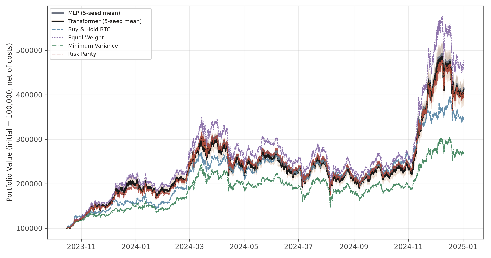

[그림 4-1] 상승 국면(bull_2024, Fold 1 OOS)의 누적 포트폴리오 가치. MLP와 Transformer는 5-seed 평균(굵은 실선)과 시드 간 최소–최대 범위(음영), 전통 벤치마크 4종은 점선·파선이며 초기 가치는 100,000이다. 두 정책망의 평균 경로는 거의 겹치고, 최종 가치는 Equal-Weight가 가장 높고 Minimum-Variance가 가장 낮다. 최종 가치의 순서는 Sharpe 순위(표 4-3)와 같지 않다.

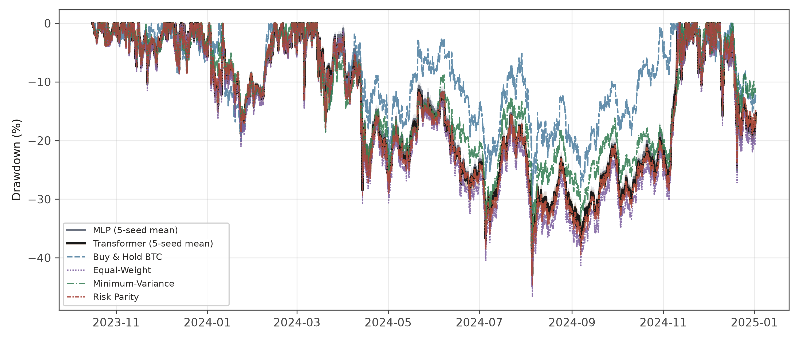

[그림 4-2] 상승 국면(bull_2024, Fold 1 OOS)의 drawdown. 직전 고점 대비 하락률(%)이며, 정책망은 시드별 drawdown의 평균(실선)과 시드 간 범위(음영)이다. 두 정책망의 경로가 Equal-Weight·Risk Parity와 함께 깊은 낙폭을 보이고, Buy & Hold BTC가 상대적으로 얕다(MDD는 표 4-2·4-3).

### 4.2.2 조정 국면(choppy_2025)

조정 국면(2025-01-02 ~ 2025-12-31, 8,713시간)에서는 두 정책망
모두 음(-)의 성과를 기록했다. Sharpe 비율은 MLP -0.194 ± 0.029,
Transformer -0.222 ± 0.031이고 CAGR은 각각 -26.5%, -28.4%다. 최대낙폭은
-46.3%, -47.3%로 상승 국면보다 깊다.

주목할 점은 변동성이 두 국면에서 거의 같다는 것이다(상승 61.8%,
61.2% / 조정 61.5%, 62.5%). 즉 조정 국면의 음(-) 성과는 정책이 위험을
더 많이 감수한 결과가 아니라, 같은 수준의 위험을 유지한 상태에서 시장
방향이 반대로 움직인 결과다. 이는 4.5절에서 다루는 정적 배분 관찰과
일관된다.

누적 가치와 drawdown 경로는 그림 4-3, 4-4에 나타냈다.

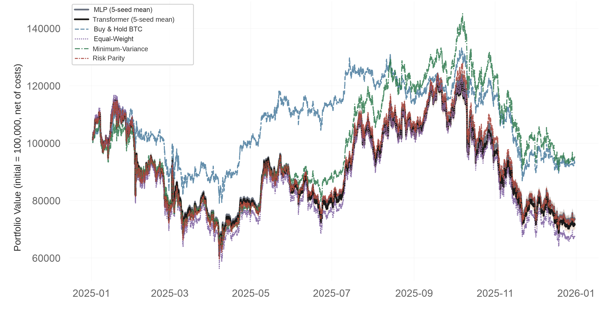

[그림 4-3] 조정 국면(choppy_2025, Fold 2 OOS)의 누적 포트폴리오 가치. 구성은 그림 4-1과 같다. 모든 전략의 최종 가치가 초기 가치(100,000)보다 낮고(6개 전략 모두 CAGR 음수), Minimum-Variance와 Buy & Hold BTC가 상대적으로 높은 가치를 유지한 반면 두 정책망은 Risk Parity·Equal-Weight와 비슷한 낮은 가치대에서 움직인다.

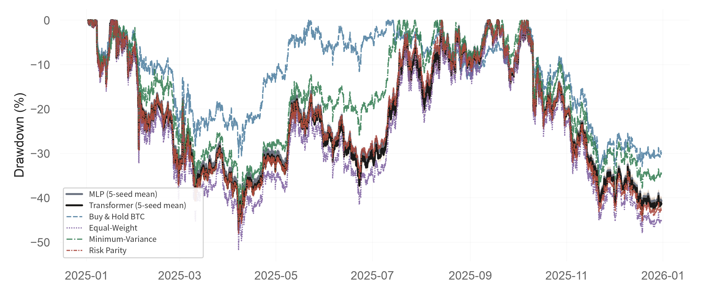

[그림 4-4] 조정 국면(choppy_2025, Fold 2 OOS)의 drawdown. 구성은 그림 4-2와 같다. 정책망 2종, Risk Parity, Equal-Weight의 낙폭이 서로 비슷하게 깊고, Buy & Hold BTC와 Minimum-Variance는 상대적으로 얕다.

### 4.2.3 국면별 결과를 평균하지 않는 이유

본 연구는 두 국면의 성과를 단일 수치로 평균하지 않는다. 이는 평가
설계의 원칙이다(3.5절).

두 fold는 서로 다른 시장 국면을 의도적으로 분리해 구성한 것이므로, 둘을
평균한 값은 "어느 국면에서도 관측되지 않은 가상의 성과"가 된다. 상승
국면의 Sharpe 2.203과 조정 국면의 -0.194를 평균한 1.0 남짓한 값은 두
국면 중 어느 쪽도 설명하지 못하며, 오히려 조정 국면의 손실을 상승
국면의 이익으로 상쇄해 가리는 효과를 낸다. 국면 의존성 자체가 본 연구의
관찰 대상이므로, 그것을 지워 버리는 집계는 수행하지 않는다.

같은 이유로 fold 수를 늘려 교차검증식 평균을 내는 방식도 채택하지
않았다. 본 연구의 평가는 k-fold 교차검증이 아니라 국면을 보존하는
확장창(expanding-window) 전진 평가이며, 각 fold의 결과는 독립적으로
보고된다.

### 4.2.4 거래비용과 turnover

평균 turnover는 네 조합 모두 0.15~0.17% 수준이다. 이는 시간당
포트폴리오의 약 0.15~0.17%만 교체된다는 뜻으로, 사실상 비중을 거의
바꾸지 않는 운용에 해당한다. 그 결과 전체 평가 구간에 걸친 누적
거래비용률도 1.29~1.84%에 머물렀다.

거래비용이 낮다는 사실은 그 자체로는 장점으로 읽힐 수 있다. 그러나 본
연구에서는 이를 효율적 운용의 증거로 해석하지 않는다. turnover가
낮은 이유가 "불필요한 거래를 절제했기 때문"인지 "애초에 배분을 조정하지
않았기 때문"인지는 성과지표만으로 구별되지 않기 때문이다. 4.5절의 행동
진단은 후자임을 보인다. 따라서 표 4-2의 turnover 값은 4.5절 진단의
선행 증거로 읽어야 하며, 비용 효율성의 지표로 읽어서는 안 된다.

## 4.3 PPO와 전통 벤치마크의 비교

### 4.3.1 성과 지표 비교

표 4-3은 PPO 정책망 2종과 전통 벤치마크 4종의 OOS 성과를 국면별 Sharpe 내림차순으로 정리한 것이다. 벤치마크 단독 지표는 부록 표 D-1에 수록했다. 3.6.1절의 공용 평가 모듈을
거쳐 PPO와 동일한 기준으로 계산했다. 벤치마크는 확정적 전략이므로 시드
변동이 없고 단일 값으로 보고한다.

[표 4-3] PPO 정책망과 전통 벤치마크의 표본외(OOS) 성과 (국면별 Sharpe 내림차순, 거래비용 0.1% 차감 후(net) 기준)

| 국면 | 순위 | 전략 | Sharpe | Sortino | Calmar | MDD | 변동성 | CAGR |
|---|---:|---|---:|---:|---:|---:|---:|---:|
| 상승 국면(bull_2024) | 1 | Buy & Hold BTC | 2.272 | 3.253 | 5.539 | -32.3% | 50.9% | 179.0% |
| 상승 국면(bull_2024) | 2 | Equal-Weight | 2.218 | 3.050 | 5.599 | -46.6% | 68.5% | 260.9% |
| 상승 국면(bull_2024) | 3 | Transformer (PPO) | 2.206 ± 0.018 | 3.036 ± 0.025 | 5.143 ± 0.189 | -42.7% ± 0.8 | 61.2% ± 1.8 | 219.8% ± 12.1 |
| 상승 국면(bull_2024) | 4 | MLP (PPO) | 2.203 ± 0.017 | 3.029 ± 0.026 | 5.169 ± 0.137 | -43.0% ± 1.0 | 61.8% ± 1.2 | 222.3% ± 6.6 |
| 상승 국면(bull_2024) | 5 | Risk Parity | 2.141 | 2.931 | 4.829 | -44.8% | 63.1% | 216.3% |
| 상승 국면(bull_2024) | 6 | Minimum-Variance | 1.818 | 2.476 | 3.173 | -39.9% | 52.6% | 126.5% |
| 조정 국면(choppy_2025) | 1 | Minimum-Variance | 0.171 | 0.232 | -0.118 | -42.4% | 53.4% | -5.0% |
| 조정 국면(choppy_2025) | 2 | Buy & Hold BTC | 0.066 | 0.092 | -0.194 | -34.8% | 44.5% | -6.7% |
| 조정 국면(choppy_2025) | 3 | Risk Parity | -0.172 | -0.235 | -0.559 | -48.0% | 63.6% | -26.8% |
| 조정 국면(choppy_2025) | 4 | MLP (PPO) | -0.194 ± 0.029 | -0.267 ± 0.040 | -0.573 ± 0.023 | -46.3% ± 0.8 | 61.5% ± 1.4 | -26.5% ± 1.1 |
| 조정 국면(choppy_2025) | 5 | Equal-Weight | -0.213 | -0.292 | -0.632 | -51.8% | 70.3% | -32.7% |
| 조정 국면(choppy_2025) | 6 | Transformer (PPO) | -0.222 ± 0.031 | -0.305 ± 0.042 | -0.600 ± 0.033 | -47.3% ± 0.4 | 62.5% ± 0.9 | -28.4% ± 1.7 |

> 주. 거래비용 0.1% 차감 후(net) 기준(순수익률). 연율화 상수 8,760, 무위험수익률 0이며 MDD는 음수로 표기한다.
>
> 주. PPO 행은 시드 42~46의 5-seed 평균 ± 표본표준편차(ddof=1)이다. 5-seed는 OOS 확인 후 후보·하이퍼파라미터 변경 없이 시드 45·46을 추가한 post-hoc robustness extension이며, 원래 3-seed 결과는 별도 보존되어 있다(3.7절). 벤치마크는 단일 결정론적 백테스트이므로 표준편차가 없다.
>
> 주. 상승 국면(bull_2024)은 Fold 1, 조정 국면(choppy_2025)은 Fold 2의 OOS 구간이다(2025-12-31까지).
>
> 주. 순위는 표기된 Sharpe 값의 내림차순이며 통계적 유의성을 뜻하지 않는다. PPO와 벤치마크 간 Sharpe 차이는 16개 비교 모두 Holm-Bonferroni 보정 후 유의하지 않았다(표 4-4, 부록 표 C-1).
>
> 주. 조정 국면(choppy_2025)에서 Buy & Hold BTC(Sharpe 0.066)와 Minimum-Variance(Sharpe 0.171)는 Sharpe가 양(+)이지만 CAGR은 음(-)이다. Sharpe는 수익률의 산술평균에, CAGR은 기하평균(복리)에 기반하므로 생기는 차이이며 계산 오류가 아니다. 이 국면에서는 6개 전략 모두 CAGR이 음수이다.
>
> 주. Minimum-Variance는 코드명 `markowitz`에 해당한다.

상승 국면에서는 Buy & Hold BTC(2.272)와 Equal-Weight(2.218)가 PPO
두 정책망(2.203, 2.206)보다 높은 Sharpe를 기록했다. 즉 상승 국면에서
PPO는 단순 보유·균등배분을 앞서지 못했다.

조정 국면에서는 6개 전략(PPO 2종 + 벤치마크 4종) 전부가 음(-)의 CAGR
을 기록했다. 즉 어느 전략도 조정 국면에서 손실을 피하지 못했다. Sharpe가
양(+)인 전략은 Minimum-Variance(0.171)와 Buy & Hold BTC(0.066)
둘뿐이며, 그중 Minimum-Variance가 가장 작은 손실(-5.0%)로 방어했다.

### 4.3.2 Sharpe와 CAGR의 부호가 엇갈리는 경우

조정 국면의 Buy & Hold BTC(Sharpe +0.066, CAGR -6.7%)와
Minimum-Variance(Sharpe +0.171, CAGR -5.0%)는 Sharpe가 양수이면서
CAGR이 음수다. 이는 모순이 아니라 두 지표의 정의 차이에서 나온다.

Sharpe는 시간당 산술평균 수익률을 변동성으로 나눈 값이고, CAGR은
기간 전체의 기하평균 성장률이다. 수익률의 변동이 클 때 기하평균은
산술평균보다 작아지며(변동성 손실), 그 차이가 충분히 크면 산술평균이
양수여도 누적 자산은 감소한다. 따라서 이 두 전략은 "평균적으로는 조금
벌었지만 변동성 때문에 최종 자산은 줄어든" 경우다.

이 때문에 본 연구는 Sharpe 단독으로 전략을 서열화하지 않고 CAGR·MDD를
함께 보고한다. 조정 국면에서 Sharpe만 보면 Minimum-Variance가 "성공한"
전략처럼 보이지만, CAGR이 음수라는 사실을 함께 제시해야 "손실을 가장
잘 줄였다"는 정확한 서술이 가능하다.

### 4.3.3 Sharpe 차이의 통계적 유의성 검정

PPO 정책망 2종 × 벤치마크 4종 × 국면 2개 = 총 16개 비교에 대해
stationary block bootstrap으로 Sharpe 차이의 95% 신뢰구간과 p-value를
산출하고, Holm-Bonferroni 보정(m=16)을 적용했다(3.6.2~3.6.3절).

검정 결과는 다음과 같이 요약된다.

- 16개 신뢰구간이 모두 0을 포함한다.
- Holm 보정 후 유의한 비교는 0건이다.
- 보정 전 최소 p-value는 0.118(조정 국면, Transformer vs
  Minimum-Variance)로 통상적 유의수준에 미치지 않는다.

본문에는 양 극단의 비교 두 개만 제시하고, 16개 전체는 부록 표 C-1에
수록한다.

[표 4-4] PPO-벤치마크 Sharpe 차이: 최소 p와 최대 p 비교

| 국면 | 정책망 | 벤치마크 | 차이 | 95% CI | p |
|---|---|---|---|---|---|
| 조정 | Transformer | Min-Variance | -0.393 | [-0.923, +0.102] | 0.118 (최소) |
| 상승 | Transformer | B&H BTC | -0.066 | [-1.012, +0.899] | 0.895 (최대) |

두 비교의 신뢰구간 폭이 각각 1.03과 1.91로 크게 다르다는 점에 유의할
필요가 있다. 전자는 비교적 좁은 구간에서도 0을 배제하지 못했고, 후자는
구간이 너무 넓어 애초에 판별력이 없었다.

### 4.3.4 비유의 결과의 해석 범위

이 결과를 "PPO와 전통 벤치마크가 통계적으로 동등하다"고 서술해서는
안 된다. 정확한 해석은 다음과 같다.

> 이 두 OOS 국면에서, PPO와 전통 벤치마크 간 Sharpe 차이가 0과 다르다는
> 통계적 증거를 얻지 못했다.

귀무가설을 기각하지 못한 것은 차이가 없다는 증거가 아니다. 두 진술을
구별해야 하는 이유는 세 가지다.

첫째, 동등성 검정을 수행하지 않았다. 두 전략이 실질적으로 같다고
주장하려면 사전에 동등성 한계를 정하고 TOST 같은 절차를 써야 하는데, 본
연구는 그렇게 설계되지 않았다.

둘째, 일부 비교는 신뢰구간이 매우 넓다. Buy & Hold BTC와의 네
비교는 폭이 1.76~1.92다(예: 상승 국면 MLP [-1.017, +0.901]). 이 구간은
"차이가 거의 없다"는 가설과 "상당한 차이가 있다"는 가설을 모두
포함하므로, 판별하지 못한 상태로 읽어야 한다.

셋째, 표본이 두 국면에 한정된다. 결론의 적용 범위는 bull_2024와
choppy_2025이며, 모든 시장 국면으로 일반화하는 주장이 아니다.

요약하면 본 절의 결과는 "PPO가 전통 벤치마크를 능가했다"도, "양자가
동등하다"도 지지하지 않는다. 주어진 설계에서 차이를 판별할 만한 증거가
확보되지 않았다는 것이 확인된 내용의 전부다. 그런데 이 비유의 결과를
PPO의 학습 실패와 구별하려면 성과지표 외의 증거가 필요하다. 4.5절의 행동
진단이 그 역할을 한다.

## 4.4 MLP와 Transformer 정책망 비교

### 4.4.1 성과 차이의 불확실성

두 정책망의 Sharpe 차이를 시드 수준에서 비교했다. 3.6.4절의 절차에 따라
동일 시드 쌍의 차이(Transformer - MLP)를 계산하고 95% 신뢰구간을
구성했다.

[표 4-5] Transformer - MLP Sharpe 차이 (5-seed)

| 국면 | 평균 차이 | 95% CI | 0 포함 |
|---|---|---|---|
| 상승 국면(bull_2024) | +0.003 | [-0.031, +0.037] | 포함 |
| 조정 국면(choppy_2025) | -0.028 | [-0.069, +0.013] | 포함 |

두 국면 모두 신뢰구간이 0을 포함한다. 즉 관측된 성과 차이는 시드
변동 범위 안에 있다. 상승 국면의 차이(+0.003)는 각 정책망의 시드 간
표준편차(0.017, 0.018)보다 작아, 차이라고 부를 수 있는 크기가 아니다.
조정 국면에서는 MLP가 평균적으로 조금 나았으나(-0.028) 역시 구간이 0을
포함한다.

4.1절에서 validation 단계의 Transformer 우위(0.859 대 0.762)를 보고했으나,
그 서열은 OOS에서 유지되지 않았다. 다만 이 0.097의 차이가 후보 선택에
사용된 것은 아니다. 후보 선택은 각 정책망 내부의 후보 4개 사이에서
독립적으로 이루어졌고(MLP는 candidate01~04, Transformer도 별도의
candidate01~04), 정책망을 가로지르는 비교는 선택 절차에 들어가지 않았다.
따라서 이 수치는 사후적으로 두 정책망의 validation 성과를 나란히 놓은
것이며, OOS 성과를 예측하지 못했다는 관찰에 해당한다.

### 4.4.2 결과의 한계

이 비교는 시드 5개에 한정된 결과다. n=5는 신뢰구간을 좁히기에 충분한
표본이 아니며, 시드를 늘리면 구간이 달라질 수 있다. 따라서 "두 구조의
성과가 같다"고 결론하지 않고, 주어진 시드 표본에서 차이를 확인하지
못했다고 기술한다. 4.3.4절에서 설명한 비유의 해석 원칙이 여기에도
동일하게 적용된다.

또한 3.3절에서 밝힌 바와 같이 두 정책망은 구조만 다른 것이 아니다. MLP의
특징추출기 출력은 1,200차원(162,707 파라미터), Transformer는
256차원(50,547 파라미터)으로, MLP가 오히려 3.2배 큰 모형이다. 따라서
표 4-5의 결과를 "구조 차이의 효과"로 귀속시킬 수 없다. 파라미터 수,
출력 차원, 학습 예산이 함께 다른 조건에서의 비교다.

### 4.4.3 계산 비용

성과는 구별되지 않았으나 학습 비용은 명확히 달랐다.

[표 4-6] 정책망별 평균 학습 시간 (5-seed, 51,200 스텝 기준)

| 정책망 | 상승 fold | 조정 fold |
|---|---|---|
| MLP | 377초 | 368초 |
| Transformer | 1,205초 | 1,269초 |

Transformer의 학습 시간이 MLP의 약 3.2~3.4배다. 성과 차이를 확인하지
못한 상태에서 계산 비용만 3배 이상 소요된다는 점은, 본 연구의 설정에서
Transformer 구조를 선택할 근거가 약함을 시사한다.

다만 이 비교에는 유보가 필요하다. Transformer 후보는 층수를 1로 줄인
설정이고(4.1절), 학습 예산은 두 정책망 모두 51,200 스텝으로 고정했다.
3.3절의 에피소드 예산 환산에 따르면 이 예산은 fold별로 1.46~2.93
에피소드에 해당한다. 시퀀스 모형이 요구하는 학습량이 더 크다면, 동일
스텝 예산은 Transformer에 불리한 조건일 수 있다. 즉 표 4-6은 "같은 예산
아래의 비용 차이"이지 "수렴까지의 비용 차이"가 아니다.

## 4.5 정책 행동 진단

4.2~4.4절은 성과지표만으로는 구별되지 않는 두 가설을 남겼다. PPO가
① 시장 상태에 반응하는 배분을 학습했으나 벤치마크를 능가할 만큼은 아닌
것인지, 아니면 ② 상태와 무관한 고정 배분을 학습한 것인지다. 본 절은
정책의 출력 자체를 직접 관측해 ②를 지지하는 증거를 제시한다.

진단 대상은 `target_weights`, 즉 softmax 정규화 직후의 목표 비중이다
(3.2.1절). 기말 실현 비중 `weights`는 가격 변동이 섞여 있어 정책의 의도를
분리할 수 없으므로 사용하지 않는다.

### 4.5.1 목표 비중의 시간적 불변성

정책이 매 시점 지시하는 비중이 얼마나 변하는지를 측정했다. 인접 시점 목표 비중의 9개 성분 절대차의 합

$$\Delta_t = \sum_{i=0}^{8} \left| w^{\text{target}}_{t,i} - w^{\text{target}}_{t-1,i} \right|$$

의 평균값은 다음과 같다.

[표 4-7] 시점 간 목표 비중 변화량 (5-seed 평균)

| 정책망 | 국면 | 평균 $\Delta_t$ | 최대 $\Delta_t$ |
|---|---|---|---|
| MLP | 상승 국면(bull_2024) | 7.36×10⁻⁸ | 4.62×10⁻⁷ |
| MLP | 조정 국면(choppy_2025) | 7.33×10⁻⁸ | 1.48×10⁻⁶ |
| Transformer | 상승 국면(bull_2024) | 3.84×10⁻⁸ | 2.83×10⁻⁷ |
| Transformer | 조정 국면(choppy_2025) | 3.94×10⁻⁸ | 1.34×10⁻⁶ |

평균 변화량은 10⁻⁸ 수준이다. 이는 float32 부동소수점의 유효정밀도
한계에 해당하는 크기로, 수치적 잡음과 구별되지 않는다. 비중의 합이 1인
9차원 벡터에서 전체 성분의 변화량 합이 10⁻⁸이라는 것은, 관측 입력이
바뀌어도 정책이 사실상 동일한 행동을 출력한다는 뜻이다.

최대값 역시 10⁻⁶ 수준에 머문다. 즉 전체 평가 구간 중 어느 한 시점에서도
의미 있는 배분 변경이 일어나지 않았다. 4.2.4절에서 보고한 낮은
turnover(0.15~0.17%)의 원인은 절제된 거래가 아니라 배분 조정의
부재다.

목표 비중의 시간 경로는 그림 4-5~4-8에 나타냈다.

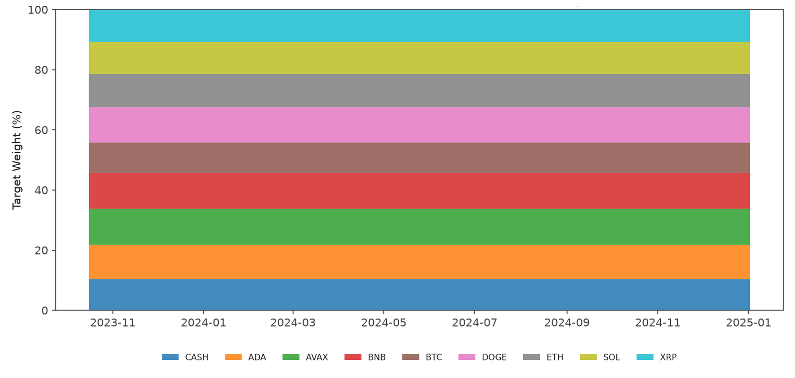

[그림 4-5] MLP의 목표 비중 시계열 — 상승 국면(bull_2024)

[그림 4-6] Transformer의 목표 비중 시계열 — 상승 국면(bull_2024)

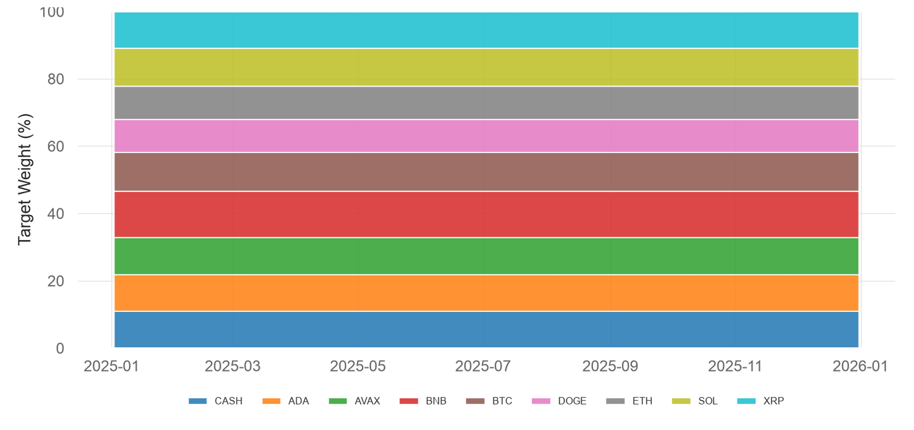

[그림 4-7] MLP의 목표 비중 시계열 — 조정 국면(choppy_2025)

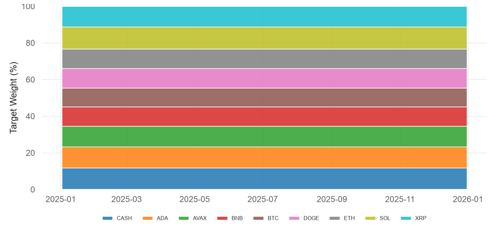

[그림 4-8] Transformer의 목표 비중 시계열 — 조정 국면(choppy_2025)

> 주. 시드 5개의 시점별 평균 목표 비중을 누적 면적으로 나타냈다(아래부터 CASH, ADA, AVAX, BNB, BTC, DOGE, ETH, SOL, XRP). 평가 구간 전체에서 각 구간의 두께가 변하지 않는 평평한 띠로 나타나, 5-seed 평균 목표 비중이 시간에 따라 거의 변하지 않음을 보여 준다. 개별 시드의 시점별 변화량은 표 4-7에서 정량화했고, 이 그림은 시드 평균만 보이므로 시드별 차이는 그림 4-9~4-12를 본다.

### 4.5.2 시드 간 정적 배분의 이질성

위 결과만 보면 "모든 시드가 동일한 균등배분에 수렴했다"고 읽기 쉽다.
그러나 시드별 평균 지시 비중을 분해하면 다른 그림이 나온다.

[표 4-8] 시드 간 배분 편차

| 정책망 | 국면 | 자산별 표준편차 | 최대 범위 | 현금 비중 범위 |
|---|---|---|---|---|
| MLP | 상승 국면(bull_2024) | 1.00~3.21%p | 7.62%p | 8.53~12.28% |
| MLP | 조정 국면(choppy_2025) | 0.63~3.43%p | 8.07%p | 7.70~14.23% |
| Transformer | 상승 국면(bull_2024) | 0.71~1.91%p | 4.88%p | 9.46~14.03% |
| Transformer | 조정 국면(choppy_2025) | 0.65~1.59%p | 3.70%p | 10.36~13.74% |

시드 간 자산별 비중의 표준편차는 0.63~3.43%p, 특정 자산의 최대
범위는 8.07%p에 이른다. 현금 비중만 보아도 시드에 따라 7.70%에서
14.23%까지 흩어진다.

따라서 정확한 서술은 다음과 같다.

> 각 시드는 서로 다른 정적 포트폴리오를 학습했고, 그 포트폴리오를
> 평가 구간 전체에 걸쳐 시간에 대해 변경하지 않았다.

"모든 시드가 같은 배분을 학습했다"는 서술은 틀렸다. 고정된 것은 시간
축이며, 시드 축에서는 상당한 산포가 남아 있다. 이는 학습이 일관된
최적해로 수렴한 것이 아니라, 시드마다 다른 지점에서 멈춘 뒤 그 지점을
유지했음을 시사한다. 균등배분과의 높은 상관(4.5.3절)은 각 시드의 배분이
개별적으로는 균등배분에서 수 %p씩 벗어나 있어도, 그 편차가 수익률
수준에서는 거의 상쇄되기 때문에 나타난다.

시드별 시간평균 목표 비중은 그림 4-9~4-12에 나타냈다.

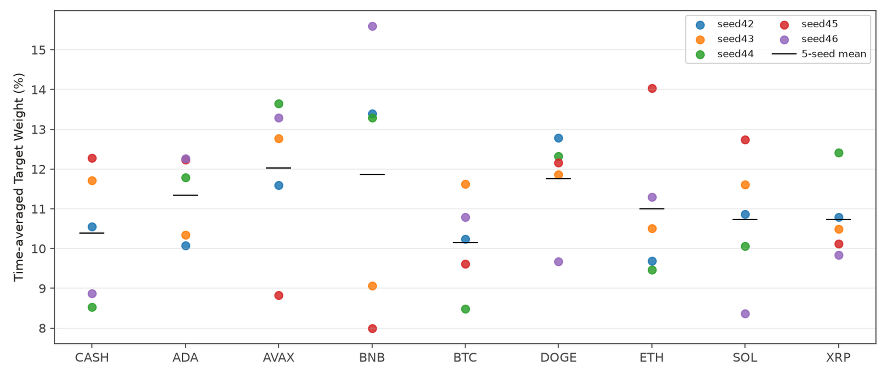

[그림 4-9] MLP의 시드별 시간평균 목표 비중 — 상승 국면(bull_2024)

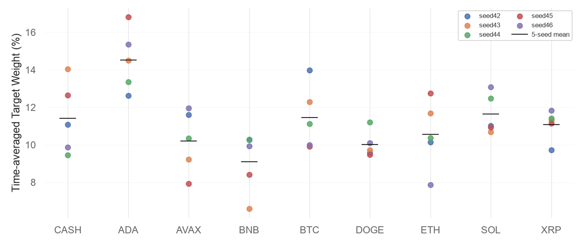

[그림 4-10] Transformer의 시드별 시간평균 목표 비중 — 상승 국면(bull_2024)

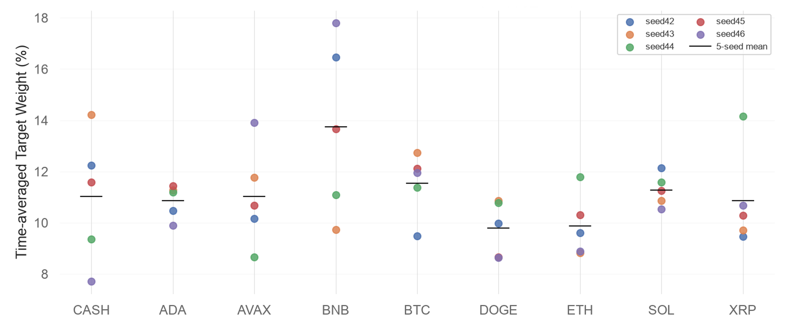

[그림 4-11] MLP의 시드별 시간평균 목표 비중 — 조정 국면(choppy_2025)

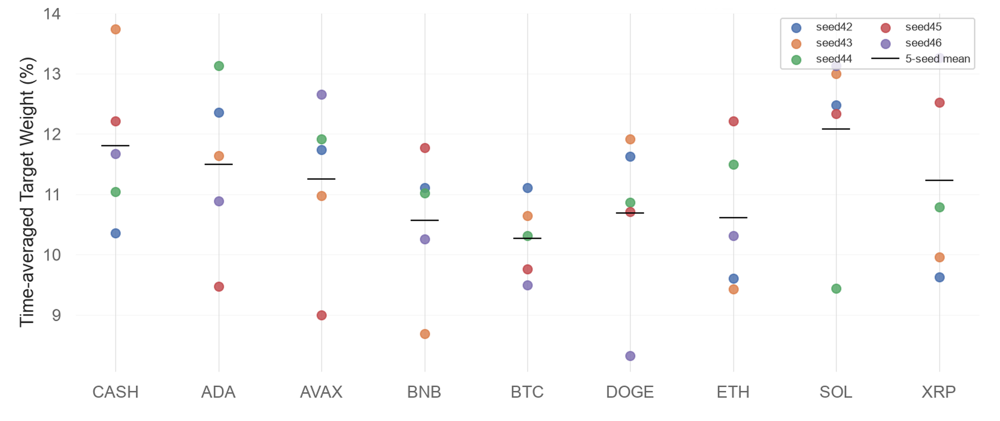

[그림 4-12] Transformer의 시드별 시간평균 목표 비중 — 조정 국면(choppy_2025)

> 주. 자산(및 현금)별로 시드 42~46의 시간평균 목표 비중을 점으로, 5-seed 평균을 검은 가로선으로 나타냈다. 각 시드는 시간에 따라 변하지 않는 비중을 유지하지만, 그 비중은 시드마다 서로 다르다(자산별 시드 간 차이는 수 %p). 즉 시드마다 서로 다른 정적 배분에 머물렀으며, 시드 간 합의된 하나의 배분을 학습한 것이 아니다. 세부 수치는 표 4-8에 있다.

### 4.5.3 Equal-Weight 대비 수익 경로 유사성

정책이 정적 배분을 출력한다면, 그 성과는 유사한 고정 배분 전략과
구별되지 않아야 한다. 지시 비중의 집중도를 HHI로 보면, 현금을 포함한
9개 성분 기준 0.113~0.115(균등 기준값 1/9 ≈ 0.111), 위험자산 8개만
재정규화한 기준 0.127~0.129(1/8 = 0.125)로 두 기준 모두 균등배분
근방이다. 즉 자산 간 비중 격차가 거의 없다. 실제로 PPO와
Equal-Weight의 시간당 순수익률 상관계수는 다음과 같다.

[표 4-9] PPO와 Equal-Weight 수익률 상관 및 추적오차

| 정책망 | 국면 | 상관계수 | 연율화 추적오차 |
|---|---|---|---|
| MLP | 상승 국면(bull_2024) | 0.9994 | 7.02% |
| MLP | 조정 국면(choppy_2025) | 0.9995 | 9.01% |
| Transformer | 상승 국면(bull_2024) | 0.9991 | 7.80% |
| Transformer | 조정 국면(choppy_2025) | 0.9997 | 7.87% |

상관계수가 네 조합 모두 0.999 이상이다. PPO의 수익률 시계열은
균등배분과 거의 같은 움직임을 보이며, 4.3절에서 Equal-Weight와의 Sharpe
차이가 가장 작았던 것(-0.015~+0.019)도 이와 일관된다. 즉 학습된 정책은
자산 간 차별적 배분을 학습한 증거를 보이지 않는다.

다만 두 전략이 동일한 것은 아니다. PPO는 현금을 약 10~12% 보유하는
반면 Equal-Weight 구현은 현금을 두지 않고 위험자산 8개에 1/8씩
배분하며, 연율화 추적오차도 7.0~9.0%로 0이 아니다. 정확한 서술은 "PPO가
균등배분을 재현했다"가 아니라 "균등배분에 근접한 정적 포트폴리오를
출력해 수익률 움직임이 거의 겹쳤다" 이다.

### 4.5.4 드로다운 구간의 현금 비중 반응

정책이 위험을 인식해 현금 비중을 조절하는지 확인했다. 포트폴리오
순자산가치가 직전 고점 대비 15% 이상 하락한 구간과 그 외 구간에서 평균
현금 비중을 비교했다.

[표 4-10] 드로다운 구간과 평시의 현금 비중

| 정책망 | 국면 | 드로다운 중 | 평시 | 차이 |
|---|---|---|---|---|
| MLP | 상승 국면(bull_2024) | 0.103898 | 0.103898 | 3.3×10⁻¹⁰ |
| MLP | 조정 국면(choppy_2025) | 0.110257 | 0.110257 | 2.5×10⁻¹⁰ |
| Transformer | 상승 국면(bull_2024) | 0.114177 | 0.114177 | 9.2×10⁻¹⁰ |
| Transformer | 조정 국면(choppy_2025) | 0.118060 | 0.118060 | 7.2×10⁻¹⁰ |

두 구간 현금 비중의 절대 차이가 네 조합 모두 10⁻⁹ 미만이다. 현금
비중과 드로다운 깊이의 상관계수도 -0.026~+0.005로 0에 가깝다(별도의
유의성 검정은 수행하지 않았다). 포트폴리오 가치가 15% 이상 하락한
국면에서도 정책은 현금 비중을 사실상 변경하지 않았다. 방어적 자산
재배분은 학습되지 않았다.

#### 원인에 대한 유보

본 절은 "상태 의존적 배분이 학습되지 않았다"는 현상을 확인했다.
그 원인은 본 연구의 설계로 특정할 수 없다. 최소한 다음 네 가지가 모두
가능하다.

1. 학습 예산 부족 — 51,200 스텝은 fold별 1.46~2.93 에피소드에
   불과하다(3.3절). 정책이 수렴 이전에 멈췄을 수 있다.
2. 보상 설계 — 학습 신호는 로그 수익률이고 거래비용은 평가
   단계에서만 차감된다(3.2.2절). 배분 변경의 편익이 보상에서 충분히
   드러나지 않았을 수 있다.
3. 피처 부족 — 환경 관측은 close/high/low 3종뿐이다(3.2.1절).
   국면 판별에 필요한 정보가 입력에 없었을 수 있다.
4. 최적화 실패 — 정책이 균등배분 근방의 평탄한 영역에 갇혀
   탐색을 멈췄을 수 있다. 시드별 산포(4.5.2절)는 이 가설과 일관된다.

이들을 구별하려면 예산·보상·피처를 각각 변화시킨 ablation이 필요하며,
본 연구의 범위를 넘는다. 5.4절에서 후속 연구 과제로 제시한다.

다만 진단의 방법론적 함의는 분명하다. 성과지표만 보고했다면 본
연구는 "PPO가 벤치마크와 비슷한 성과를 냈다"로 끝났을 것이다. 지시 비중을
직접 관측함으로써, 그 유사 성과가 상태 의존적 운용의 결과가 아니라
시간에 대해 고정된 배분의 산물임을 식별할 수 있었다. 강화학습
포트폴리오 연구에서 성과지표와 행동 진단을 함께 보고해야 하는 이유다.

## 4.6 결과 종합

본 장의 결과를 연구질문별로 정리하면 다음과 같다.

① PPO는 전통 벤치마크를 능가하지 못했다. 상승 국면에서 Buy & Hold
BTC(2.272)와 Equal-Weight(2.218)가 PPO(2.203, 2.206)보다 높은 Sharpe를
기록했다. 조정 국면에서는 6개 전략 전부가 음(-)의 CAGR을 기록했고,
Minimum-Variance(-5.0%)가 가장 잘 방어했다. PPO 2종은 각 국면에서
최상위가 아니었다.

② 성과 차이는 통계적으로 판별되지 않았다. 16개 비교 모두 Holm 보정
후 비유의했고, 보정 전 최소 p-value도 0.118이었다. 이는 동등성의 증거가
아니라 차이를 판별할 증거가 확보되지 않았다는 뜻이다(4.3.4절).

③ 두 정책망 구조 간 차이도 확인되지 않았다. Sharpe 차이의 95%
신뢰구간이 두 국면 모두 0을 포함했다. 반면 학습 비용은 Transformer가
약 3.2~3.4배였다. 단, 두 모형은 구조만 다른 것이 아니라 파라미터 수도
3.2배 차이가 나므로(MLP가 더 큼) 차이를 구조에 귀속할 수 없다.

④ 성과의 국면 의존성이 정책망 간 차이를 압도했다. 국면 간 Sharpe
차이는 약 2.4였고, 정책망 간 차이는 0.003~0.028이었다. 두 자릿수 이상의
격차다.

⑤ 정책은 상태 의존적 배분을 학습하지 않았다. 시점 간 지시 비중
변화량이 10⁻⁸ 수준(float32 정밀도 한계)이고, Equal-Weight와의 수익률
상관이 0.999 이상이며, 15% 이상 드로다운 구간과 평시의 현금 비중의
절대 차이가 네 조합 모두 10⁻⁹ 미만이었다. 각 시드는 서로 다른 정적 포트폴리오를
학습한 뒤 시간에 대해 그것을 유지했다(시드 간 자산별 표준편차
0.63~3.43%p).

이 결과들은 서로 독립된 관찰이 아니다. ⑤는 ①~③의 해석을 제한한다.

성과지표만 보면 ①~③은 "PPO가 벤치마크와 비슷한 수준이었다"로 요약되고,
이는 경쟁력 있는 결과로 읽힐 여지가 있다. ⑤는 그 읽기를 차단한다.
정책이 상태와 무관한 정적 배분을 출력했다면, 유사한 성과를 "시장에
대응하는 운용 능력"의 증거로 제시할 수 없다.

구체적으로 ⑤가 설명하는 것은 두 가지다.

- 낮은 turnover(0.15~0.17%, 4.2.4절). 비용 효율적 운용의 증거가
  아니라 배분 조정 부재의 결과다.
- Equal-Weight와의 높은 수익률 상관(0.999 이상, 4.5.3절). 정적
  배분의 HHI가 균등배분 이론값에 근접했으므로(0.113~0.115 대 0.111)
  수익률 움직임이 거의 겹친다.

반면 ⑤가 설명하지 못하는 것도 분명히 해 둔다. 벤치마크 간 성과
서열(①)과 검정의 비유의성(②)은 정적 출력만으로 도출되지 않는다. 전자는
각 국면의 자산 가격 움직임에, 후자는 신뢰구간의 폭과 검정력에 달려
있다. 또한 PPO의 배분은 Equal-Weight와 같지 않다. PPO는 현금을
약 10~12% 보유하지만 Equal-Weight 구현은 현금을 보유하지 않으며(8개
자산에 1/8씩), 연율화 추적오차도 7.0~9.0%로 0이 아니다. 따라서 "PPO가
Equal-Weight와 같은 포트폴리오를 출력했다"고 기술하는 것은 부정확하고,
균등배분에 근접한 서로 다른 정적 포트폴리오를 출력했다고 기술하는 것이 정확하다.

### 4.6.1 본 장의 방법론적 함의

이 제한은 성과지표만으로는 드러나지 않는다. 핵심은 다음과 같다.
성과표만으로는 정책이 시장에 반응하는 배분을 학습했는지 판단할 수
없다. 표 4-2와 표 4-4의 수치는 상태 의존적 운용을 학습한 정책과,
균등배분 근방의 정적 배분을 출력하는 정책 양쪽 모두와 양립한다. 지시
비중(`target_weights`)을 직접 관측한 뒤에야 본 연구의 정책이 후자임이
드러났다.

벤치마크와의 성과 차이가 작게 나타날 때, 그것이 운용 능력의 결과인지
정적 배분의 결과인지는 정책 출력을 보지 않고는 구별할 수 없다. 이
관찰을 다른 연구에도 적용할 수 있는 보고 원칙으로 정리하는 작업은
5.3절에서 다룬다.

### 4.6.2 확인하지 못한 것

본 장이 확인하지 못한 것을 명시한다.

- 학습 실패의 원인. 예산 부족·보상 설계·피처 부족·최적화 실패 중
  어느 것인지 특정하지 못했다(4.5절 「원인에 대한 유보」). ablation이 필요하다.
- 다른 국면으로의 일반화. 결론은 bull_2024와 choppy_2025에
  한정된다. 두 국면은 사후적으로 경계를 지정해 구성했다(3.5절).
- 동등성. 비유의 결과는 동등성을 지지하지 않으며, 동등성 검정을
  수행하지 않았다.
- 시드 표본의 충분성. 정책망 비교는 n=5 기준이며, 시드를 늘리면
  신뢰구간이 달라질 수 있다.
- 구조 효과의 분리. 두 정책망은 파라미터 수·출력 차원이 함께
  달라, 구조만의 효과를 분리하지 못했다.

이들은 5장에서 연구의 한계와 후속 과제로 다룬다.

---

# 5. 논의 및 결론

## 5.1 연구 결과 요약

본 연구는 암호화폐 포트폴리오 최적화에 PPO를 적용하고, 그 결과를 국면을
보존하는 전진 평가 설계로 검증했다. 두 정책망(MLP, Transformer)을 두
OOS 국면(상승 2024, 조정 2025)에서 전통 벤치마크 4종과 비교했으며,
성과지표와 함께 정책의 출력 자체를 진단했다.

관측된 결과는 다음과 같다.

상승 국면에서 PPO 두 정책망의 Sharpe는 2.203, 2.206으로, Buy
& Hold BTC(2.272)와 Equal-Weight(2.218)에 미치지 못했다. 조정 국면에서는
PPO를 포함한 6개 전략 전부가 음(-)의 CAGR을 기록했고,
Minimum-Variance(-5.0%)가 가장 작은 손실로 방어했다. PPO는 두 국면
어디에서도 최상위가 아니었다.

PPO와 벤치마크 간 16개 비교에서 Holm 보정 후 유의한
결과는 없었고, 보정 전 최소 p-value도 0.118이었다. 두 정책망 간 Sharpe
차이의 95% 신뢰구간도 두 국면 모두 0을 포함했다. 이는 차이가 없다는
증거가 아니라 차이를 판별할 증거가 확보되지 않았다는 뜻이다.

시점 간 목표 비중 변화량이 10⁻⁸ 수준(float32 정밀도
한계)에 머물렀고, 15% 이상 드로다운 구간과 평시의 현금 비중 차이가
10⁻⁹ 미만이었다. 각 시드는 서로 다른 정적 포트폴리오를 학습한 뒤
평가 구간 전체에 걸쳐 그것을 유지했다(시드 간 자산별 표준편차
0.63~3.43%p). 상태 의존적 배분은 학습되지 않았다.

이 세 결과의 관계가 본 연구의 핵심이다. 성과지표만 보면 "PPO가 벤치마크와
크게 다르지 않았다"로 요약되지만, 그 수치는 시장에 반응하는 정책과
정적 배분을 출력하는 정책 양쪽 모두와 양립한다. 정책 출력을 직접 관측한
뒤에야 본 연구의 정책이 후자임이 확인되었다.

## 5.2 연구 질문에 대한 논의

본 절은 연구질문별로 본 연구가 말할 수 있는 것과 말할 수 없는 것을
구분한다. 4장이 관측 결과의 종합이라면, 본 절은 그 결과가 지지하는
주장의 범위를 정한다.

### 5.2.1 PPO와 전통 전략의 성과 비교

연구질문 1에 대해서는, PPO가 전통 전략을 능가했다는 증거를 얻지
못했다. 다만 이는 열등하다는 증거도 아니다.

점추정만 보면 상승 국면에서 PPO는 Buy & Hold BTC와 Equal-Weight보다
낮았고, 조정 국면에서는 Minimum-Variance보다 낮았다. 그러나 16개 비교
어느 것도 Holm 보정 후 유의하지 않았고, 신뢰구간은 모두 0을 포함했다.
따라서 서열 자체를 통계적으로 확정할 수 없다.

이 결과를 "PPO와 전통 전략이 동등하다"로 읽어서는 안 된다는 점은
4.3.4절에서 밝혔다. 동등성 검정을 수행하지 않았기 때문이다.

주목할 점은 같은 "비유의"라도 구간이 허용하는 차이의 범위가 크게
다르다는 것이다. Equal-Weight와의 비교는 구간이 좁아(예: 상승 국면
MLP [-0.037, +0.005]) 큰 차이는 배제되지만 0도 배제하지 못한다. 반면
Buy & Hold BTC와의 비교는 구간 폭이 1.76~1.92로 작은 차이와 상당한
차이를 모두 포함한다. 즉 전자는 추정이 정밀하되 0을 기각하지 못한
경우이고, 후자는 추정 자체가 정밀하지 않은 경우다.

다만 이 구분은 추정의 정밀도에 관한 것이지 비유의의 원인에 관한
것이 아니다. 구간이 좁다는 사실로부터 "참값이 실제로 작다"를 도출할
수는 없다. 신뢰구간은 참값의 위치를 확정하지 않으며, 본 연구는
동등성 검정을 수행하지 않았기 때문이다. 두 경우를 같은 "비유의"로
묶어 보고하면 이 정밀도 차이가 드러나지 않는다는 것이 요점이다.

### 5.2.2 정책망 구조에 따른 성과 차이

연구질문 2에 대해서는, 본 연구의 설계로 구조의 효과를 분리할 수
없다는 것이 결론이다.

Transformer와 MLP의 Sharpe 차이는 두 국면 모두 신뢰구간이 0을
포함했다(4.4.1절). 그러나 이 결과를 "구조는 중요하지 않다"로 읽을 수
없는 이유가 두 가지 있다.

첫째, 두 모형은 구조만 다른 것이 아니다. MLP의 특징추출기 출력은
1,200차원(162,707 파라미터), Transformer는 256차원(50,547 파라미터)으로
MLP가 오히려 3.2배 큰 모형이다. 구조·파라미터 수·출력 차원이 함께
달라진 조건에서의 비교이므로, 차이의 부재를 구조에 귀속할 수 없다.

둘째, 두 모형 모두 정적 배분으로 귀결됐다(4.5절). 성과 차이 자체는
이 조건에서도 비교할 수 있으나, 비교의 대상이 "상태에 반응하는 운용
능력"은 아니게 된다. 즉 본 연구는 두 설정 모두 정적 배분으로
귀결되어, 상태 반응형 운용 능력에 대한 구조의 효과는 보여주지 못했다.
관측된 것은 두 구조가 같은 양상으로 귀결됐다는 사실이다.

계산 비용은 명확히 달랐다. Transformer의 학습 시간은 MLP의 약
3.2~3.4배였다. 다만 학습 예산을 51,200 스텝으로 고정했으므로 이는
"같은 예산 아래의 비용 차이"이지 "수렴까지의 비용 차이"가 아니다.

### 5.2.3 정적 배분으로 수렴한 원인

정적 배분으로 수렴한 원인은 특정할 수 없다. 아래 네 가지 설명이
모두 가능하다.

4.5절 말미에서 제시한 가설들을 다시 정리하고, 각각에 대해 본 연구가 가진
간접 증거를 함께 적는다.

① 학습 예산 부족. 51,200 스텝은 fold별 1.46~2.93 에피소드에
해당한다(3.3절). 특히 Fold 2는 전체 구간을 1.46회만 통과하므로 구간
후반부는 한 번만 학습된다. 정책이 수렴 이전에 멈췄을 가능성이 있다.

② 보상 설계. 학습 신호는 로그 수익률이고 거래비용은 평가
단계에서만 차감된다(3.2.2절). 학습 중에는 배분 변경의 비용이 보상에
반영되지 않으므로, 비용 회피 때문에 정적 배분을 택한 것으로 보기는
어렵다. 오히려 배분 변경의 편익이 보상에서 충분히 드러나지 않았을
가능성이 있다.

③ 피처 부족. 환경 관측은 close/high/low 3종뿐이다(3.2.1절). 국면
판별에 필요한 정보가 입력에 없었다면, 정책이 상태에 반응하려 해도
반응할 근거가 없다.

④ 최적화 실패. 균등배분 근방은 보상 지형에서 평탄한 영역일 수
있다. 시드마다 서로 다른 정적 포트폴리오에 머물렀다는 관찰(4.5.2절,
자산별 표준편차 0.63~3.43%p)이 이 가설과 정합적이다.

다만 그 관찰이 ④를 다른 가설보다 지지하는 것은 아니다. 시드 간
산포는 학습 예산이 부족해 각 시드가 서로 다른 지점에서 멈춘 경우(①),
보상이 배분 차이를 충분히 구별하지 못해 여러 배분이 비슷한 보상을
받는 경우(②), 입력에 국면 정보가 없어 정책이 초기값 근방에 머무는
경우(③)와도 모두 양립한다. 따라서 네 가설 중 어느 것도 본 연구의
데이터로 상대적 지지를 받지 않는다.

이들을 구별하려면 예산·보상·피처를 각각 변화시킨 ablation이 필요하며,
5.5절에서 후속 과제로 제시한다.

가설을 특정하지 못한 채 보고하는 이유는 분명하다. 네 가지 중 하나를
골라 단정하면 그 자체가 사후적 서사가 된다. 본 연구가 확인한 것은
현상이지 원인이 아니며, 그 구분을 유지하는 편이 후속 연구에 더 유용하다.

## 5.3 방법론적 시사점

본 연구는 성과 측면에서 기여를 주장하지 않는다. PPO는 전통 벤치마크를
능가하지 못했고, 학습된 정책은 상태에 반응하지 않았다. 그럼에도 본
연구가 제시할 수 있는 것은 이러한 결과를 식별하고 과장 없이 보고하기
위한 평가 절차다. 본 절은 그 절차를 다른 연구에도 적용 가능한 원칙의
형태로 논한다.

### 5.3.1 성과지표와 정책 행동의 병행 보고

원칙: 강화학습 포트폴리오 연구는 성과지표와 함께 정책의 출력 자체를
보고해야 한다.

성과지표는 정책이 *무엇을 달성했는지* 말하지만 *무엇을 했는지*는 말하지
않는다. 본 연구에서 두 진술은 전혀 다른 결론으로 이어졌다. 성과표만
제시했다면 "PPO가 전통 전략과 크게 다르지 않은 성과를 보였다"로 끝났을
것이고, 그 서술은 보고된 수치와 모순되지 않는다. 그러나 지시 비중을
관측하자 그 수치가 시장 대응의 산물이 아님이 드러났다.

여기서 중요한 것은 본 연구가 실패했다는 사실이 아니라, 성과지표가 그
실패를 가릴 수 있었다는 구조적 사실이다. 벤치마크와의 성과 차이가 작을
때 그것이 운용 능력의 결과인지 벤치마크 근방의 정적 배분인지는 성과
지표상 구별되지 않는다. 특히 균등배분처럼 그 자체로 견고한 전략이
벤치마크에 포함된 경우, 정책이 그 근방에 머무르기만 해도 경쟁력 있는
수치가 산출된다.

따라서 다음 세 가지를 최소한의 보고 항목으로 제안한다.

1. 시점 간 배분 변화량 — 정책이 실제로 배분을 바꾸는지. 본 연구에서 이 값이 float32 정밀도 수준이라는 사실이 결정적 증거였다.
2. 벤치마크와의 수익률 상관 및 추적오차 — 정책이 특정 벤치마크를 근사하고 있는지. 상관만으로는 부족하며, 추적오차를 함께 보아야 "근접"과 "동일"을 구별할 수 있다(본 연구는 상관 0.999 이상이면서 추적오차 7~9%로, 유사하지만 동일하지 않았다).
3. 시드별 배분의 산포 — 학습이 일관된 해로 수렴했는지. 평균만 보고하면 "모든 시드가 같은 배분을 학습했다"는 잘못된 인상을 준다.

이 항목들은 추가 실험 없이 기존 백테스트 산출물에서 계산할 수 있다.
비용이 거의 들지 않는 데 비해 해석을 바꾸는 힘은 크다.

### 5.3.2 비유의 결과의 신중한 해석

원칙: 귀무가설을 기각하지 못한 것을 동등성의 증거로 쓰지 않는다.

본 연구의 16개 비교는 모두 비유의했다. 이를 "PPO가 전통 전략과 통계적
으로 동등하다"로 서술하는 것은 흔하지만 잘못된 추론이다. 동등성을
주장하려면 사전에 동등성 한계를 정하고 TOST 같은 절차를 적용해야 하며,
본 연구는 그렇게 설계되지 않았다.

실천적으로는 다음 세 가지를 함께 보고할 것을 제안한다.

- 신뢰구간의 폭. p-value만 보고하면 그 비교가 어느 정도 크기의
  차이까지 배제했는지가 드러나지 않는다. 본 연구에서 Equal-Weight와의
  비교는 구간 폭이 0.035~0.121이어서 큰 차이는 배제되지만, Buy & Hold
  BTC와의 비교는 1.76~1.92로 작은 차이와 상당한 차이를 모두 허용한다.
  둘 다 "비유의"지만 허용하는 차이의 범위가 전혀 다르다. 구간 폭은
  추정의 정밀도를 보여줄 뿐 참값의 위치를 확정하지 않으므로, 좁은
  구간을 "차이가 없다"는 근거로 쓰지 않도록 주의해야 한다(5.2.1절).
- 다중비교 보정. 비교 수가 늘면 우연한 유의 결과가 나오기 쉽다. 본
  연구는 16개 비교에 Holm-Bonferroni를 적용했다. 보정하지 않았다면
  최소 p=0.118도 여전히 비유의였겠으나, 보정 여부와 비교 개수를 밝히는
  것 자체가 보고의 일부다.
- 적용 범위. 본 연구의 결론은 bull_2024와 choppy_2025 두 국면에
  한정된다. 모든 시장 국면으로 일반화하는 주장이 아니다.

### 5.3.3 사후 변경의 투명한 공시

원칙: 사전 계획과 달라진 부분은 결과에 유리하든 불리하든 명시한다.

본 연구에는 사전 프로토콜과 어긋난 지점이 두 군데 있고, 둘 다 본문에
밝혔다.

시드 확장. 최초 OOS는 3-seed로 완료했고, 이후 "최소 5시드" 원칙에
따라 시드 2개를 추가했다. 시간 순서상 이는 OOS 결과를 본 뒤의 변경이다.
따라서 사전 계획된 프로토콜이 아니라 post-hoc robustness extension
으로 명시하고, 원래의 3-seed 결과도 별도 보존했다(3.7.3절). 추가 시드는
두 정책망·두 fold에 동일하게 적용했고 후보나 하이퍼파라미터는 변경하지
않았으나, 그 사실만으로 사후 변경이 아닌 것이 되지는 않는다.

선택 기준 문구의 확정 시점. 후보 집합과 시드 조합은 탐색 전에
고정했으나, 선택 기준의 문구는 validation 결과를 검토한 뒤 확정했다.
그래서 본문은 이를 "사전 정의된 기준"이라 쓰지 않고 "validation 결과
검토 후 확정하고 OOS 확인 전 동결한 기준"으로 기록한다(4.1.2절).

이런 공시는 연구를 약해 보이게 만든다. 그러나 밝히지 않으면 독자가
사후 변경 여부를 확인할 방법이 없고, 그 경우 보고된 모든 수치의 신뢰도가
함께 떨어진다. 부정적 결과를 보고하는 연구일수록 이 공시가 중요하다.
성과가 좋지 않았다는 결론 자체는 사후 조정의 동기가 되지 않지만,
독자는 그것을 사전에 알 수 없기 때문이다.

### 5.3.4 결과 동결과 재현 절차

본 연구는 OOS 확인 시점에 산출물을 동결하고, 61개 파일의 SHA-256
체크섬과 패키지 버전, 평가 설정, 분석 코드의 커밋 계보를 명세로
기록했다(3.7절). 이는 "OOS 확인 후 후보를 재조정하지 않았다"는 주장을
검증 가능한 형태로 만들기 위한 장치다.

다만 체크섬이 보장하는 범위는 제한적이다. 파일이 기록 시점과 동일함을
증명할 뿐, 지표 계산의 타당성이나 해석의 정당성을 보장하지 않는다. 또한
동결 이후에도 분석 코드는 수정되었고(행동 진단의 정의 수정), 그 때문에
명세는 실험 동결 커밋과 분석 코드의 커밋을 분리해 기록한다. 재현을
시도하는 독자는 이 둘을 구별해야 한다.

## 5.4 연구의 한계

### 5.4.1 원인 식별의 한계

본 연구는 정책이 상태 의존적 배분을 학습하지 않았다는 현상을
확인했으나, 그 원인을 특정하지 못했다. 학습 예산 부족, 보상 설계,
피처 부족, 최적화 실패 네 가지가 모두 가능하며(5.2.3절), 본 연구의
설계로는 이들을 분리할 수 없다. 원인을 특정하려면 각 요인을 독립적으로
변화시킨 ablation이 필요하다.

이 한계는 본 연구의 가장 큰 제약이다. 현상만으로는 "PPO가 이 문제에
부적합하다"고도, "설정이 부적절했다"고도 결론할 수 없기 때문이다.

### 5.4.2 평가 범위의 한계

OOS 국면이 2개뿐이다. 결론의 적용 범위는 상승 국면(2024)과 조정
국면(2025)에 한정된다. 더구나 두 국면의 경계는 사후적으로 지정한
것이다(3.5절). 실시간 운용에서는 현재 국면이 무엇인지 미리 알 수 없으므로,
본 연구의 국면 구분은 분석을 위한 사후 분류이지 운용 가능한 신호가
아니다.

Fold 2에 validation 구간이 없다. 후보 선택은 Fold 1의 validation
결과로만 수행했고, Fold 2는 그 후보를 그대로 적용해 재학습했다. 따라서
Fold 2의 결과는 "해당 국면에 맞춰 조정된 모형"의 성과가 아니라 "다른
국면에서 선택된 설정을 이식한" 성과다.

비교 대상 정책망이 2종이다. LSTM 기반 특징추출기도 구현했으나 팀
합의로 연구 범위에서 제외했으므로, 본 연구의 결론은 MLP와 Transformer에
한정되며 LSTM의 성과는 추정하지 않는다.

벤치마크가 4종이다. Buy & Hold BTC, Equal-Weight, Minimum-Variance,
Risk Parity를 사용했다. 모멘텀·평균회귀 계열 전략이나 다른 강화학습
알고리즘(SAC, TD3 등)과의 비교는 수행하지 않았다.

### 5.4.3 설계상의 한계

하이퍼파라미터 탐색이 제한적이다. 정책망별로 사전 지정한 후보 4개만
비교했고, Optuna 등을 이용한 체계적 탐색은 수행하지 않았다(계산 예산
제약). 더 나은 설정이 탐색 범위 밖에 존재할 가능성을 배제할 수 없다.

학습 예산이 작다. 51,200 스텝은 fold별 1.46~2.93 에피소드에
해당한다. 이 예산이 절대적 수준에서 충분한지는 검증하지 않았다. 또한
두 정책망에 같은 스텝 수를 적용했으나, 같은 스텝 수가 두 구조에
동등한 학습 기회였는지는 검증하지 않았다. 시퀀스 모형이 요구하는
학습량이 더 크다면 이 설정은 Transformer에 불리하게 작용했을 수
있다(4.4.3절).

피처 집합이 제한적이다. 환경 관측은 close/high/low 3종이다. 데이터
수집 단계에서는 더 많은 피처를 확보했으나, 학습 예산 제약으로 환경
입력에는 반영하지 않았다.

거래 환경이 단순화되어 있다. 거래비용은 편도 0.1% 고정이며, 슬리피지
·시장충격·호가 단위·유동성 제약은 모형화하지 않았다. 또한 학습 신호에는
거래비용이 반영되지 않고 평가 단계에서만 차감된다(3.2.2절).

### 5.4.4 통계적 추론의 한계

시드 수가 적다. 정책망 비교는 n=5 기준이며, 신뢰구간을 좁히기에
충분한 표본이 아니다. 시드를 늘리면 구간이 달라질 수 있다.

동등성 검정을 수행하지 않았다. 따라서 비유의 결과로부터 두 전략이
실질적으로 같다는 주장을 할 수 없다(4.3.4절).

bootstrap의 불확실성 범위가 조건부다. 신뢰구간은 고정된 5개 정책
(학습 완료된 모형)을 조건으로 한 수익률 시계열의 재표집 불확실성을
반영하며, 재학습에서 발생하는 불확실성 전체를 포괄하지 않는다.

## 5.5 향후 연구 과제

본 연구가 남긴 과제는 두 갈래다. 하나는 관측된 현상의 원인을 규명하는
것이고, 다른 하나는 평가 범위를 확장하는 것이다.

### 5.5.1 정적 배분의 원인 규명

5.2.3절의 네 가설을 구별하려면 각 요인을 독립적으로 변화시킨 ablation이
필요하다. 우선순위를 두면 다음과 같다.

① 학습 예산 확장. 가장 먼저 확인할 것은 예산 부족 여부다. 스텝 수를
단계적으로 늘리면서 배분 변화량(4.5.1절의 $\Delta_t$)을 추적하면, 정책이
수렴 전에 멈춘 것인지 아니면 예산과 무관하게 정적 해에 머무는지 구별할
수 있다. 이 실험은 추가 설계 변경 없이 수행 가능하므로 비용 대비
정보량이 가장 크다.

② 보상 설계 대안. 현재 보상은 로그 수익률이며 거래비용을 포함하지
않는다. 거래비용을 보상에 반영하거나, 위험조정 보상(예: 차등 Sharpe)
또는 드로다운 페널티를 도입하면 배분 조정의 유인이 달라질 수 있다.
특히 방어적 현금 이동이 학습되지 않은 점(4.5.4절)은 하방 위험이 보상에
명시되지 않은 것과 관련될 수 있다.

③ 피처 확장. 환경 관측을 close/high/low 3종에서 확장해, 국면 판별에
필요한 정보를 입력에 포함시킨다. 변동성·거래량·시장 전반 지표 등이
후보다. 정책이 반응할 근거 자체가 없었다면, 다른 어떤 조정도 효과가
없을 것이므로 이 실험은 ①·②의 해석에도 전제가 된다.

④ 최적화 설정 점검. 균등배분 근방이 평탄한 영역이라면 탐색을 늘리는
조정(엔트로피 계수 상향 등)이 필요하다. 시드 간 산포(4.5.2절)를 지표로
삼아 수렴 여부를 판단할 수 있다.

### 5.5.2 평가 범위의 확장

더 많은 국면과 기간. OOS 국면을 2개에서 늘려, 결론이 특정 시장
환경에 의존하는지 확인한다. 국면 경계의 사후 지정 문제를 줄이려면
사전에 규칙 기반으로 구간을 분할하는 방식도 검토할 수 있다.

자산 범위 확대. 현재 8개 암호화폐를 대상으로 한다. 자산 수가 늘면
균등배분 자체의 성격이 달라지므로, 정책이 균등배분 근방에 머무는 현상이
자산 수에 의존하는지 확인할 수 있다.

알고리즘 비교. PPO 외에 SAC, TD3 등 다른 연속행동 알고리즘에서도
같은 정적 배분 현상이 나타나는지 확인한다. 이는 관측된 현상이 PPO
고유의 것인지 문제 설정 전반의 것인지를 가르는 실험이다.

LSTM 정책망. 본 연구에서 범위 외로 둔 LSTM 기반 특징추출기를
동일한 평가 절차로 비교에 포함한다.

### 5.5.3 통계적 추론의 보강

동등성 검정. 비유의 결과를 "차이 없음"으로 읽을 수 없다는 한계를
해소하려면, 사전에 동등성 한계를 정하고 TOST 등을 적용해야 한다. 어느
정도의 Sharpe 차이를 실질적으로 무의미하다고 볼 것인지를 먼저 정의하는
작업이 선행되어야 한다.

시드 수 확대. 정책망 비교의 신뢰구간을 좁히려면 더 많은 시드가
필요하다. 이때 시드 수를 사전에 확정하고 중간 결과에 따라 변경하지
않는 것이 중요하다(5.3.3절).

재학습 불확실성의 반영. 현재 bootstrap은 학습이 끝난 정책을 조건으로
한다. 재학습 자체의 변동까지 포함하려면 학습-평가 전체를 반복하는
중첩 설계가 필요하다.

### 5.5.4 평가 절차의 적용

5.3절에서 제시한 보고 원칙—성과지표와 정책 행동의 병행 보고, 비유의
결과의 신중한 해석, 사후 변경의 공시—은 본 연구에 한정되지 않는다.
강화학습 포트폴리오 연구에서 이 항목들이 표준적으로 보고된다면, 성과
수치만으로는 드러나지 않는 학습 실패를 조기에 식별할 수 있을 것이다.
특히 배분 변화량과 벤치마크 추적오차는 추가 실험 없이 기존 백테스트
산출물에서 계산되므로, 도입 비용이 낮다.

---

---

# 부록 A. 실험 환경 및 패키지 버전

## A.1 패키지 버전

[표 A-1] 패키지 버전

| 패키지 | 버전 | 패키지 | 버전 |
|---|---|---|---|
| Python | 3.13.7 | empyrical-reloaded | 0.5.12 |
| PyTorch | 2.13.0 | arch | 8.0.0 |
| Stable-Baselines3 | 2.9.0 | scipy | 1.18.0 |
| Gymnasium | 1.3.0 | PyPortfolioOpt | 1.6.0 |
| pandas | 3.0.5 | quantstats | 0.0.81 |
| numpy | 2.2.6 | | |

## A.2 재현성 확보 기록

[표 A-2] 재현성 확보 기록

| 항목 | 내용 |
|---|---|
| 실험 동결 커밋 (experiment freeze commit) | `10892a1` (2026-09-08) |
| 동결 범위 | 모형 가중치, 백테스트 산출물, 성과지표, 통계검정 결과 |
| 체크섬 기록 파일 수 | 61개 (백테스트 20 + 모형 .zip 20 + 벤치마크 8 + 요약 12 + 원천 DB 1) |

## A.3 학습 환경 및 소요 시간

[표 A-3] 학습 환경 및 소요 시간

| 정책망 | 학습 환경 | 1회 학습 소요 시간 |
|---|---|---|
| MLP | Google Colab | 약 336~412초 |
| Transformer | Google Colab | 약 1,024~1,314초 |

> 640~1,310초"는 Fold 1 탐색 단계의 값이었다. 위 표는 본문 표
> 4-6과 동일한 최종 학습(fold1_final·fold2_final, 5-seed) 기준으로
> 정정한 것이다. 동결 산출물의 `train_elapsed_sec` 실측값이다.

---

# 부록 B. 하이퍼파라미터 탐색 전체 표

탐색은 Fold 1의 검증 구간인 횡보 국면(side_2023)에서 정책망별 4개 후보 × 3개 시드(42, 43, 44), 총 12회씩 수행하였다. 모든 값은 거래비용(0.1%) 차감 후(net) validation Sharpe이며 소수점 3자리로 표기한다. 후보별 평균 ± 표준편차는 시드별 값에서 산출하였다. 모든 후보의 학습량은 51,200으로 동일하다.

하이퍼파라미터 후보의 정의는 다음과 같다.

[표 B-1] 정책망별 하이퍼파라미터 후보 (Fold 1 탐색, 모든 후보의 total_timesteps = 51,200)

| 정책망 | 후보 | 설정 (기본값 대비 변경) | 비고 |
|---|---|---|---|
| MLP | candidate01 | 변경 없음 (학습률 3e-4, 에폭 10) | 기본 설정 |
| MLP | candidate02 | 학습률 1e-4 | 학습률 하향 |
| MLP | candidate03 | 학습률 1e-3 | **최종 선택** |
| MLP | candidate04 | 에폭 수 5 | 에폭 절반 |
| Transformer | candidate01 | 변경 없음 (d_model 32, 헤드 4, 층 2, 학습률 3e-4) | 기본 설정 |
| Transformer | candidate02 | 학습률 1e-4 | 학습률 하향 |
| Transformer | candidate03 | d_model 16 | 모형 축소 |
| Transformer | candidate04 | 층 수 1 | 층 수 축소, **최종 선택** |

**주석**: 위 외의 설정(할인율 0.99, GAE λ 0.95, `n_steps` 2,048, 미니배치 64 등)은 모든 후보에서 Stable-Baselines3 기본값이다(3.3.1절 표). 선택 기준과 결과는 표 B-2·B-3과 3.5.2절을 따른다.

## B.1 MLP 탐색 결과

[표 B-2] MLP 하이퍼파라미터 탐색 결과

| 후보 | 시드 | validation Sharpe | 평균 ± 표준편차 |
|---|---|---|---|
| candidate01 | 42 | 0.762 | 0.736 ± 0.039 |
| candidate01 | 43 | 0.756 | |
| candidate01 | 44 | 0.692 | |
| candidate02 | 42 | 0.759 | 0.736 ± 0.046 |
| candidate02 | 43 | 0.766 | |
| candidate02 | 44 | 0.683 | |
| candidate03 (선택) | 42 | 0.775 | 0.762 ± 0.045 |
| candidate03 (선택) | 43 | 0.799 | |
| candidate03 (선택) | 44 | 0.712 | |
| candidate04 | 42 | 0.772 | 0.744 ± 0.055 |
| candidate04 | 43 | 0.779 | |
| candidate04 | 44 | 0.680 | |

최종 선택 (MLP): candidate03 (`learning_rate` = 1e-3, net validation Sharpe 산술평균 0.762 ± 0.045, 최저 시드 0.712)

## B.2 Transformer 탐색 결과

[표 B-3] Transformer 하이퍼파라미터 탐색 결과

| 후보 | 시드 | validation Sharpe | 평균 ± 표준편차 |
|---|---|---|---|
| candidate01 | 42 | 0.781 | 0.807 ± 0.030 |
| candidate01 | 43 | 0.798 | |
| candidate01 | 44 | 0.840 | |
| candidate02 | 42 | 0.776 | 0.807 ± 0.031 |
| candidate02 | 43 | 0.805 | |
| candidate02 | 44 | 0.839 | |
| candidate03 | 42 | 0.817 | 0.809 ± 0.021 |
| candidate03 | 43 | 0.785 | |
| candidate03 | 44 | 0.824 | |
| candidate04 (선택) | 42 | 0.907 | 0.859 ± 0.058 |
| candidate04 (선택) | 43 | 0.875 | |
| candidate04 (선택) | 44 | 0.794 | |

최종 선택 (Transformer): candidate04 (`n_layers` = 1, net validation Sharpe 산술평균 0.859 ± 0.058, 최저 시드 0.794)

## B.3 후보 선택 기준

정책망별로 3개 시드의 net validation Sharpe 산술평균이 최대인 후보를 선택한다. 소수점 셋째 자리까지 동률이면 (1) 최저 시드 Sharpe, (2) 평균 Calmar, (3) 더 작은 구조(낮은 계산비용) 순으로 정한다. 표준편차는 선택 점수에 포함하지 않고 불확실성으로 별도 보고한다.

이 선택 기준은 validation 결과 검토 후 확정하고 OOS 확인 전 동결한 기준이다. 후보와 시드 조합 자체는 탐색 실행 전에 고정하였다.

확정된 후보는 표본 외(OOS) 평가(Fold 1, Fold 2)에서 재조정하지 않았다.

최종 OOS 평가의 시드는 42~46(5개)이며, 시드 45, 46은 OOS 확인 후 후보·하이퍼파라미터 변경 없이 일괄 추가한 post-hoc robustness extension이다. 위 탐색 표의 validation 수치는 확장 전 3-seed(42, 43, 44) 기준 그대로이다.

---

# 부록 C. 통계 검정 상세

[표 C-1] PPO-벤치마크 Sharpe 차이의 bootstrap 검정 (16개 비교 전체)

본문 4.3.3절의 요약에 대응하는 전체 결과다. stationary block bootstrap
(블록 24시간, 2,000 replicate)으로 95% 신뢰구간과 p-value를 산출하고
Holm-Bonferroni 보정(m=16)을 적용했다. 산출 절차는 3.6.2~3.6.3절을 따른다.

| 국면 | 정책망 | 벤치마크 | 차이 | 95% CI | p | Holm 보정 후 |
|---|---|---|---|---|---|---|
| 상승 | MLP | B&H BTC | -0.069 | [-1.017, +0.901] | 0.872 | 비유의 |
| 상승 | MLP | Equal-Weight | -0.015 | [-0.037, +0.005] | 0.168 | 비유의 |
| 상승 | MLP | Min-Variance | +0.385 | [-0.293, +1.050] | 0.273 | 비유의 |
| 상승 | MLP | Risk Parity | +0.062 | [-0.118, +0.242] | 0.482 | 비유의 |
| 상승 | Transformer | B&H BTC | -0.066 | [-1.012, +0.899] | 0.895 | 비유의 |
| 상승 | Transformer | Equal-Weight | -0.012 | [-0.074, +0.048] | 0.676 | 비유의 |
| 상승 | Transformer | Min-Variance | +0.388 | [-0.352, +1.057] | 0.281 | 비유의 |
| 상승 | Transformer | Risk Parity | +0.065 | [-0.131, +0.263] | 0.507 | 비유의 |
| 조정 | MLP | B&H BTC | -0.260 | [-1.125, +0.632] | 0.555 | 비유의 |
| 조정 | MLP | Equal-Weight | +0.019 | [-0.019, +0.054] | 0.291 | 비유의 |
| 조정 | MLP | Min-Variance | -0.365 | [-0.854, +0.164] | 0.164 | 비유의 |
| 조정 | MLP | Risk Parity | -0.022 | [-0.138, +0.085] | 0.681 | 비유의 |
| 조정 | Transformer | B&H BTC | -0.288 | [-1.173, +0.623] | 0.568 | 비유의 |
| 조정 | Transformer | Equal-Weight | -0.009 | [-0.026, +0.009] | 0.276 | 비유의 |
| 조정 | Transformer | Min-Variance | -0.393 | [-0.923, +0.102] | 0.118 | 비유의 |
| 조정 | Transformer | Risk Parity | -0.050 | [-0.182, +0.099] | 0.495 | 비유의 |

검정 설정.

- 블록 크기: 24시간 (민감도 확인: 24, 168시간)
- bootstrap replicate 수: 2,000
- 신뢰수준: 95%
- 다중비교 보정: Holm-Bonferroni, m = 16
- 난수 시드: MASTER_SEED = 20261007에서 SHA-256 기반 결정론적 파생
  (`derive_seed(policy, fold, benchmark, block_size)`). Python 내장
  `hash()`는 `PYTHONHASHSEED` 랜덤화로 프로세스마다 달라지므로
  사용하지 않았다

리샘플 방식. PPO 5개 시드와 벤치마크의 순수익률 시계열 총 6개를
StationaryBootstrap에 동시에 투입해, 매 replicate마다 동일한 블록
인덱스로 함께 리샘플했다. 각 replicate에서
$\text{mean}_{\text{시드}}\left[\text{Sharpe}(\text{PPO}_{\text{시드}}) - \text{Sharpe}(\text{benchmark})\right]$
를 계산해 표본분포를 구성했다. 시계열 간 동시성을 보존하기 위한 설계다.

해석상 유의. 유의하지 않음은 동등성의 증거가 아니다. 본 표의 결과는
두 OOS 국면에서 PPO와 전통 벤치마크 간 Sharpe 차이가 0과 다르다는
통계적 증거를 얻지 못했음을 뜻한다(4.3.4절). 동등성 검정은 수행하지
않았으며, 결론의 적용 범위는 bull_2024와 choppy_2025에 한정된다.

[표 C-2] 블록 크기 민감도 (24시간 대 168시간)

| 국면 | 정책망 | 벤치마크 | p (24h) | p (168h) |
|---|---|---|---|---|
| 상승 | MLP | B&H BTC | 0.872 | 0.921 |
| 상승 | MLP | Equal-Weight | 0.168 | 0.148 |
| 상승 | MLP | Min-Variance | 0.273 | 0.246 |
| 상승 | MLP | Risk Parity | 0.482 | 0.557 |
| 상승 | Transformer | B&H BTC | 0.895 | 0.874 |
| 상승 | Transformer | Equal-Weight | 0.676 | 0.682 |
| 상승 | Transformer | Min-Variance | 0.281 | 0.256 |
| 상승 | Transformer | Risk Parity | 0.507 | 0.584 |
| 조정 | MLP | B&H BTC | 0.555 | 0.538 |
| 조정 | MLP | Equal-Weight | 0.291 | 0.305 |
| 조정 | MLP | Min-Variance | 0.164 | 0.122 |
| 조정 | MLP | Risk Parity | 0.681 | 0.652 |
| 조정 | Transformer | B&H BTC | 0.568 | 0.491 |
| 조정 | Transformer | Equal-Weight | 0.276 | 0.287 |
| 조정 | Transformer | Min-Variance | 0.118 | 0.145 |
| 조정 | Transformer | Risk Parity | 0.495 | 0.430 |

블록 크기를 24시간에서 168시간으로 늘려도 비유의 결론은 바뀌지 않는다.

---

# 부록 D. 정책별 상세 결과(시드별 표 및 그림)

본 부록은 본문 4.2~4.5의 결과를 뒷받침하는 보조 자료다. 모든 값은 동결된 요약 CSV에서 옮긴 것이며, 표준편차는 표본표준편차(ddof=1)다.

## D.1 전통 벤치마크의 전 지표

[표 D-1] 전통 벤치마크의 표본외(OOS) 성과 (거래비용 0.1% 차감 후(net) 기준)

| 전략 | 국면 | Sharpe | Sortino | Calmar | MDD | 변동성 | CAGR | 평균 turnover | 누적 거래비용률 |
|---|---|---:|---:|---:|---:|---:|---:|---:|---:|
| Buy & Hold BTC | 상승 국면(bull_2024) | 2.272 | 3.253 | 5.539 | -32.3% | 50.9% | 179.0% | 0.0000% | 0.0000% |
| Equal-Weight | 상승 국면(bull_2024) | 2.218 | 3.050 | 5.599 | -46.6% | 68.5% | 260.9% | 0.1675% | 1.7850% |
| Minimum-Variance | 상승 국면(bull_2024) | 1.818 | 2.476 | 3.173 | -39.9% | 52.6% | 126.5% | 0.1963% | 2.0918% |
| Risk Parity | 상승 국면(bull_2024) | 2.141 | 2.931 | 4.829 | -44.8% | 63.1% | 216.3% | 0.1662% | 1.7706% |
| Buy & Hold BTC | 조정 국면(choppy_2025) | 0.066 | 0.092 | -0.194 | -34.8% | 44.5% | -6.7% | 0.0000% | 0.0000% |
| Equal-Weight | 조정 국면(choppy_2025) | -0.213 | -0.292 | -0.632 | -51.8% | 70.3% | -32.7% | 0.1378% | 1.2011% |
| Minimum-Variance | 조정 국면(choppy_2025) | 0.171 | 0.232 | -0.118 | -42.4% | 53.4% | -5.0% | 0.1901% | 1.6563% |
| Risk Parity | 조정 국면(choppy_2025) | -0.172 | -0.235 | -0.559 | -48.0% | 63.6% | -26.8% | 0.1451% | 1.2646% |

**주석**
- 거래비용 0.1% 차감 후(net) 기준. 벤치마크는 PPO와 동일한 OOS 날짜 범위로 재실행한 값이다(상승 국면 10,656시간, 조정 국면 8,713시간).
- 평가 구간 첫 시점의 진입 비용과 종료 시 청산 비용은 반영하지 않았으므로 Buy & Hold BTC의 거래비용은 0으로 보고되며, 누적 거래비용률은 실제 운용 비용의 하한이다. 누적 거래비용률은 화폐 금액이 아니라 Σ(turnover × 0.001)이며 4자리 %로 표기한다.
- 조정 국면(choppy_2025)의 Buy & Hold BTC와 Minimum-Variance는 Sharpe가 양(+)이지만 CAGR이 음(-)이다(산술평균 대 기하평균 기반의 정의 차이).
- Minimum-Variance는 코드명 `markowitz`에 해당한다.

## D.2 시드별 OOS 성과

[표 D-2] MLP 시드별 OOS 성과 — Fold 1, 상승 국면(bull_2024) (거래비용 0.1% 차감 후(net) 기준)

| 시드 | Sharpe | Sortino | Calmar | MDD | 변동성 | CAGR | 평균 turnover | 누적 거래비용률 |
|---:|---:|---:|---:|---:|---:|---:|---:|---:|
| 42 | 2.223 | 3.055 | 5.301 | -42.4% | 61.5% | 224.8% | 0.1735% | 1.8487% |
| 43 | 2.214 | 3.048 | 5.205 | -42.6% | 61.3% | 221.7% | 0.1748% | 1.8626% |
| 44 | 2.201 | 3.021 | 5.235 | -44.3% | 63.8% | 232.1% | 0.1746% | 1.8608% |
| 45 | 2.200 | 3.030 | 5.160 | -41.9% | 60.7% | 216.2% | 0.1726% | 1.8392% |
| 46 | 2.177 | 2.989 | 4.942 | -43.8% | 61.7% | 216.4% | 0.1689% | 1.7994% |

주: 후보 candidate03, OOS 스텝 수 10,656. 원천 `results/frozen_summaries/mlp_fold1_final_summary.csv`.

[표 D-3] MLP 시드별 OOS 성과 — Fold 2, 조정 국면(choppy_2025) (거래비용 0.1% 차감 후(net) 기준)

| 시드 | Sharpe | Sortino | Calmar | MDD | 변동성 | CAGR | 평균 turnover | 누적 거래비용률 |
|---:|---:|---:|---:|---:|---:|---:|---:|---:|
| 42 | -0.177 | -0.243 | -0.551 | -45.7% | 60.4% | -25.1% | 0.1498% | 1.3049% |
| 43 | -0.245 | -0.338 | -0.612 | -45.9% | 60.2% | -28.1% | 0.1520% | 1.3240% |
| 44 | -0.177 | -0.243 | -0.566 | -47.6% | 63.4% | -26.9% | 0.1458% | 1.2703% |
| 45 | -0.187 | -0.257 | -0.564 | -45.7% | 60.8% | -25.8% | 0.1487% | 1.2955% |
| 46 | -0.184 | -0.252 | -0.573 | -46.7% | 62.6% | -26.8% | 0.1464% | 1.2758% |

주: 후보 candidate03, OOS 스텝 수 8,713. 원천 `results/frozen_summaries/mlp_fold2_final_summary.csv`.

[표 D-4] Transformer 시드별 OOS 성과 — Fold 1, 상승 국면(bull_2024) (거래비용 0.1% 차감 후(net) 기준)

| 시드 | Sharpe | Sortino | Calmar | MDD | 변동성 | CAGR | 평균 turnover | 누적 거래비용률 |
|---:|---:|---:|---:|---:|---:|---:|---:|---:|
| 42 | 2.213 | 3.047 | 5.119 | -42.5% | 60.5% | 217.6% | 0.1709% | 1.8206% |
| 43 | 2.196 | 3.022 | 4.974 | -41.7% | 59.1% | 207.2% | 0.1718% | 1.8303% |
| 44 | 2.222 | 3.057 | 5.338 | -43.1% | 62.6% | 230.0% | 0.1728% | 1.8410% |
| 45 | 2.180 | 2.998 | 4.948 | -42.4% | 60.2% | 209.7% | 0.1706% | 1.8179% |
| 46 | 2.219 | 3.055 | 5.339 | -43.9% | 63.5% | 234.4% | 0.1758% | 1.8735% |

주: 후보 candidate04(n_layers = 1), OOS 스텝 수 10,656. 원천 `results/frozen_summaries/transformer_fold1_final_summary.csv`.

[표 D-5] Transformer 시드별 OOS 성과 — Fold 2, 조정 국면(choppy_2025) (거래비용 0.1% 차감 후(net) 기준)

| 시드 | Sharpe | Sortino | Calmar | MDD | 변동성 | CAGR | 평균 turnover | 누적 거래비용률 |
|---:|---:|---:|---:|---:|---:|---:|---:|---:|
| 42 | -0.241 | -0.332 | -0.624 | -47.9% | 63.5% | -29.9% | 0.1491% | 1.2993% |
| 43 | -0.250 | -0.345 | -0.620 | -47.1% | 61.8% | -29.2% | 0.1520% | 1.3242% |
| 44 | -0.234 | -0.322 | -0.618 | -47.5% | 63.2% | -29.4% | 0.1491% | 1.2990% |
| 45 | -0.173 | -0.239 | -0.546 | -46.7% | 61.3% | -25.5% | 0.1484% | 1.2934% |
| 46 | -0.211 | -0.290 | -0.593 | -47.3% | 62.8% | -28.1% | 0.1500% | 1.3072% |

주: 후보 candidate04(n_layers = 1), OOS 스텝 수 8,713. 원천 `results/frozen_summaries/transformer_fold2_final_summary.csv`.

## D.3 정책별 상세 그림

본 절의 그림은 정책망 단독 평균(실선)과 시드 간 범위(음영)를 벤치마크 4종과 함께 나타낸 상세도로, 본문 그림 4-1~4-4의 정책망별 분해에 해당한다. 모든 경로는 거래비용 0.1% 차감 후(net) 기준이다.

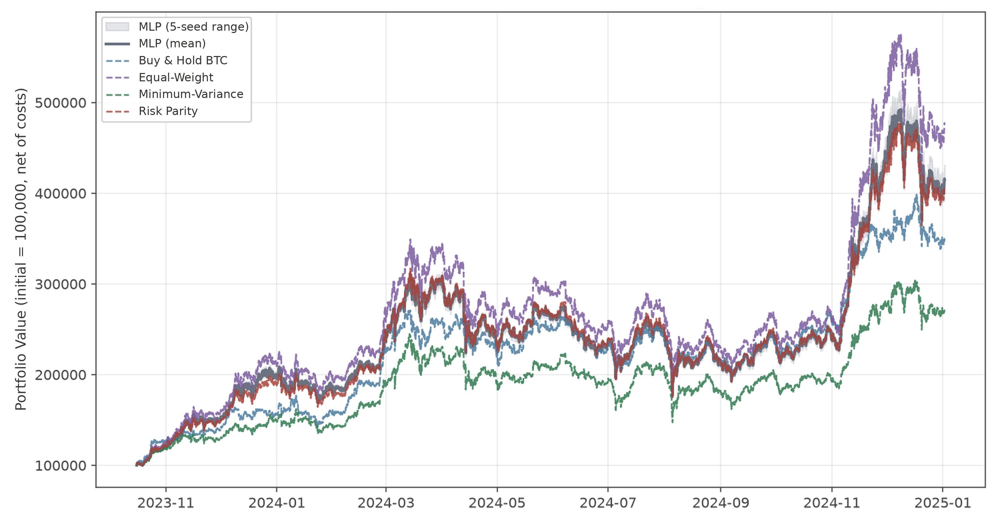

[그림 D-1] MLP의 누적 포트폴리오 가치 — 상승 국면(bull_2024)

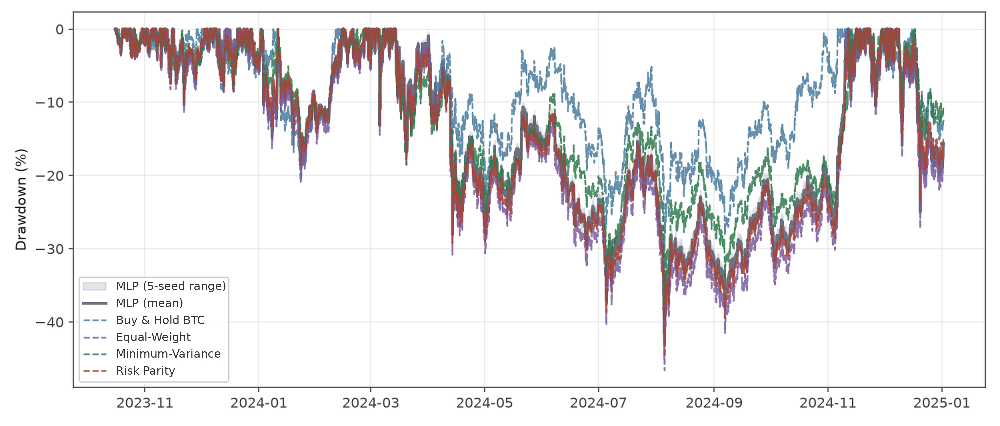

[그림 D-2] MLP의 drawdown — 상승 국면(bull_2024)

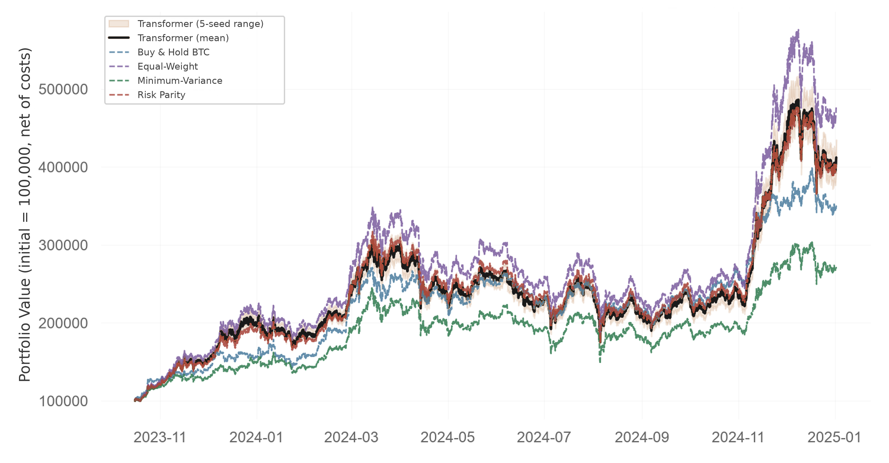

[그림 D-3] Transformer의 누적 포트폴리오 가치 — 상승 국면(bull_2024)

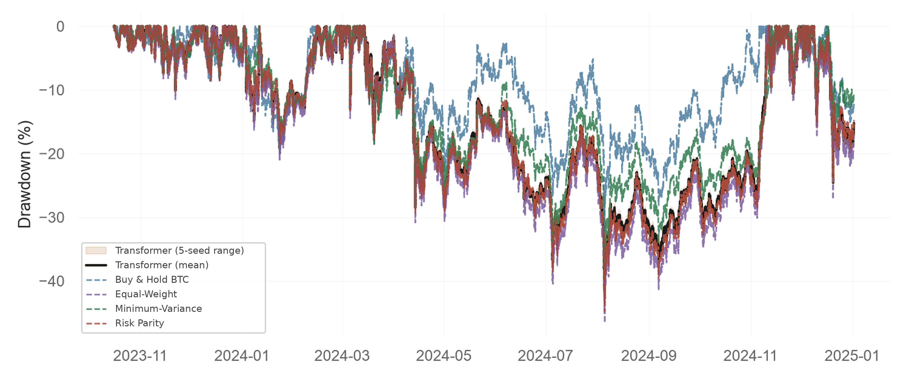

[그림 D-4] Transformer의 drawdown — 상승 국면(bull_2024)

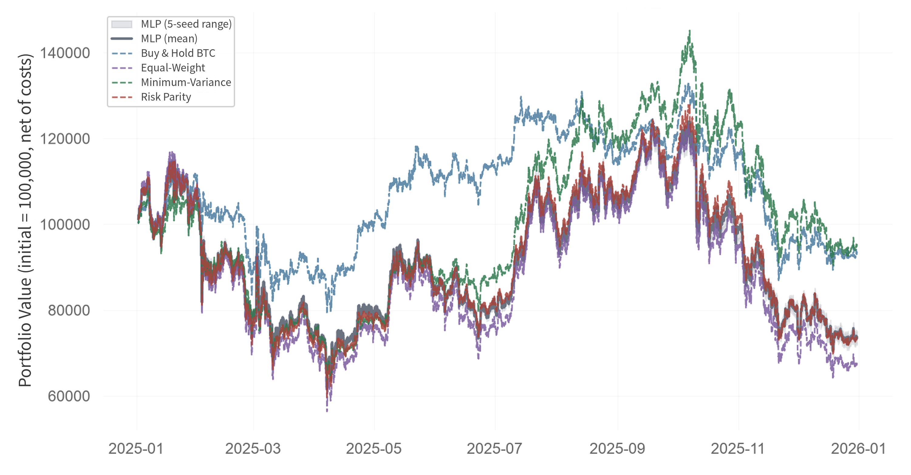

[그림 D-5] MLP의 누적 포트폴리오 가치 — 조정 국면(choppy_2025)

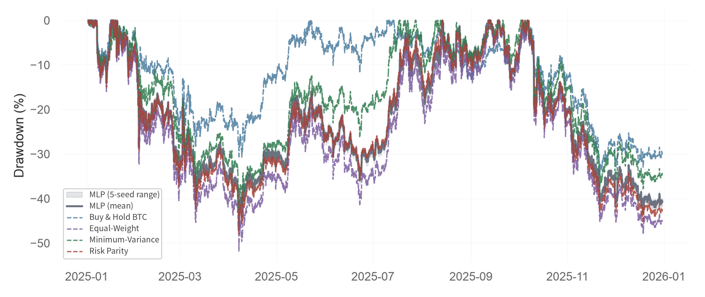

[그림 D-6] MLP의 drawdown — 조정 국면(choppy_2025)

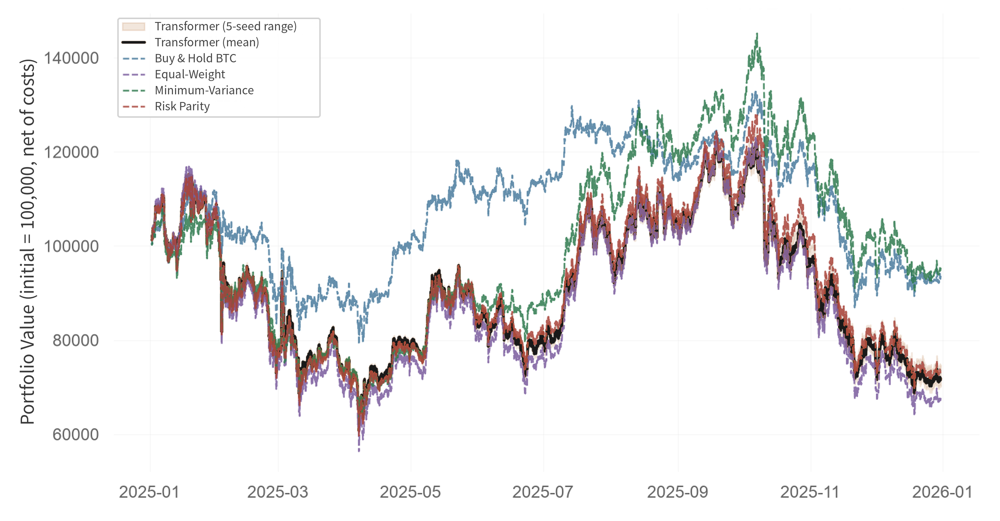

[그림 D-7] Transformer의 누적 포트폴리오 가치 — 조정 국면(choppy_2025)

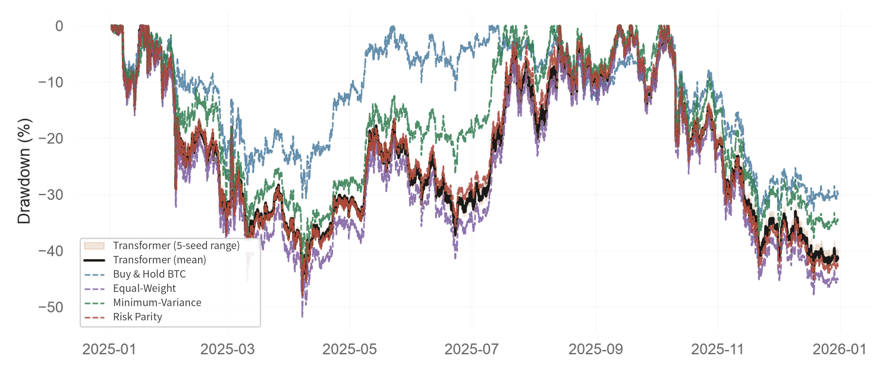

[그림 D-8] Transformer의 drawdown — 조정 국면(choppy_2025)

---

# 참고문헌

Bailey, D. H., Borwein, J. M., López de Prado, M., & Zhu, Q. J. (2017). The probability of backtest overfitting. *Journal of Computational Finance, 20*(4). https://doi.org/10.21314/JCF.2016.322

Cont, R. (2001). Empirical properties of asset returns: Stylized facts and statistical issues. *Quantitative Finance, 1*(2), 223–236. https://doi.org/10.1080/713665670

DeMiguel, V., Garlappi, L., & Uppal, R. (2009). Optimal versus naive diversification: How inefficient is the 1/N portfolio strategy? *The Review of Financial Studies, 22*(5), 1915–1953. https://doi.org/10.1093/rfs/hhm075

Gort, B. J. D., Liu, X.-Y., Sun, X., Gao, J., Chen, S., & Wang, C. D. (2022). Deep reinforcement learning for cryptocurrency trading: Practical approach to address backtest overfitting. arXiv:2209.05559. https://arxiv.org/abs/2209.05559

Harvey, C. R., Liu, Y., & Zhu, H. (2016). … and the cross-section of expected returns. *The Review of Financial Studies, 29*(1), 5–68. https://doi.org/10.1093/rfs/hhv059

Henderson, P., Islam, R., Bachman, P., Pineau, J., Precup, D., & Meger, D. (2018). Deep reinforcement learning that matters. *Proceedings of the AAAI Conference on Artificial Intelligence, 32*(1), 3207–3214. https://doi.org/10.1609/aaai.v32i1.11694

Holm, S. (1979). A simple sequentially rejective multiple test procedure. *Scandinavian Journal of Statistics, 6*(2), 65–70.

Jiang, Z., & Liang, J. (2017). Cryptocurrency portfolio management with deep reinforcement learning. arXiv:1612.01277. https://arxiv.org/abs/1612.01277

Jiang, Z., Xu, D., & Liang, J. (2017). A deep reinforcement learning framework for the financial portfolio management problem. arXiv:1706.10059. https://arxiv.org/abs/1706.10059

Ledoit, O., & Wolf, M. (2004). A well-conditioned estimator for large-dimensional covariance matrices. *Journal of Multivariate Analysis, 88*(2), 365–411.

Lim, B., Arık, S. Ö., Loeff, N., & Pfister, T. (2021). Temporal fusion transformers for interpretable multi-horizon time series forecasting. *International Journal of Forecasting, 37*(4), 1748–1764. https://doi.org/10.1016/j.ijforecast.2021.03.012

Liu, X.-Y., Yang, H., Gao, J., & Wang, C. D. (2021). FinRL: Deep reinforcement learning framework to automate trading in quantitative finance. *Proceedings of the 2nd ACM International Conference on AI in Finance (ICAIF '21)*. https://doi.org/10.1145/3490354.3494366 (arXiv:2111.09395)

López de Prado, M. (2018). *Advances in financial machine learning*. Wiley.

Maillard, S., Roncalli, T., & Teïletche, J. (2010). The properties of equally weighted risk contribution portfolios. *The Journal of Portfolio Management, 36*(4), 60–70.

Markowitz, H. (1952). Portfolio selection. *The Journal of Finance, 7*(1), 77–91. https://doi.org/10.2307/2975974

Politis, D. N., & Romano, J. P. (1994). The stationary bootstrap. *Journal of the American Statistical Association, 89*(428), 1303–1313.

Raffin, A., Hill, A., Gleave, A., Kanervisto, A., Ernestus, M., & Dormann, N. (2021). Stable-Baselines3: Reliable reinforcement learning implementations. *Journal of Machine Learning Research, 22*(268), 1–8.

Schulman, J., Moritz, P., Levine, S., Jordan, M., & Abbeel, P. (2016). High-dimensional continuous control using generalized advantage estimation. *Proceedings of the 4th International Conference on Learning Representations (ICLR 2016)*. arXiv:1506.02438.

Schulman, J., Wolski, F., Dhariwal, P., Radford, A., & Klimov, O. (2017). Proximal policy optimization algorithms. arXiv:1707.06347. https://arxiv.org/abs/1707.06347

Sutton, R. S., & Barto, A. G. (2018). *Reinforcement learning: An introduction* (2nd ed.). MIT Press.

Vaswani, A., Shazeer, N., Parmar, N., Uszkoreit, J., Jones, L., Gomez, A. N., Kaiser, L., & Polosukhin, I. (2017). Attention is all you need. *Advances in Neural Information Processing Systems, 30*.

White, H. (2000). A reality check for data snooping. *Econometrica, 68*(5), 1097–1126. https://doi.org/10.1111/1468-0262.00152

---

# 표 목차

| 번호 | 제목 | 위치 | 쪽 |
| --- | --- | --- | --- |
| 표 2-1 | 백테스트 방법론적 쟁점과 본 연구의 대응 | 2.4 |  |
| 표 3-1 | 시장 국면 구분 | 3.1.3 |  |
| 표 3-2 | 비중 관련 기호와 정의 | 3.2.1 |  |
| 표 3-3 | 정책망별 특징 벡터 차원과 총 파라미터 수 | 3.3.1 |  |
| 표 3-4 | PPO 주요 설정 | 3.3.1 |  |
| 표 3-5 | 학습 구간별 에피소드 환산 | 3.3.1 |  |
| 표 3-6 | 두 정책망·모든 Fold의 공통 학습 조건 | 3.3.1 |  |
| 표 3-7 | Fold 구성 | 3.5.1 |  |
| 표 3-8 | 성과 평가 지표의 정의 | 3.6.1 |  |
| 표 3-9 | 5-seed와 3-seed 결과의 비교 | 3.7 |  |
| 표 4-1 | 정책망별 최종 후보와 validation 성과 (3-seed) | 4.1 |  |
| 표 4-2 | 정책망별 국면별 OOS 성과 (5-seed 평균 ± 표준편차) | 4.2 |  |
| 표 4-3 | PPO 정책망과 전통 벤치마크의 OOS 성과 통합 비교 | 4.3.1 |  |
| 표 4-4 | PPO−벤치마크 Sharpe 차이: 최소 p와 최대 p 비교 | 4.3.2 |  |
| 표 4-5 | Transformer − MLP Sharpe 차이 (5-seed) | 4.4 |  |
| 표 4-6 | 정책망별 평균 학습 시간 | 4.4 |  |
| 표 4-7 | 시점 간 목표 비중 변화량 | 4.5.1 |  |
| 표 4-8 | 시드 간 배분 편차 | 4.5.2 |  |
| 표 4-9 | PPO와 Equal-Weight 수익률 상관 및 추적오차 | 4.5.3 |  |
| 표 4-10 | 드로다운 구간과 평시의 현금 비중 | 4.5.4 |  |
| 표 A-1 | 패키지 버전 | 부록 A.1 |  |
| 표 A-2 | 재현성 확보 기록 | 부록 A.2 |  |
| 표 A-3 | 학습 환경 및 소요 시간 | 부록 A.3 |  |
| 표 B-1 | 하이퍼파라미터 후보 정의 | 부록 B |  |
| 표 B-2 | MLP 하이퍼파라미터 탐색 결과 | 부록 B.1 |  |
| 표 B-3 | Transformer 하이퍼파라미터 탐색 결과 | 부록 B.2 |  |
| 표 C-1 | PPO−벤치마크 Sharpe 차이의 bootstrap 검정 (16개 비교 전체) | 부록 C |  |
| 표 C-2 | 블록 크기 민감도 (24시간 대 168시간) | 부록 C |  |
| 표 D-1 | 전통 벤치마크의 OOS 성과 — 전 지표 | 부록 D |  |
| 표 D-2 | MLP 시드별 OOS 성과 — Fold 1, 상승 국면(bull_2024) | 부록 D |  |
| 표 D-3 | MLP 시드별 OOS 성과 — Fold 2, 조정 국면(choppy_2025) | 부록 D |  |
| 표 D-4 | Transformer 시드별 OOS 성과 — Fold 1, 상승 국면(bull_2024) | 부록 D |  |
| 표 D-5 | Transformer 시드별 OOS 성과 — Fold 2, 조정 국면(choppy_2025) | 부록 D |  |

---

# 그림 목차

| 번호 | 제목 | 위치 | 쪽 |
| --- | --- | --- | --- |
| 그림 4-1 | 상승 국면(bull_2024, Fold 1 OOS)의 누적 포트폴리오 가치 | 4.2.1 |  |
| 그림 4-2 | 상승 국면(bull_2024, Fold 1 OOS)의 drawdown | 4.2.1 |  |
| 그림 4-3 | 조정 국면(choppy_2025, Fold 2 OOS)의 누적 포트폴리오 가치 | 4.2.2 |  |
| 그림 4-4 | 조정 국면(choppy_2025, Fold 2 OOS)의 drawdown | 4.2.2 |  |
| 그림 4-5 | MLP의 목표 비중 시계열 — 상승 국면(bull_2024) | 4.5.1 |  |
| 그림 4-6 | Transformer의 목표 비중 시계열 — 상승 국면(bull_2024) | 4.5.1 |  |
| 그림 4-7 | MLP의 목표 비중 시계열 — 조정 국면(choppy_2025) | 4.5.1 |  |
| 그림 4-8 | Transformer의 목표 비중 시계열 — 조정 국면(choppy_2025) | 4.5.1 |  |
| 그림 4-9 | MLP의 시드별 시간평균 목표 비중 — 상승 국면(bull_2024) | 4.5.2 |  |
| 그림 4-10 | Transformer의 시드별 시간평균 목표 비중 — 상승 국면(bull_2024) | 4.5.2 |  |
| 그림 4-11 | MLP의 시드별 시간평균 목표 비중 — 조정 국면(choppy_2025) | 4.5.2 |  |
| 그림 4-12 | Transformer의 시드별 시간평균 목표 비중 — 조정 국면(choppy_2025) | 4.5.2 |  |
| 그림 D-1 | MLP의 누적 포트폴리오 가치 — 상승 국면(bull_2024) | 부록 D |  |
| 그림 D-2 | MLP의 drawdown — 상승 국면(bull_2024) | 부록 D |  |
| 그림 D-3 | Transformer의 누적 포트폴리오 가치 — 상승 국면(bull_2024) | 부록 D |  |
| 그림 D-4 | Transformer의 drawdown — 상승 국면(bull_2024) | 부록 D |  |
| 그림 D-5 | MLP의 누적 포트폴리오 가치 — 조정 국면(choppy_2025) | 부록 D |  |
| 그림 D-6 | MLP의 drawdown — 조정 국면(choppy_2025) | 부록 D |  |
| 그림 D-7 | Transformer의 누적 포트폴리오 가치 — 조정 국면(choppy_2025) | 부록 D |  |
| 그림 D-8 | Transformer의 drawdown — 조정 국면(choppy_2025) | 부록 D |  |

---

# 요약

> 초록은 `paper/front/초록.md`(전체안)과
> `paper/front/초록_축약안.md`(축약안)에 작성되어 있다. 학과 분량
> 제한 확인 후 하나를 선택해 이 위치에 배치한다.
> 전체안 국문 1,215자·영문 449단어 / 축약안 716자·265단어.
